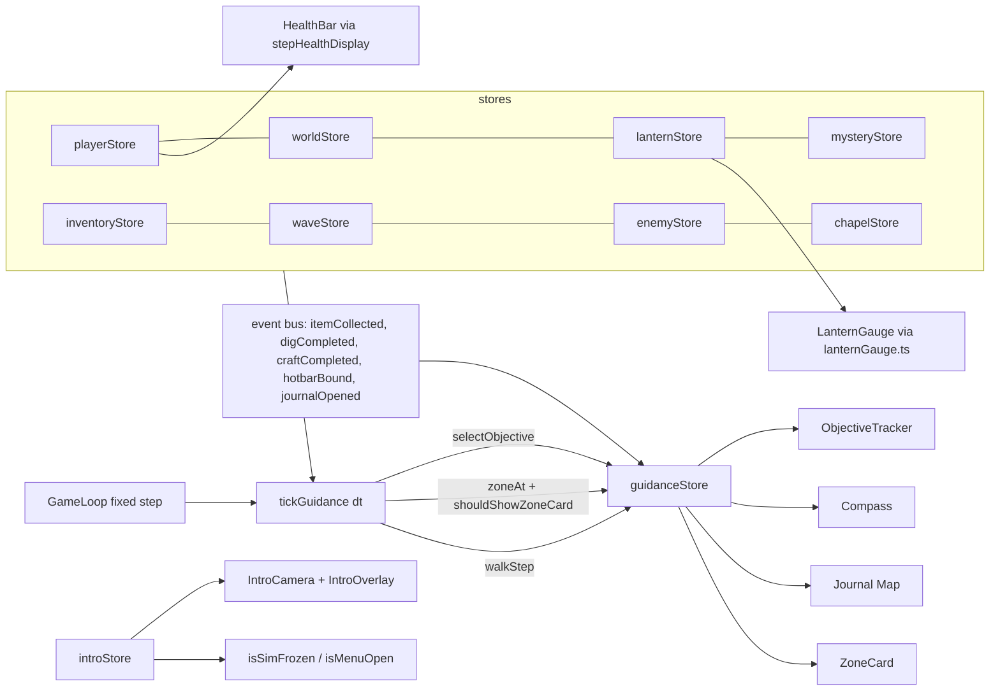

# Design: Clarity and HUD

## Overview
Spec 06 makes the game readable: a health bar (with numbers) replaces the health flame, the flame shows lantern fuel only, and an objective tracker, first-day tutorial, compass, map objective marker and zone name cards say where to go. A 35 s intro cutscene plays on New Game. All values come from `docs/game-design.md` §11 and live in `src/data/`. Every rule is a pure function in `src/game/systems/` with a fast-check test. Stores and components only wire them.

Approach: one new pure "display" function per HUD element (`stepHealthDisplay`, `selectObjective`, `currentTutorialStep`, `buildCompassMarkers`, `worldToMap`, `shouldShowZoneCard`, `introStateAt`). Two new stores hold the state they need: `guidanceStore` (objective, tutorial, zone cards) and `introStore` (playing/seen). A single `tickGuidance(dt)` runs inside the existing fixed step in `GameLoop.tsx`.

## Findings in the code (corrections to the requirements)
| Requirement says | Code says | Design resolution |
|---|---|---|
| Req 2.9: `FuelReservoir.tsx` is the fuel display to match | It is an oil *tube*; the flame is `LanternHealth.tsx`, which shows *health* and dips on hit via `flameDipFactor` | Delete both. One new `LanternGauge.tsx` (flame + "Oil N%") reads `lanternStore.fuel`, so two fuel values cannot exist. Remove `flameDipFactor` and `FLAME_DIP_PEAK` from `damageFeedback.ts` (vignette, desaturation and heartbeat stay). |
| Health is "player health" | Two copies: `playerStore.health` and `uiWorldStore.playerHealth`. `hurtPlayer` writes both, but `uiWorldStore.healPlayer` (altar) writes only the second, so the old flame never showed altar heals. `healPlayer` also hard-codes 100. | `HealthBar` reads `playerStore.health`. `healPlayer` now writes both and caps at a new `playerStore.maxHealth` (initial `PLAYER_MAX_HEALTH`; spec 08 will change it). `maxHealth` is not added to `PlayerState`, so the save shape is untouched. |
| Req 7: zone detection | `ZONES` has names only; scare zones are small trigger boxes. No `zoneAt` exists. `ZONES` names ("Chapel", "Catacombs") differ from the card names. | New `ZONE_BOUNDS` (data, derived from `cemeteryLayout.ts`) and pure `zoneAt`. New `data/zoneCards.ts` holds the §11 texts; `ZONES` is left alone. |
| Req 4: "any pickup", "first craft", "hotbar binding changed" are events | `itemCollected` is in the `GameEvent` union but **never emitted**. No craft or hotbar event exists. | Emit `itemCollected` from the three `spawnStore.collect*` actions on success. Add `craftCompleted` (Workbench after `commitCraft` ok), `hotbarBound` (Satchel `assignHotbar` call) and `journalOpened` to `GameEvent`. Page 1 is read from `mystery.pages.has(1)` (set by `examineStore`). |
| Req 8.14: intro sound on Howler's shared context | `AudioManager.ts` is all stubs and has no `AudioContext` yet | The intro adds no sound (the requirement is conditional: "where the intro uses sound"). Ambient intro audio waits for the audio task. |
| Req 3.13: only rules 1, 4, 11 have no place | Rule 10 (relics) has no single place; revealing relic spots by day would spoil exploration (pillar 3) | Rule 10 points to the nearest *uncollected relic site whose map cell is already explored* (same rule as map landmarks in `mapReveal.discoveredLandmarks`); none if nothing is explored. Proposed wording change for 3.13: "rules 1, 4, 11, and rule 10 when no relic site is explored". |
| Req 9.9 vs 4.14: step numbers outside 1–7 are a *parse error* (9.9) but "unparseable tutorial data" must load with an empty set and the rest of the save unchanged (4.14) | Contradiction | Tutorial/`introSeen` fields are sanitised field by field (junk → default), so 4.14 wins for those two fields. 9.9 applies to everything else (malformed text, missing or wrongly typed existing fields, empty input). Proposed wording change for 9.9: remove "tutorial step numbers outside 1 to 7". |
| Req 4.13 (keep steps *recorded in the snapshot*) vs 9.7 (keep steps *in effect at restore*) | Snapshot is taken at dusk; the tutorial is retired at night start, so both sets are equal | `guidanceStore` is not in `SNAPSHOT_STORES` and `retryNight` never touches `tutorialDone`. Satisfies both. |
| Req 8.2/9.3 make the stored intro-seen flag irrelevant to Continue | Flag is never read for a decision | Stored and restored anyway (Req 8.15, 9.1); only `begin()` and `finish()` write it. |
| New Game from the title | `TitleScreen.start()` runs for both New Game and Continue and **never calls `resetRun`**, so Quit to Title then New Game continues the old run (tutorial progress would leak). `EndingScreen.newGame` already calls `resetRun`. | Split into `newGame()` (`resetRun()`, `introStore.begin()`, start) and `continueGame()` (`loadGame()`, start). `EndingScreen.newGame` also calls `begin()`. |
| `Hud` layout | `WaveTally` sits at top centre and `RiteMeter` at `top: 8vh`; the compass takes top centre | Both move below the compass (CSS only, one `--hud-compass-h` token). |
| Req 3.6 "K = live count" | `WaveState.pending` can hold zombies waiting for a free slot | K = living zombies, as written. `LIVE_ENEMY_CAP` (14) exceeds every wave size (max 12), so pending empties on the first tick. Noted, no change. |

Noticed, out of scope: `resetRun` restores `mapStore` to the explored cells read at page load, so a new game can inherit an old map.

## Architecture
New files (pure logic first):

| Layer | File | Purpose |
|---|---|---|
| data | `src/data/healthBar.ts` | `HEALTH_BAR` sizes and timings (Req 1.13) |
| data | `src/data/objectiveRules.ts` | the 11 rules: text, progress target, marker label, place ref |
| data | `src/data/tutorialSteps.ts` | 7 steps, prompt templates, `TUTORIAL_WALK_TARGET_M = 3`, `TUTORIAL_GLYPH` |
| data | `src/data/compass.ts` | tick step 15°, half-span 90°, marker glyphs and labels |
| data | `src/data/zoneCards.ts` | name and line per `ZoneId`, `ZONE_CARD_SHOW_S = 2.5`, `ZONE_CARD_COOLDOWN_S = 30`, `ZONE_CARD_FADE_S` |
| data | `src/data/zones.ts` (edit) | add `ZONE_BOUNDS` |
| data | `src/data/introCutscene.ts` | `INTRO_SHOTS`, `INTRO_END_POSE`, fade length |
| data | `src/data/mapLandmarks.ts` (edit) | move `CELL_PX`, `MARGIN_PX` here as `MAP_PX` so the pure projection can use them |
| data | `src/data/cemeteryLayout.ts` (edit) | add `CHAPEL_ALTAR` = chapel centre + (0, 0, 4.5), matching `ALTAR_OFFSET` in `Chapel.tsx` |
| systems | `healthDisplay.ts`, `lanternGauge.ts`, `objective.ts`, `tutorial.ts`, `compass.ts`, `mapProject.ts`, `zoneAt.ts`, `zoneCardTrigger.ts`, `cameraPath.ts`, `introTimeline.ts` | pure rules, each with a `*.test.ts` |
| systems | `saveGame.ts` (edit) | new optional fields |
| state | `guidanceStore.ts`, `introStore.ts`, `guidanceTick.ts` | stores and the glue that reads stores and calls the pure functions |
| state | `menuState.ts` (edit) | add `isSimFrozen()`; `isMenuOpen()` includes `intro.playing` |
| state | `gameStore.ts` (edit) | `retryEpoch` counter |
| state | `playerStore.ts`, `uiWorldStore.ts`, `settingsStore.ts`, `gameSave.ts`, `retryNight.ts`, `resetRun.ts`, `spawnStore.ts` (edits) | see below |
| scene | `scene/effects/IntroCamera.tsx`, `introCameraRuntime.ts` | camera owner during the intro (pattern of `EndingCamera`/`endingCameraRuntime`) |
| ui | `HealthBar.tsx`, `LanternGauge.tsx`, `ObjectiveTracker.tsx`, `Compass.tsx`, `ZoneCard.tsx`, `IntroOverlay.tsx` (all in `ui/hud/`) | render only |
| ui | `Hud.tsx`, `Settings.tsx`, `Map.tsx`, `mapDraw.ts`, `TitleScreen.tsx`, `EndingScreen.tsx` (edits) | wiring |

Removed: `LanternHealth.tsx`, `FuelReservoir.tsx`, `useHitAge`'s flame use (the hook stays for the vignette).



Data flow: `tickGuidance(dt)` (called once per fixed `STEP` after `useDigStore.step`) builds an `ObjectiveInput` from the stores (`readObjectiveInput()`, same style as `riteStatus.ts`), runs the pure selector, and writes the result to `guidanceStore.objective` only when it changed. The tracker, compass and map all read that one value. The health bar and flame run per render frame from `playerStore.health` and `lanternStore.fuel` through their pure step functions. `installGuidanceWatchers()` is called from `main.tsx` beside `installDuskSnapshot()` and subscribes to the event bus (tutorial completion) and to `mysteryStore`.

## Data Models

### src/data/healthBar.ts
```ts
export const HEALTH_BAR = {
  widthPx: 260, heightPx: 18,
  holdS: 0.15, drainS: 0.6, easeS: 0.4,
  flashS: 0.12, thickenS: 0.3, pulseCycleS: 1.2,
  lowBelow: LOW_HEALTH_THRESHOLD,           // from balance.ts, 30
} as const
```

### src/data/objectiveRules.ts
```ts
export type ObjectiveRuleId = 1|2|3|4|5|6|7|8|9|10|11
export type PlaceRef =
  | { kind: 'fixed-spawn'; id: string }     // FIXED_SPAWNS id: 'fx-page-1', 'fx-crypt-key', 'fx-bone-whistle', 'fx-ossuary-key'
  | { kind: 'altar' }                       // CHAPEL_ALTAR
  | { kind: 'nearest-relic' }
export interface ObjectiveRuleDef {
  id: ObjectiveRuleId
  main: string                              // e.g. 'Find the Rusted Crypt Key'
  target?: number                           // progress denominator, shown as ' (0/1)' or ' (R/5)'
  marker?: string                           // short map label, e.g. 'Crypt key'
  place?: PlaceRef
}
export const OBJECTIVE_RULES: readonly ObjectiveRuleDef[]   // order = priority, text from §11
export const OBJECTIVE_MAX_LINE = 60
```
Rule 2's text uses "(R/5)" per Req 3.5. Rule 3 exists in data but cannot match until spec 07 supplies `craneAlive`.

### src/data/tutorialSteps.ts
```ts
export type TutorialStepId = 1|2|3|4|5|6|7
export type TutorialAction = 'walk'|'pickup'|'readPage'|'dig'|'craft'|'bindHotbar'|'openJournal'
export const TUTORIAL_STEPS: readonly { id: TutorialStepId; action: TutorialAction; template: string }[]
// templates use binding tokens: '{MoveForward} {MoveLeft} {MoveBackward} {MoveRight} to move, mouse to look',
// '{Interact} to pick up the oil on the shelf', '{Satchel} opens the satchel; press {Hotbar1}–{Hotbar4} on an item to bind it', '{Journal} opens the journal and map'
```

### src/data/zones.ts: `ZONE_BOUNDS`
Rectangles on the ground plane (x, z), built from the layout so they track it:

| Zone | Rect |
|---|---|
| `chapel` | `CHAPEL_CENTER` ± (`halfX` + `wallThickness`, `halfZ` + `wallThickness`) |
| `catacombs` | corridor `CATACOMBS`: x = `centerX` ± (`width`/2 + `wallThickness`), z from `entranceZ` to `entranceZ + dir × length` |
| `mausoleum-row` | corridor `MAUSOLEUM_ROW` x-extent widened to the lining crypts (`AVENUE_CRYPT_SIZE` depth + setback), z from `entranceZ` to `avenueFarZ()` (includes the Crane crypt) |
| `grounds` | everything else (fallback), so `zoneAt` is total |

Checked order: chapel, catacombs, mausoleum-row, grounds. A test proves every `SPAWN_POINTS` and `FIXED_SPAWNS` position resolves to its declared `zone`.

### src/data/zoneCards.ts
```ts
export const ZONE_CARDS: Readonly<Record<ZoneId, { name: string; line: string }>>  // exact §11 text
export const ZONE_CARD_SHOW_S = 2.5, ZONE_CARD_COOLDOWN_S = 30, ZONE_CARD_FADE_S = 0.25
```
`ZONE_CARD_FADE_S` (inside the 150–300 ms band of Req 7.5) is the only number I pick here.

### src/data/introCutscene.ts
```ts
export interface IntroShot {
  id: 1|2|3|4|5
  duration: number                          // 7 s each → 35 s total (Req 8.3)
  camera: { position: readonly Vec3[]; target: readonly Vec3[] }   // Catmull-Rom control points
  card: { text: string; at: number; hold: number }                 // hold ≥ 3 s, text from §11
  burst?: { x: number; z: number; at: number }                     // shot 4 only
}
export const INTRO_SHOTS: readonly IntroShot[]
export const INTRO_FADE_S = 0.5             // dip to ink at every shot boundary; ≥ 0.5 s so it also satisfies Req 8.13
export const INTRO_END_POSE: { position: Vec3; target: Vec3 }  // eye (0, 1.65, 0) looking at (0, 1.65, -3)
```
Shot paths use real layout points: shot 1 outside the south fence at z 62 → 46 looking north at the gate line; shot 2 from (-4, 2.6, 38) to (-1, 2.2, 20) toward the hut; shot 3 sweeping past `CHAPEL_CENTER` (10, 0, 5); shot 4 from above the `grave-oak-hollow` spawn (-15, 0, 12) with a `GraveBurst` queued at it ("soil thrown outward", reusing `graveBurstRuntime.queue`); shot 5 through the hut door (+Z wall) to the end pose. `INTRO_END_POSE` equals the controller's spawn eye position (`FirstPersonController` spawn `[0, 0.05, 0]`, eye 1.6 m above the feet, yaw 0, pitch 0 looks at -Z, the bench). The constant is local to the controller, so a comment in both places records the dependency.

### Types (src/game/types.ts, edits)
```ts
// Settings gains:
tutorialPrompts: boolean            // default true
// bindings default gains:
Skip: 'Space'                       // Enter is always accepted too
// GameEvent gains:
| { type: 'craftCompleted'; recipeId: RecipeId }
| { type: 'hotbarBound'; slot: 0|1|2|3 }
| { type: 'journalOpened' }
```
`settings.ts` `sanitize` merges over defaults, so existing stored settings load with `tutorialPrompts: true`. `BOOLEAN_KEYS`, `extractSettings` and `Settings.tsx` `TOGGLES` get the new key ("Tutorial prompts").

## Components and Interfaces

### Pure functions (src/game/systems)

```ts
// healthDisplay.ts
export interface HealthDisplayState {
  hp: number; maxHp: number; fill: number; chunk: number   // HP units; chunk ≥ fill
  holdLeft: number; drainFrom: number; drainT: number
  easeFrom: number; easeT: number
  fx: 'none' | 'flash' | 'thick'; fxLeft: number
}
export const initHealthDisplay = (hp: number, maxHp: number): HealthDisplayState   // chunk == fill, no animation
export const stepHealthDisplay = (s: HealthDisplayState, input: { hp: number; maxHp: number }, flashing: boolean, dtS: number): HealthDisplayState
export const healthFraction = (s: HealthDisplayState): number      // clamp(fill / maxHp, 0, 1)
export const chunkFraction = (s: HealthDisplayState): number
export const healthText = (hp: number, maxHp: number): string      // "72 / 100"
export const lowFrame = (hp: number, flashing: boolean): { low: boolean; pulse: boolean; thick: boolean }
```
Rules: input is sanitised first (non-finite → 0, clamp to 0..max; max must be ≥ 1). A drop in `hp` sets `fill = hp` immediately, sets `chunk = max(chunk, previous fill)` (the highest value still shown), restarts `holdLeft = holdS` and starts `fx` (`flash` for `flashS` when `flashing`, otherwise `thick` for `thickenS`). When `holdLeft` reaches 0 the chunk drains linearly from `drainFrom` to `fill` over `drainS`. A rise starts an ease of `fill` over `easeS`; `chunk` is kept ≥ `fill`. A max change re-clamps everything in the same step. `lowFrame`: `low = hp < lowBelow`; `pulse = low && flashing`; `thick = low && !flashing`.

```ts
// lanternGauge.ts
export const flameSize = (fuel: number): number           // 0.12..1, non-decreasing in fuel; only input is fuel
export const flameBrightness = (fuel: number): number
export const oilLabel = (fuel: number): string           // fuel < LANTERN_FLICKER_BELOW (20) → 'Low oil', else `Oil ${round(fuel)}%`
export const gutterFactor = (tS: number, fuel: number, flashing: boolean): number   // 1 unless fuel < 20 && flashing
```

```ts
// objective.ts
export interface ObjectiveInput {
  phase: Phase; nightNumber: number; secondsLeft: number            // left in the current day or dusk phase
  waves: { running: boolean; index: number; total: number; zombiesLeft: number }
  rite: { available: boolean; running: boolean; craneAlive: boolean }
  progress: { page1Read: boolean; cryptKey: boolean; whistle: boolean; stairRevealed: boolean; ossuaryKey: boolean; relics: number }
  relicSites: readonly Vec3[]; playerPos: Vec3
}
export interface Objective { rule: ObjectiveRuleId; main: string; second: string; position?: Vec3; marker?: string }
export const selectObjective = (i: ObjectiveInput): Objective   // total; first matching rule wins; rule 11 fallback
export const formatClock = (seconds: number): string            // 'm:ss', never negative
export const composeSecondLine = (o: Objective, prompt: string | null): string
```
`rite.available` = `endingStore.nightFiveCleared && riteAvailability === 'ready'` (from `readRiteStatus`). `waves.running` = night phase and `waveStore.waves.phase !== 'done'`; `index` is clamped to 1..`total`. Relic count uses `countRelics` from `finalRite.ts`. Stair revealed = `mystery.gates.catacombs`. Counts and `N`, `K`, `R` are clamped before formatting; lines are cut to `OBJECTIVE_MAX_LINE`.

```ts
// tutorial.ts
export const currentTutorialStep = (done: ReadonlySet<TutorialStepId>): TutorialStepId | null   // lowest id not done
export const tutorialPrompt = (c: { done: ReadonlySet<TutorialStepId>; enabled: boolean; phase: Phase; nightNumber: number; bindings: Record<string, string> }): string | null
export const formatPrompt = (template: string, bindings: Record<string, string>): string      // glyph + text
export const keyLabel = (code: string): string           // 'KeyE'→'E', 'Digit1'→'1', 'ShiftLeft'→'Shift', 'MouseLeft'→'Left mouse'
export const walkStep = (walked: number, from: readonly [number, number] | null, to: readonly [number, number]): number
export const serializeTutorial = (done: ReadonlySet<TutorialStepId>): number[]
export const parseTutorial = (raw: unknown): ReadonlySet<TutorialStepId>   // junk → empty; keeps only integers 1..7
```
There is no stored "current step": it is derived as the lowest id not in `done`. Every action marks its step done even when that step is not current, which gives "skip if already done", "resume on re-enable" and "never two at once" for free. `tutorialPrompt` returns null unless `enabled && phase === 'day' && nightNumber === 1`.

```ts
// compass.ts
export const headingDeg = (yaw: number): number                  // -yaw in degrees, 0..360 (N = -Z, E = +X; forward = (-sin yaw, -cos yaw))
export const bearingDeg = (from: Vec2, to: Vec2): number         // atan2(dx, -dz), 0..360
export const relativeAngle = (bearing: number, heading: number): number   // (-180, 180]
export const compassTicks = (heading: number): { rel: number; label?: 'N'|'E'|'S'|'W' }[]   // every 15° within ±90
export interface CompassMarker { id: string; glyph: string; label: string; rel: number; x: number; pinned: 'left'|'right'|null; distanceM?: number }
export const buildCompassMarkers = (c: { player: Vec2; heading: number; objective?: Vec3; phase: Phase; bellBuilt: boolean }): CompassMarker[]
```
`x = clamp(rel / 90, -1, 1)`; `pinned` is set when `|rel| > 90`. The ◆ marker label is `` `${round(distance)} m` ``. Spawn markers come from `eligibleGraves(WAVE_GRAVES, player)` in `waves.ts`, merged per 15° bucket so eight skulls do not crowd the strip. Chapel (`CHAPEL_CENTER`) and hut (origin) are always present.

```ts
// mapProject.ts   (pixel layout from data MAP_PX; same transform that mapDraw.toPx now calls)
export const worldToMap = (x: number, z: number): [number, number]
export const mapToWorld = (px: number, py: number): [number, number]
export const clampToMap = (px: number, py: number): [number, number]   // nearest point inside the canvas inset by MARGIN_PX
```

```ts
// zoneAt.ts / zoneCardTrigger.ts
export const zoneAt = (x: number, z: number, bounds = ZONE_BOUNDS): ZoneId
export type ZoneLastShown = Readonly<Partial<Record<ZoneId, number>>>
export const shouldShowZoneCard = (prev: ZoneId | null, next: ZoneId, now: number, last: ZoneLastShown): boolean
export const recordZoneCard = (last: ZoneLastShown, zone: ZoneId, now: number): ZoneLastShown
export const cardOpacity = (elapsedS: number, reducedMotion: boolean): number   // fades inside the 2.5 s window
```
`shouldShowZoneCard` is false when `prev === next`, true when the zone was never shown or `now - last ≥ 30`. `last` only changes through `recordZoneCard`, called when a card actually shows, so re-entering inside the cooldown does not restart it (Req 7.3). `now` is a sim clock held in `guidanceStore.zoneClock` (advanced by `tickGuidance`), so pause and the intro do not run it down.

```ts
// cameraPath.ts
export const samplePath = (points: readonly Vec3[], u: number): Vec3   // uniform Catmull-Rom, u clamped to 0..1, finite for finite input
// introTimeline.ts
export const introDuration = (shots = INTRO_SHOTS): number
export const introStateAt = (t: number): { shot: number; u: number; position: Vec3; target: Vec3; card: { text: string; opacity: number } | null; fade: number; done: boolean }
export const advanceIntro = (t: number, dt: number, paused: boolean): number    // paused → t unchanged
```
`EndingCamera` uses three's `CatmullRomCurve3`; the intro uses a small pure sampler instead so Req 8.17 can be property-tested in Node. The look is the same (uniform Catmull-Rom).

```ts
// saveGame.ts (extended)
export interface SaveState { …existing; tutorial: TutorialStepId[]; introSeen: boolean }
export const hasPassedFirstDay = (w: WorldState): boolean    // nightNumber > 1 || phase !== 'day'
```

### UI components
- **HealthBar** (`ui/hud/HealthBar.tsx`), bottom left in `.hud-corner` with `LanternGauge` above it. `useRef` holds a `HealthDisplayState`; a rAF loop runs `stepHealthDisplay` with `playerStore.health`, `playerStore.maxHealth` and `settings.flashingLights` and writes inline widths. The loop stops when nothing is animating. The component is keyed on `gameStore.retryEpoch` so Retry Night re-initialises it with `initHealthDisplay` (chunk zero width, Req 9.6). The text "72 / 100" is always rendered, outside the `accessibleHUD` check. A "Low" tag text and a thick/steady frame class carry low health without colour or motion.
- **LanternGauge**: SVG flame; scale and brightness from `flameSize`/`flameBrightness`; label from `oilLabel`; the gutter is a CSS animation class applied only when `gutterFactor` can vary (fuel < 20 and flashing lights on).
- **ObjectiveTracker**: top left. Main line sits in a `role="status" aria-live="polite"` region keyed on `rule` and main text, so it announces on objective change only. The second line is outside the live region and is rendered from `Math.ceil(secondsLeft)` selectors so it re-renders once per second. Fade is `var(--transition-fast)`, which tokens already zero for reduced motion.
- **Compass**: top centre, `pointer-events: none`; reads `playerStore.yaw`/`position` per frame, `guidanceStore.objective`, `worldStore.phase`, `chapelStore.isBellActive()`.
- **ZoneCard**: centre upper third, `aria-live="polite"`, heading font `--font-heading`; opacity from `cardOpacity(card.elapsed, reduced)`. It never emits `subtitleShown`.
- **Map**: `Map.tsx` passes the objective into `drawMap` (`MapScene.objective?`). `mapDraw` draws the ◆ marker with its text label (16 px) first, then the quill, so the arrow is on top. Both positions go through `clampToMap`. The quill's `-yaw` rotation already matches `headingDeg`.
- **IntroOverlay**: ink fade layer, handwritten card (`--font-hand`, ≥ 20 px, dark backing), "Space to skip" hint and a focusable Skip button (autofocus, visible focus outline). `Hud` renders only `IntroOverlay`, `Subtitles` and `Toast` while `introStore.playing`.

## Intro and freezing the simulation
`introStore { playing, seen, begin(), skip(), finish() }`. `begin()` sets `playing = true, seen = false` (Req 8.18). `skip()` and `finish()` set `playing = false, seen = true`, call `refreshGuidance()` so the first objective is there on the first frame, and ask `IntroCamera` to leave the camera on `INTRO_END_POSE`.

One helper, `isSimFrozen()` in `menuState.ts`: `paused || examining || journalOpen || intro.playing`. It replaces the repeated inline checks, so the gating is the same everywhere:

| System | Change |
|---|---|
| `GameLoop.tsx` `TickDriver` | `if (isSimFrozen() \|\| screen === 'ending')` → accumulator reset and return. Stops day timer, lantern drain, stamina, digging and `tickGuidance` (Req 8.11). |
| `WaveDirector.tsx`, `EnemyDirector.tsx`, `EnemyModels.tsx` | use `isSimFrozen()`. No spawns, no zombie AI. |
| `ScareStager.tsx` | `isSimFrozen() \|\| taken`. `isMenuOpen()` already holds beats back. |
| `Lantern.tsx` F-key handler | ignore while `intro.playing` (fuel only changes in `runTick`, which is frozen). |
| `FirstPersonController`, input, interaction raycast, `requestLock` | already return on `isMenuOpen()`, which now includes `intro.playing`. No edit. The pointer is not locked during the intro. |

`IntroCamera` (inside `<GameLoop>`, after the controller, so it mounts only after Rapier has loaded) owns the camera while `playing`: each frame, if not `paused`, `introCameraRuntime.time = advanceIntro(...)` (delta capped at 0.1 s like `EndingCamera`), then `introStateAt(time)` gives position and look target. It queues the shot 4 `graveBurstRuntime` burst once. There is no random shake or head bob, so Req 8.12 and 10.2 hold at any setting. When `done`, it calls `introStore.finish()`. Esc already pauses through `usePauseTriggers` (keydown path), which stops the clock because `paused` is true; `PauseMenu.resume` does not request pointer lock while `isMenuOpen()` is true, so the cursor stays free until the intro ends. Skip listens for the `Skip` binding or Enter on `window`.

## Zone entry
`tickGuidance` converts `playerStore.position` with `zoneAt` each fixed step. When the zone changes and `shouldShowZoneCard` is true, it calls `recordZoneCard` and sets `guidanceStore.card = { zone, elapsed: 0 }`, replacing any card that is showing (Req 7.4). `card.elapsed` advances by `dt` and clears at `ZONE_CARD_SHOW_S`. The first tick after the intro (or after Continue) has `prev = null`, so the starting zone shows its card. `zoneLastShown` and the clock are never saved and are cleared by `resetRun` and `restore()`.

## Save format
`SAVE_VERSION` stays **1**: the change is additive and a bump would reject every existing save (Req 9.2).
```ts
SaveFile adds:  tutorial?: number[]     // optional on read
                introSeen?: boolean     // optional on read
```
- `toSaveFile` always writes both. `captureSave` fills them from `guidanceStore.tutorialDone` and `introStore.seen`.
- `fromSaveFile` fills `tutorial` with `parseTutorial(raw.tutorial)` (missing or junk → empty) and `introSeen` with the stored boolean, or `hasPassedFirstDay(world)` when missing or not a boolean. All other validation is unchanged (null on any failure), so `hasValidSave` hides Continue for a corrupt file.
- `loadGame` calls `guidanceStore.restore(save.tutorial)` (sets `tutorialDone`, clears walk, zone and card state) and `introStore.setSeen(save.introSeen)`.

## Retry Night
`retryNight()` already restores every snapshot store (so HP, max HP and lantern come back) and then clears enemies, dig and waves. Additions:
- `gameStore.retryEpoch` is incremented. `HealthBar` is keyed on it, so the recent-damage chunk, hit flash and thickened frame start fresh from the restored HP (Req 9.5, 9.6).
- `guidanceStore.card` is cleared (a showing zone card does not survive the jump to dusk).
- `guidanceStore` is **not** in `SNAPSHOT_STORES` and `tutorialDone` is untouched (Req 4.13, 9.7). Tutorial prompts are derived, so none can be "showing" after a night start.
- `uiWorldStore.lastDamageAt` is already omitted from the snapshot; the health bar no longer depends on it.

## Accessibility
- Flashing lights Off: the hit flash becomes a 300 ms thickened frame, low health a still thick frame with the "Low" tag, the low-oil gutter a steady flame (all decided in the pure functions, tested). Intro fades are always ≥ 0.5 s and nothing flashes.
- Camera shake Off / reduced motion: no new effect moves the camera; the intro path is smooth by construction. `prefers-reduced-motion` turns the existing `--transition-*` tokens to 0 ms, so tracker and card changes become instant; `cardOpacity(…, true)` is a step. New transitions use opacity only, no translate.
- Meaning without colour: "72 / 100" numbers, "Oil N%" / "Low oil", "(0/1)" counts, a glyph + text on every compass marker and the map marker, glyph before tutorial prompts.
- Keyboard: Skip button and the Tutorial prompts checkbox are native controls with `:focus-visible` outlines; Space or Enter skips; Esc always pauses.
- Text ≥ 16 px: every new class uses `font-size: 1rem` or more (card text and subtitles-style text 20 px). Canvas labels on the map use a 16 px font.
- Screen readers: tracker main line and zone card are polite live regions; the compass and health bar expose `role="meter"`/text without announcing every tick.

## Error Handling
- `stepHealthDisplay` sanitises HP and max HP and never throws; a non-finite or negative value becomes 0, too large is clamped to max (Req 1.16). `maxHp < 1` is treated as 1.
- `selectObjective` is total: unknown or out-of-range counts are clamped, and the fallback is rule 11. A missing `FIXED_SPAWNS` id yields an objective with no position rather than an error.
- `parseTutorial` drops anything that is not an integer 1–7; the rest of the save loads. `readSave` still returns null on any structural problem, so Continue is hidden and nothing else in localStorage is touched.
- `samplePath` clamps `u` and needs at least 2 points; `introStateAt` clamps `t` to `0..duration`.
- `IntroCamera` and `Skip` are idempotent: `finish()` and `skip()` on an already-ended intro do nothing.
- `tickGuidance` skips a tick if the player position is not finite; a failed zone lookup falls back to `grounds`.

## Correctness Properties
*A property is a characteristic or behavior that should hold true across all valid executions of a system-essentially, a formal statement about what the system should do. Properties serve as the bridge between human-readable specifications and machine-verifiable correctness guarantees.*

### Property 1: Health display invariant
For any initial state and any sequence of damage, heal and max-HP-change events with any time steps, the chunk is ≥ the fill and both stay within 0..max HP.
**Validates: Requirements 1.14, 1.15**

### Property 2: Fill follows HP and max HP
For any HP and max HP (max ≥ 1), after a step the fill fraction equals `clamp(hp / max, 0, 1)` when HP dropped or max changed (same frame), and the text equals "N / M" with N = clamped HP and M = current max.
**Validates: Requirements 1.2, 1.3, 1.4, 1.12**

### Property 3: Recent-damage chunk timing
For any damage taken from a settled state, the chunk stays at the previous fill for 0.15 s, then reaches the new fill after a further 0.6 s of steps; for any further damage during hold or drain the chunk never drops below the value it showed at that moment and the hold restarts.
**Validates: Requirements 1.5, 1.6**

### Property 4: Healing eases up
For any heal, the fill never decreases during the ease and equals the new HP after 0.4 s.
**Validates: Requirements 1.7**

### Property 5: Flashing lights decides the hit effect and the low frame
For any damage step and any flashing flag, the effect is `flash` for 0.12 s when flashing is on and `thick` for 0.3 s when off; for any HP and flag, `lowFrame` has `low` iff HP < 30, `pulse` only if flashing, and `thick` only if not flashing.
**Validates: Requirements 1.8, 1.9, 1.10, 1.11, 10.1**

### Property 6: Invalid HP input is clamped
For any numeric input including NaN, ±Infinity, negative and above-max values, `stepHealthDisplay` does not throw and returns a state within range.
**Validates: Requirements 1.16**

### Property 7: Fresh display after Retry Night
For any HP and max HP, `initHealthDisplay` has chunk equal to fill, no hold, drain or ease running, and no effect.
**Validates: Requirements 9.6**

### Property 8: Flame depends on fuel only and is monotonic
For any fuel values a ≤ b, `flameSize(a) ≤ flameSize(b)` and `flameBrightness(a) ≤ flameBrightness(b)`; the functions take no health input.
**Validates: Requirements 2.1, 2.2, 2.10**

### Property 9: Oil label rule
For any fuel in 0..100, the label is "Low oil" iff fuel < 20, otherwise it matches `Oil N%` with N = round(fuel).
**Validates: Requirements 2.3, 2.4, 2.5, 10.3**

### Property 10: Gutter only when allowed
For any time, the gutter factor is constant 1 when flashing is off or fuel ≥ 20, and varies over time when fuel < 20 and flashing is on.
**Validates: Requirements 2.6, 2.7, 10.1**

### Property 11: Objective selector is total, idempotent and first-match
For any `ObjectiveInput`, `selectObjective` returns exactly one rule 1..11, returns an equal result when called twice, and returns the lowest-numbered rule whose condition holds (checked against a reference implementation); rule 11 when none of 1–10 hold.
**Validates: Requirements 3.2, 3.3, 3.4, 3.14, 3.15**

### Property 12: Objective text shape
For any input, main and second lines are ≤ 60 characters; progress text is `(0/1)` or `(R/5)` with 0 ≤ R ≤ 5; in rule 1, N is within 1..M and K ≥ 0; dusk and day clocks are `m:ss` and never negative.
**Validates: Requirements 3.1, 3.5, 3.6, 3.7, 3.8**

### Property 13: Objective position
For any input, the position is absent for rules 1, 4 and 11 (and for rule 10 only when no explored relic site exists), and present otherwise.
**Validates: Requirements 3.13**

### Property 14: Collecting an item advances the day objective
For any day state, setting `cryptKey`, `whistle`, `ossuaryKey` or adding a relic yields a rule number ≥ the previous one.
**Validates: Requirements 3.12**

### Property 15: Tutorial prompt replaces the countdown
For any objective and any non-null prompt, `composeSecondLine` returns the prompt; for null it returns the objective's second line.
**Validates: Requirements 3.9, 4.11**

### Property 16: Tutorial director invariant
For any set of done steps and any order of marking steps done, the current step is the lowest id not done (or null), is never in the done set, and at most one prompt exists; marking the current step done makes the next not-done step current.
**Validates: Requirements 4.2, 4.3, 4.4, 4.10, 4.15**

### Property 17: Walking completes the move step
For any path of positions, accumulated walked distance equals the sum of segment lengths and step 1 is done iff it is ≥ 3 m.
**Validates: Requirements 4.5**

### Property 18: Prompts follow bindings, setting and phase
For any bindings, the prompt contains the label of each bound key and changes when a binding changes; for any state with the setting off, or phase not day, or night number ≠ 1, the prompt is null.
**Validates: Requirements 4.6, 4.7, 4.9**

### Property 19: Tutorial serialization round trip
For any set of steps 1..7, `parseTutorial(serializeTutorial(s))` equals `s`; for any junk input `parseTutorial` returns a valid (possibly empty) set without throwing.
**Validates: Requirements 4.14, 4.16**

### Property 20: Relative angle range and forward target
For any player position, target position and heading, the relative angle is in (−180, 180]; a target placed along the player's forward vector `(−sin yaw, −cos yaw)` gives 0.
**Validates: Requirements 5.12**

### Property 21: Heading is periodic
For any heading, adding 360° gives the same relative angles and tick offsets.
**Validates: Requirements 5.13, 5.3**

### Property 22: Compass markers
For any state, chapel and hut markers are always present; the ◆ marker exists iff the objective has a position and shows whole metres; spawn markers exist iff phase is dusk or night and the bell is built; every marker has a glyph and a label; a marker with |rel| > 90 is pinned to the side of its sign with x = ±1; ticks fall every 15° within ±90 and letters N/E/S/W appear at 0/90/180/270.
**Validates: Requirements 5.2, 5.4, 5.5, 5.6, 5.7, 5.8, 5.9, 5.10**

### Property 23: World–map transform
For any world position inside the playable bounds, `worldToMap` lies inside the canvas, and `mapToWorld(worldToMap(p))` is within 0.01 m of `p`; for any point whatever, `clampToMap` lies inside the canvas.
**Validates: Requirements 6.6, 6.7, 6.8, 6.9**

### Property 24: Zone card cooldown
For any sequence of zone changes with non-decreasing times, a card is never shown twice for the same zone less than 30 s apart; `shouldShowZoneCard` is false when previous equals next, never mutates its inputs, and is true for a zone not shown before.
**Validates: Requirements 7.1, 7.3, 7.9, 7.10, 7.11**

### Property 25: Zone lookup
For any position, `zoneAt` returns one of the four zones, and every `SPAWN_POINTS` and `FIXED_SPAWNS` position resolves to its declared zone.
**Validates: Requirements 7.2, 7.1**

### Property 26: Card opacity
For any elapsed time and reduced-motion flag, opacity is in 0..1, is 0 outside 0..2.5 s, and with reduced motion is only 0 or 1.
**Validates: Requirements 7.5, 10.8**

### Property 27: Intro timeline
For any t from 0 to the total duration, the camera position and look target are finite, the shot index never decreases with t, and the fade opacity changes by at most `1 / 0.5` per second; paused time does not advance (`advanceIntro(t, dt, true) === t`).
**Validates: Requirements 8.8, 8.13, 8.17**

### Property 28: Save round trip with new fields
For any valid save state including `tutorial` and `introSeen`, `fromSaveFile(toSaveFile(s))` deeply equals `s`.
**Validates: Requirements 4.12, 8.15, 9.1, 9.8**

### Property 29: Old saves load with defaults
For any valid save object without the new fields, `fromSaveFile` accepts it with an empty tutorial, and `introSeen` is true iff `nightNumber > 1 || phase !== 'day'`.
**Validates: Requirements 9.2**

### Property 30: Corrupt saves are rejected safely
For any corrupt input (malformed JSON, missing or wrongly typed existing fields, empty text), `readSave` returns null without throwing; for any junk `tutorial` or `introSeen` value in an otherwise valid save, the save still loads with the defaults.
**Validates: Requirements 9.4, 9.9, 4.14**

## Testing Strategy
Property-based tests use `fast-check` with vitest, at least 100 runs each, and every test carries a tag comment `Feature: 06-clarity-and-hud, Property N: <text>`. Each of the 30 properties is one test.

**Unit tests (examples):**
- Data: tutorial step ids and texts match §11; `ZONE_CARDS` strings are exact; `INTRO_SHOTS` are 5 shots, total 32–38 s, each ≥ 4 s, each card hold ≥ 3 s, `INTRO_END_POSE` eye is (0, 1.65, 0); objective rule order and texts match §11.
- Stores: `introStore.begin/skip/finish` flags (Req 8.1, 8.7, 8.18); `isSimFrozen()` true while `playing` (Req 8.11); `retryNight()` bumps `retryEpoch` and leaves `tutorialDone` alone; `resetRun` clears `guidanceStore`; a card for zone B replaces the one for A; `TitleScreen` Continue path does not call `begin()`.
- Settings: `tutorialPrompts` defaults true and round-trips through `saveSettings`/`loadSettings`; an old stored settings object loads with the default.
- Events: `spawnStore.collectMaterial` emits `itemCollected` on success only.
- Structure: a test scans `src/game/**` imports for `react`, `three`, `howler` (Req 11.2) and `src/ui/hud/hud.css` for `font-size` declarations under `1rem` (Req 10.5, 11.1).
- Updated existing tests: `damageFeedback.test.ts` drops the flame-dip cases; `saveGame.test.ts` gains the new fields; `hudMath.test.ts` loses `isLowHealth` usage if the helper is removed.

**Not suitable for PBT:** CSS layout, canvas drawing, fades and the intro's look. These are covered by the browser checkpoint below.

**Final checkpoint (real browser, Chrome, Edge or Firefox, desktop at 1080p).** Marked done only after each item is seen working:
1. New Game plays the intro: five shots, cards readable, fades, "Space to skip" and Skip button (Tab to it, Enter), Esc pauses and the clock holds, Resume continues; no zombie, scare, lantern or day-timer change during it (check the lantern percent and dusk countdown before and after).
2. After the intro the camera hands over without a jump, and the tracker shows "Read the page Elias left in the hut (0/1)".
3. Tutorial prompts appear one at a time on the second line, advance on each action, can be turned off in Settings, and stay gone after night 1 starts.
4. Health bar: numbers always visible, red fill drops at once, pale chunk lingers then drains, altar heal eases up, Low tag and pulse below 30 HP, and with Flashing lights Off the frame thickens and stays still. Lantern flame ignores hits and shows "Oil N%" / "Low oil".
5. Compass follows heading, shows ◆ with metres, ✝, ⌂, and ☠ at night once the bell is built; markers pin at the edges.
6. Journal map shows the arrow pointing the way the player faces and the objective marker with its label.
7. Zone cards show on entering each of the four zones and not again within 30 s.
8. Retry Night shows restored HP with no drain animation.
9. Keyboard-only pass through the Skip button and Settings toggle; reduced-motion setting gives fades or instant changes only; computed font sizes ≥ 16 px.
10. Frame rate ≥ 45 fps and fewer than 150 draw calls with the HUD up; `npm run build` and `npm run lint` clean.
