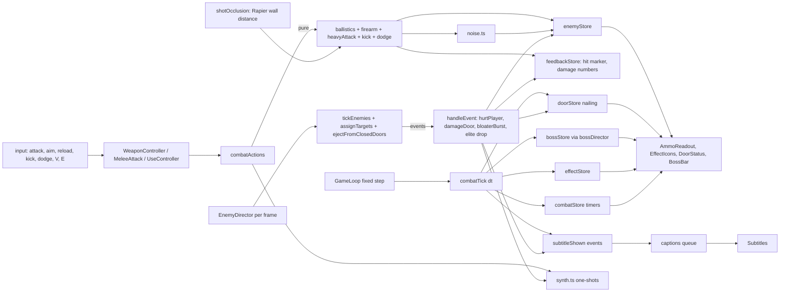

# Design: Combat and Enemies

## Overview
Spec 07 deepens combat: two firearms, two heavy melee weapons, a kick, a stamina dodge, workbench weapon upgrades, a shared timed-effect system, hit feedback, three new enemy kinds (Bloater, Brute, elites), a chapel with two barricaded doors, and Father Aldous Crane in the night 5 rite. Every number comes from `docs/game-design.md` (the **(07)** tags). Where the bible is silent, the value is listed in "Values chosen here" so it can be added to the bible.

Approach, in four rules:
1. **Rules are pure functions** in `src/game/systems/` (ballistics, firearm, recoil, noise, heavy attack, kick, dodge, effects, upgrades, bloater, elites, barricade, chapel doors, boss director, wave additions). Each takes plain data and returns new data plus events. Each has a `*.test.ts` and fast-check properties.
2. **Rapier is used for occlusion only.** Zombies have no colliders (the AI moves plain `(x, z)` positions), so shots are tested against a pure capsule per zombie. One Rapier ray per shot ray answers "how far is the nearest wall", injected like the existing `SegmentBlocked`.
3. **Glue lives in `src/game/state/`** (`combatTick.ts`, `combatActions.ts`, `nightState.ts`), following spec 06's `tickGuidance` pattern. Drivers in `src/scene/` read input, call the glue, and render.
4. **Spec 06 is built first.** This spec uses `isSimFrozen()`, `guidanceStore` (objective rule 3 reads `rite.craneAlive`, which this spec now supplies), `playerStore.maxHealth`, `gameStore.retryEpoch`, `HealthBar`, `Compass`, the `--hud-compass-h` token and the optional-field save pattern with `SAVE_VERSION` kept at 1. None of that is redesigned here.

## Findings in the code (corrections to the requirements)
| Requirement or bible says | Code or other text says | Design resolution |
|---|---|---|
| Req 16.7: until stage 1, "the Chapel keeps its earlier effect that zombies cannot enter" | The bible zones table says the chapel is a safe zone only after repair. In code nothing consults `isDoorBarred()` (only a colour on the door mesh uses it), so zombies can walk in today. The front wall has a 1.4 m gap. | **Proposed fix to Req 16.7:** before stage 1 the doors are open and the chapel is not safe; no frames, plaques or door HUD lines. After stage 1 the doors are closed while they hold at least 1 board. `isDoorBarred` is replaced by `chapelDoors.ts` rules that the AI actually uses. |
| Two chapel doors | `ChapelBuilding.tsx` has only the front gap. `Chapel.tsx` `DoorMesh` is a box in the doorway with no collider, so it hides boards and does nothing. | Cut a vestry opening in the west wall (two slabs and a lintel, like the front). Remove `DoorMesh`; `ChapelDoors.tsx` draws frames and boards. Boards never collide with the player (the keeper squeezes through the frame); they stop zombies by logic only. |
| Req 14.3 (light hit or kick staggers a Brute 0.3 s) vs bible §7 ("light hits and kicks don't stagger it") vs bible §4 (kick: Brutes only stagger 0.3 s) | `resolveMelee` staggers every type 0.3 s | Follow Req 14.3 and the §4 kick row: Brutes stagger 0.3 s, never more. **Proposed bible fix:** §7 Brute row says "light hits and kicks only stagger it for 0.3 s". |
| Req 13.8: another Bloater within 3 m of a burst is killed by it | The burst deals 25 and a Bloater has 80 HP | Apply the 25 damage. A chained Bloater swells only if that damage takes it to 0 HP. **Proposed fix to Req 13.8:** "IF the burst damage reduces another Bloater's HP to 0". |
| Req 17.1: "10 s since the Final_Rite started" | `riteStarted` is set at the first hold, and `riteProgress` only advances while holding | Use `bossStore.riteClock`: sim seconds since `endingStore.riteStarted`, whether or not the player is holding. Progress can never exceed the clock, so the boss always rises long before the 44 s cap matters. |
| Req 17.12 "then allow the rite to complete" and spec 06's `craneAlive` for the tracker | One flag cannot be both | `craneFighting` (HP above 0, drives the tracker and boss bar) and `riteBlocked` (until the 4 s quiet and the closing subtitle end, drives the 44 s cap). |
| Req 8.10 durability | `applyHit` and `createWeaponState` are never called; `Viewmodel`'s `weaponState` prop is never fed; the Bone Club never breaks | `combatStore.durability` tracks every durable melee weapon; `MeleeAttack` spends 1 per swing that hits at least one zombie. This also fixes the Bone Club and Sharpened Shovel. |
| Req 12.1/12.2 consumables | `consumables.ts` is never called; Bandage and Lantern Refill cannot be used in the game today | New `UseController.tsx` drives timed use for all four consumables, so the existing two start working too. Blessed Rounds and Kola Tonic apply on press (no use time in the bible). |
| Req 5.3 "melee holds Block" | `Block` is bound to right mouse, but `EnemyDirector` always calls `hurtPlayer(dmg, false)` | Wire `blocking = aim held && melee in hand` into `hurtPlayer` and `blockMoveMultiplier`. `Block` is the one right-mouse action (block, aim throw, aim firearm); the Controls screen labels it "Block / Aim". |
| Req 4.9 ammo crafting | `crafting.ts` has a private `addItem` that caps every stack at 10 and refuses overflow. Ammo stacks are 36 and 20, and an over-limit craft must add only what fits. | `craft()` takes limits from `ITEM_MAP[id].stackLimit` and uses a new `addCapped`. `recipes.ts` gains an `outputCap: 'partial'` flag for ammo recipes. |
| Req 1.4 "unlock: pick up the revolver" | `RecipeDef.unlock` and `UnlockEvent` have only start, night and journal. `RecipeBook.tsx` keeps its own hand-copied `Record<ItemId, string>` of names. | Add `{ type: 'pickup'; weapon }` to both. `RecipeBook` and the new upgrade list read names from `ITEM_MAP`. |
| Elite drop "kola tonic"; crypt shelves "kola tonic (rare)" | `LootEntry.item` is typed `MaterialId` | Widen to `LootItemId = MaterialId \| 'kola-tonic'`. |
| Weapons sit in the lodge, vestry cupboard, woodpile and Crane crypt | None of these exist. `CRANE_CRYPT` is a backdrop ("players never walk through its doorway"). | New placements (see Values chosen). The Sabre lies on the crypt's front step, not inside. |
| Req 18.6 Crane never in a wave | `WaveComposition = Record<EnemyId, number>` | Split `EnemyId` (all kinds) from `WaveEnemyId` (all but `father-crane`). |
| Req 17.10 salt circles slow Crane | `constrainToSalt` pushes every enemy to the rim | `SaltCircles.tsx` skips `father-crane`; `bossDirector` halves his speed while inside any circle. |
| Req 20.1–20.4 Retry Night | `retryNight` never resets `projectileStore` (thrown items, traps, salts survive). `mystery` is not in the snapshot, and `pickData` cannot snapshot its nested Sets. | Reset the projectile store. Add a small adapter store `riteProgress` to the snapshot (only that number). New `nightState.ts` clears all Night_State in one place. |
| Req 19.4 per-entry sanitising | `validInventory` accepts any item id and any quantity | Slots are filtered per entry (unknown id, qty above the stack limit, qty not a positive integer) before the structural check. A structurally broken inventory still returns null. |
| Req 21.8–21.9 rebinding | `settingsStore.setBinding` exists but no screen uses it, and nothing checks conflicts | New `bindings.ts` rule and a Controls section in Settings. |
| Req 22.4 captions | `Subtitles.tsx` has no cap and no minimum time | New pure `captions.ts` queue (max 3, minimum 1.5 s). |
| Req 23.7 sounds on `Howler.ctx` | `AudioManager.ts` is all stubs. In `howler.core.js`, `Howl.init` calls `setupAudioContext()` only when the first `Howl` is built, so `Howler.ctx` is null while no sound file exists. | `synth.ts` builds one silent, non-preloaded primer `Howl` on the first user gesture, which makes Howler create `ctx` and `masterGain`. The synth then uses them. |
| Stamina spend (kick, dodge, heavy) | `TickDriver` rewrites `playerStore.stamina` every tick from its own `regenDelayTimer` ref | Move that ref to `staminaRuntime`. `spendStamina()` writes the store and resets the delay, so a spend is not undone. |
| Aim FOV −10° | Nothing sets the world camera FOV after the Canvas mounts (the Viewmodel has its own camera) | `FirstPersonController` sets `camera.fov = settings.fov − aimOffset` each frame. |
| Looks table (Bloater scale x 1.35, y 1.1, z 1.35) | `ENEMY_LOOKS.scale` is a number | `scale: number \| readonly [x, y, z]`. |
| 06 `isSimFrozen()` | Does not include `gameStore.taken` | Combat timers also stop on `taken` (the boss director needs this for Req 17.13). |

Noticed, out of scope: `respawnForDay` is still not called on a new day (see the 2026-11-08 log entry); a second copy of the same durable weapon shares one durability value (state is per item id).

## Architecture
New and changed files. Data first, then pure systems, state, scene, UI, audio.

| Layer | File | Purpose |
|---|---|---|
| data (new) | `firearms.ts`, `heavyMelee.ts`, `combatMoves.ts` | Firearm, heavy weapon, kick and dodge numbers |
| data (new) | `upgrades.ts`, `effects.ts`, `elites.ts`, `barricades.ts`, `boss.ts` | Upgrade table, effect table, elite rules and drops, door rules, boss phases |
| data (new) | `combatFeedback.ts`, `captions.ts`, `sounds.ts`, `weaponPickups.ts` | Marker/number timings, caption table, sound recipes, pickup placements |
| data (edit) | `items.ts`, `weapons.ts`, `recipes.ts`, `lootTables.ts`, `enemies.ts`, `waves.ts`, `repairs.ts`, `zones.ts`, `waypoints.ts`, `cemeteryLayout.ts`, `assets.ts` | New ids and rows; `CHAPEL_DOORS`; vestry waypoint; looks |
| systems (new) | `ballistics.ts`, `firearm.ts`, `recoil.ts`, `muzzleFlash.ts`, `noise.ts` | Shots, magazine and reload, camera kick and aim, flash profile, gunfire noise |
| systems (new) | `heavyAttack.ts`, `knockdown.ts`, `kick.ts`, `dodge.ts` | Charge and release, stagger and knockdown rules, kick, dodge |
| systems (new) | `hitMarker.ts`, `damageNumbers.ts`, `effects.ts`, `upgrades.ts` | Feedback and buffs |
| systems (new) | `bloater.ts`, `elites.ts`, `chapelDoors.ts`, `barricade.ts`, `bossDirector.ts`, `weaponPickups.ts` | Enemy and door rules |
| systems (new) | `captions.ts`, `bindings.ts`, `combatSave.ts` | Caption queue, rebind rule, combat save sanitising |
| systems (edit) | `combat.ts`, `melee.ts`, `enemyAI.ts`, `waves.ts`, `durability.ts`, `crafting.ts`, `stamina.ts`, `playerHealth.ts`, `saveGame.ts`, `finalRite.ts`, `projectiles.ts`, `navigation.ts`, `consumables.ts`, `repairs.ts` | See Components |
| state (new) | `combatStore.ts`, `doorStore.ts`, `bossStore.ts`, `effectStore.ts`, `feedbackStore.ts` | One store per domain |
| state (new) | `combatTick.ts`, `combatActions.ts`, `nightState.ts`, `combatPersistence.ts`, `staminaRuntime.ts` | Fixed-step glue, action glue, Night_State clear, persisted field list, stamina delay |
| state (edit) | `retryNight.ts`, `gameSave.ts`, `resetRun.ts`, `chapelStore.ts`, `startEnding.ts`, `spawnStore.ts`, `settingsStore.ts` | Snapshot list, save, reset, build doors on stage 1 |
| scene (new) | `player/WeaponController.tsx`, `player/UseController.tsx`, `player/weaponRuntime.ts`, `player/viewmodelWeapons.tsx`, `player/shotOcclusion.ts` | Fire, reload, kick, dodge, use; per-frame values; weapon meshes; Rapier wall distance |
| scene (new) | `world/ChapelDoors.tsx`, `world/WeaponPickups.tsx`, `enemies/EliteMarks.tsx`, `enemies/CraneProps.tsx`, `effects/DamageNumbers.tsx`, `effects/GraveGas.tsx`, `effects/MuzzleLight.tsx` | Doors, pickups and props, elite ring and aura, censer and stole, instanced numbers, gas, flash light |
| scene (edit) | `GameLoop.tsx`, `player/MeleeAttack.tsx`, `player/Viewmodel.tsx`, `player/FirstPersonController.tsx`, `player/input.ts`, `enemies/EnemyDirector.tsx`, `enemies/EnemyModels.tsx`, `enemies/WaveDirector.tsx`, `world/ChapelBuilding.tsx`, `world/Chapel.tsx`, `world/FinalRite.tsx`, `world/SaltCircles.tsx` | See Components |
| ui (new) | `hud/AmmoReadout.tsx`, `hud/EffectIcons.tsx`, `hud/HitMarker.tsx`, `hud/DoorStatus.tsx`, `hud/BossBar.tsx`, `hud/BossNameCard.tsx`, `hud/ChargeMeter.tsx`, `workbench/UpgradeList.tsx`, `menus/Controls.tsx` | HUD and menus |
| ui (edit) | `hud/Hud.tsx`, `hud/Subtitles.tsx`, `hud/Crosshair.tsx`, `workbench/RecipeBook.tsx`, `menus/Settings.tsx`, `chapel/RepairUI.tsx` | Wiring |
| audio (new/edit) | `synth.ts`, `volumes.ts`, `AudioManager.ts` | Procedural Web Audio on `Howler.ctx` |



Data flow in one shot: `WeaponController` sees the attack press, asks `combatActions.fireHeld()` which (1) calls `pullTrigger` on the magazine, (2) builds a `ShotInput` from the camera, (3) calls `resolveShot` with the live enemies and `shotOcclusion`, (4) applies damage through `applyDamage` and the knockdown rules, (5) raises one `NoiseEvent`, (6) updates `feedbackStore`, plays the synth sound and emits the caption. It returns events, never touches React.

Timing: pure timers (reload, cooldowns, charge, effects, nailing, boss, damage numbers) advance in `tickCombat(STEP)` called from the existing fixed loop in `TickDriver`. Input-edge actions run per frame in the drivers, like `ThrowControls` today. Zombie AI stays in `EnemyDirector` (per frame, `dt` capped at 0.1 s), and every pure function takes `dt`, so a property checks that one 0.1 s step equals ten 0.01 s steps for the timers.


## Data Models

### Types (src/game/types.ts)
```ts
export type MaterialId = …existing | 'wood-plank' | 'black-powder' | 'lead-shot' | 'silver-filings'
export type AmmoId = 'revolver-cartridge' | 'shotgun-shell'
export type FirearmId = 'revolver' | 'shotgun'
export type HeavyMeleeId = 'wood-axe' | 'silver-sabre'
export type CraftedItemId = …existing | FirearmId | HeavyMeleeId | 'blessed-rounds' | 'kola-tonic'
export type ItemId = MaterialId | CraftedItemId | KeyItemId | RelicId | AmmoId
export type RecipeId = …existing | 'r-revolver-cartridge' | 'r-shotgun-shell' | 'r-blessed-rounds'
export type DoorId = 'front' | 'vestry'
export type EffectId = 'blessed-rounds' | 'adrenaline' | 'salt-circle'
export type UpgradeId = 'up-revolver-cylinder' | 'up-revolver-speedloader' | 'up-revolver-barrel'
  | 'up-shotgun-choke' | 'up-shotgun-belt' | 'up-shotgun-heavy'
  | 'up-axe-haft' | 'up-axe-edge' | 'up-sabre-blessed' | 'up-sabre-hilt'
export type DamageSource = 'melee' | 'heavy' | 'kick' | 'revolver' | 'shotgun' | 'holy-water-flask'
  | 'nail-bomb' | 'lantern-trap' | 'burst'

// Settings gains:  damageNumbers: boolean   (default true; BOOLEAN_KEYS, extractSettings and Settings.tsx TOGGLES get the key)
// Default bindings gain:  Reload: 'KeyR', Kick: 'KeyQ', Dodge: 'KeyC', HeavyAttack: 'KeyV'   (Block stays 'MouseRight')
// GameEvent gains:
  | { type: 'enemyKilled'; uid: string; enemy: EnemyId; source: DamageSource; headshot: boolean; elite: boolean }
  | { type: 'firearmFired'; weapon: FirearmId; hit: boolean }
  | { type: 'boardNailed'; door: DoorId }
  | { type: 'boardBroken'; door: DoorId }
  | { type: 'bossRisen' } | { type: 'bossDefeated' }
```
`enemyKilled` is the one event spec 08 (score, combo, coins, contracts, achievements) subscribes to. It is emitted exactly once per zombie, at the moment its HP goes from above 0 to 0 or below; every damage path funnels through `applyDamage`, which reports that transition (`killed`), and every target picker skips `hp <= 0`. Settings sanitising already merges stored bindings over the defaults, so existing players get the new bindings.

### src/data constants
```ts
// firearms.ts
export interface FirearmDef {
  id: FirearmId; ammo: AmmoId
  capacity: number; reloadS: number; fireIntervalS: number
  pellets: number; damage: number                 // damage is per ray; = WEAPON_MAP[id].damage
  spreadHipDeg: number; spreadAimedDeg: number
  headshotMult: number
  rangeM: number                                  // revolver: hard cut-off. shotgun: full damage up to here
  falloffEndM: number | null                      // shotgun 20: linear to 0 between rangeM and here
  recoilUpDeg: number; recoilRecoverS: number
  noiseRadiusM: number
  startMagazine: number; startAmmo: number        // pickup grants (6 + 6, 2 + 4)
}
export const FIREARMS: readonly FirearmDef[]       // revolver: 6, 2.4, 0.45, 1×34, 1.5°/0.5°, ×2, 40, —, 2.5°/0.3, 30
                                                   // shotgun:  2, 2.0, 0.3, 8×9, 6°/5°, ×1.5, 15, 20, 6°/0.4, 40
export const HEAD_ZONE_M = 0.3
export const SHOTGUN_BRUTE_KNOCKDOWN = { withinM: 3, durationS: 1.5 } as const   // durationS is a value chosen here

// heavyMelee.ts
export interface HeavyDef { id: HeavyMeleeId; chargeS: number; heavyDamage: number; staminaCost: number; knockdownS: number; wailerBonus: number }
// wood-axe {0.8, 70, 25, 1.5, 0}   silver-sabre {0.6, 60, 20, 1.2, 0.5}.  Light damage and cooldown and durability live in WEAPONS.

// combatMoves.ts
export const KICK = { staminaCost: 15, damage: 5, pushM: 2, staggerS: 0.6, bruteStaggerS: 0.3, cooldownS: 1.2 } as const
export const DODGE = { staminaCost: 25, distanceM: 3, durationS: 0.25, iFramesS: 0.2, cooldownS: 0.8 } as const
export const KNOCKDOWN_DAMAGE_MULT = 1.25

// effects.ts
export interface EffectDef { id: EffectId; name: string; durationS: number; glyph: string; mods: { firearmDamage?: number; moveSpeed?: number; sprintDrain?: number } }
// blessed-rounds {30, ×2 firearm}  adrenaline {20, move ×1.3, drain ×0.5}  salt-circle {30, none}

// upgrades.ts
export interface UpgradeDef { id: UpgradeId; weapon: FirearmId | HeavyMeleeId; name: string; cost: ItemStack[]; changes: { stat: StatKey; from: number; to: number }[] }
export type StatKey = 'capacity' | 'reloadS' | 'damage' | 'spreadHipDeg' | 'pelletDamage'
  | 'durability' | 'lightDamage' | 'heavyDamage' | 'heavyStaminaCost'
// All ten rows of the §4 table. Honed Edge: lightDamage 30→38 and heavyDamage 70→88. Blessed Edge: 28→34 and 60→72.

// elites.ts
export const ELITE = { fromNight: 2, maxPerWave: 1, chance: { normal: 0.06 }, hpMult: 2, speedMult: 1.15, damageMult: 1.25,
                       scale: 1.05, eligible: ['shambler', 'bloater', 'brute'] } as const
export const ELITE_DROPS: readonly { item: ItemId; qty: number; weight: number }[]   // 30, 25, 20, 15, 10 → total 100

// barricades.ts
export const DOORS = { ids: ['front', 'vestry'], slots: 3, boardHp: 60, startBoards: 2, nailCost: [wood-plank 1, iron-nail 2],
                       nailTimeS: 2, bruteMult: 2, riteMult: 2, nailMoveEpsM: 0.05 } as const

// boss.ts  (all from §7)
export const BOSS = { riseAfterS: 10, riseTelegraphS: 1.5, nameCardS: 3, riteCapS: 44, deathQuietS: 4,
  phaseAt: { two: 0.6, three: 0.25 }, speed: { 1: 1.2, 2: 1.5, 3: 1.7 }, saltSpeedMult: 0.5,
  censer: { windupS: 1.0, arcDeg: 120, reachM: 3, damage: 30 },
  toll: { everyS: 12, telegraphS: 1.2, radiusM: 8, damage: 20, pushM: 3 },
  congregation: { everyS: { 1: 25, 2: 25, 3: 18 }, telegraphS: 1.0, count: 3 } } as const

// enemies.ts additions
export type EnemyId = 'shambler' | 'lurker' | 'wailer' | 'bloater' | 'brute' | 'father-crane'
export type WaveEnemyId = Exclude<EnemyId, 'father-crane'>
export type AudioCueId = …existing | 'bloater-gurgle' | 'brute-grunt' | 'brute-step' | 'crane-censer'
// bloater {80, 1.0, 15}  brute {300, 1.1, 30}  father-crane {1500, 1.2 (boss phase overrides), 30}
export const BLOATER = { swellS: 0.8, burstRadiusM: 3, burstDamage: 25 } as const
export const ENEMY_CAPSULE = { radiusM: 0.35, downHeightM: 0.5 } as const        // height = model height × look scale y
export const ENEMY_MODEL_HEIGHT = { zombie: 1.75, brute: 1.95 } as const
export const ENEMY_LOOKS: Record<EnemyId, { model: 'zombie' | 'brute'; tint: string; scale: number | readonly [number, number, number] }>
// bloater zombie [1.35,1.1,1.35] #9aa58a   brute brute 1.0 #b5a99a   father-crane brute 1.2 #3a3440

// waves.ts
export type WaveComposition = Record<WaveEnemyId, number>
export const WAVE_ADDITIONS: Readonly<Record<NightNumber, readonly Partial<WaveComposition>[]>>   // §8 "Added in spec 07", indexed by wave
export function waveAdditions(night: number): readonly Partial<WaveComposition>[]                  // [] outside 1..5
// NIGHTS is built as base + additions, so the base rows stay literally the §8 base columns.

// combatFeedback.ts
export const HIT_MARKER = { hitS: 0.15, killScale: 1.5, steadyS: 0.3 } as const
export const DAMAGE_NUMBER = { lifeS: 0.8, riseMps: 1.2, max: 24 } as const
export const MUZZLE = { flashingOn: { durationS: 0.06, peak: 1, light: true }, flashingOff: { durationS: 0.3, peak: 0.35, light: false } } as const
export const AIM = { fovDeg: 10, moveMult: 0.7, blendS: 0.12 } as const
```

### Items, recipes, loot (the data task)
- `items.ts`: four materials (stack 10), `ammo` kind for `revolver-cartridge` (36) and `shotgun-shell` (20), crafted `revolver`, `shotgun`, `wood-axe`, `silver-sabre` (weapon), `blessed-rounds`, `kola-tonic` (consumable). `ItemKind` gains `'ammo'`; `usesSatchelSlot` is unchanged (ammo uses a slot).
- `weapons.ts`: `WeaponDef.kind` gains `'firearm' | 'heavy'`; `revolver` damage 34 / 0.45 / ∞, `shotgun` 9 / 0.3 / ∞ (per pellet), `wood-axe` 30 / 0.85 / 60, `silver-sabre` 28 / 0.55 / ∞, consumables with an `effect: EffectId`.
- `recipes.ts`: three recipes from §5 (`r-revolver-cartridge` 1 black powder + 1 lead shot → 6; `r-shotgun-shell` 1 powder + 2 lead + 1 cloth → 4; `r-blessed-rounds` 1 holy water + 1 silver filings → 1, unlocked after night 2). `unlock: { type: 'pickup'; weapon }` for the first two. Ammo recipes carry `outputCap: 'partial'`.
- `lootTables.ts`: `woodpile` (wood-plank 2–4), `powder-tin` (black-powder 1, a one-time spawn: `SpawnPoint.once`), `broken-coffin` gains lead-shot and wood-plank, `crypt-shelves` gains black-powder (weight 1) and kola-tonic (weight 1), `catacomb-walls` gains silver-filings (weight 1). Wood planks from "fallen oaks" are folded into the fence and coffin spawns; the tree scatter is seeded and its positions are not stable data.
- `repairs.ts`: stage 1 label "Bar the Doors", description "Fits barricade frames on both doors and nails 2 boards on each. Zombies cannot enter while both doors hold." Costs unchanged (4 iron nails, 2 bone).

### Weapon pickups (src/data/weaponPickups.ts)
```ts
export type WeaponPickupId = 'pk-revolver' | 'pk-shotgun' | 'pk-axe' | 'pk-sabre'
export interface WeaponPickupDef { id: WeaponPickupId; weapon: FirearmId | HeavyMeleeId; ammo?: { item: AmmoId; qty: number }
  magazine?: number; slotsNeeded: number; unlocksRecipe?: RecipeId; position: Vec3; zone: ZoneId }
```
| Id | Weapon (+ammo) | Slots | Unlocks | Position (see Values chosen) |
|---|---|---|---|---|
| `pk-revolver` | revolver, magazine 6, 6 cartridges | 2 | `r-revolver-cartridge` | Vestry cupboard, inside the chapel |
| `pk-shotgun` | shotgun, magazine 2, 4 shells | 2 | `r-shotgun-shell` | Gatekeeper's lodge, Mausoleum Row |
| `pk-axe` | wood-axe | 1 | — | Woodpile by the hut |
| `pk-sabre` | silver-sabre | 1 | — | Crane crypt front step |

### Stores (one per domain, all plain JSON)
```ts
// combatStore.ts
interface CombatState {
  // persisted (saved and snapshotted): see combatPersistence.ts
  firearms: Partial<Record<FirearmId, { magazine: number }>>
  durability: Partial<Record<DurableId, number>>        // DurableId = 'bone-club' | 'sharpened-shovel' | 'wood-axe'
  upgrades: UpgradeId[]
  takenPickups: WeaponPickupId[]
  // live (never saved or snapshotted; cleared by nightState)
  live: {
    heldId: ItemId | null; sinceShotS: number
    reload: { weapon: FirearmId; leftS: number; totalS: number } | null
    charge: ChargeState | null; releaseRequest: 'heavy' | 'normal' | 'tooTired' | null; tooTiredS: number   // the swing itself stays a ref in MeleeAttack
    kickLeftS: number; dodge: DodgeState | null; dodgeCooldownS: number
    use: ConsumableUseState | null
  }
  /** Which weapon states exist is decided when an item is first acquired; they persist while it is on the ground. */
  reconcile: (inventory: Inventory) => void
  …actions (setMagazine, spendDurability, takePickup, buyUpgrade, …)
}
// doorStore.ts   { built: boolean; doors: Record<DoorId, number[]> /* board hp, lowest slot first */; nail: { door: DoorId; elapsedS: number } | null }
// bossStore.ts   { boss: BossState }  (see bossDirector)
// effectStore.ts { effects: ActiveEffect[] }
// feedbackStore.ts { marker: HitMarkerState | null; numbers: DamageNumber[]; tooTired: boolean }
```
`combatPersistence.ts` is the single list of persisted fields: `COMBAT_PERSISTED = { combat: ['firearms', 'durability', 'upgrades', 'takenPickups'], doors: ['built', 'doors'] } as const`. `captureCombatSave()` and the Retry Night snapshot list are both built from it, and a test fails if a Save field is missing from the snapshot (Req 20.3).

### Save format (additive, SAVE_VERSION stays 1)
```ts
interface CombatSave {
  firearms: Partial<Record<FirearmId, { magazine: number }>>
  durability: Partial<Record<DurableId, number>>
  upgrades: UpgradeId[]
  takenPickups: WeaponPickupId[]
  doors: { built: boolean; front: number[]; vestry: number[] }
}
// SaveFile gets  combat?: unknown   (optional on read, always written)
// SaveState gets combat: CombatSave
```
`sanitizeCombat(raw: unknown, ctx: { inventory: Inventory; chapel: ChapelState }): CombatSave` works field by field:
- Missing or junk `raw` → all defaults. `doors` default: `built = chapel.completedStages.includes('barDoor')`, 2 boards of full health per door when built (a pre-07 save with stage 1 done gets its barricades).
- `firearms`: unknown ids dropped; magazine an integer in 0..capacity-with-owned-upgrades, else the weapon's default; a firearm not in the satchel is dropped.
- `durability`: ids not durable, or weapon not in the satchel, dropped; value an integer in 1..max-with-upgrades else max.
- `upgrades`: unknown ids dropped; an upgrade whose weapon is not in the satchel is dropped (Req 19.5); duplicates removed.
- `takenPickups`: unknown ids dropped.
- `doors`: at most 3 boards per door, each integer in 1..boardMax (75 allowed once Hardened Boards exists, so the bound is `BOARD_HP_MAX_SAVE = 75`); out-of-range boards dropped one by one.
Inventory slots are sanitised the same way before the structural check: unknown item id, non-integer, qty ≤ 0 or qty above the item's stack limit drops that slot entry (Req 19.4). Hotbar entries that name a dropped item become null. `readSave` still returns null for unparsable or structurally wrong data, so Continue is hidden and storage is untouched (Req 19.6).

### Retry Night snapshot and Night_State
Snapshot list gains: `combat` (persisted fields only, via `omit: ['live']`), `doors` (omit `nail`), and a virtual store `riteProgress` (`getState` returns `{ riteProgress }`, `setState` patches `mysteryStore.mystery.riteProgress`). `inventory`, `chapel`, `world`, `player`, `lantern`, `spawn` and `uiWorld` are already in it, so materials, ammunition stacks, owned weapons, repair stages, health and fuel come back. `nightState.clearNightState()` is called by `retryNight`, `resetRun`, `startEnding`, and when the player is taken. It clears:

| Cleared | How |
|---|---|
| Timed effects | `effectStore.clear()` |
| Grave gas, dust, grave bursts | `gasRuntime.queue`, `meleeRuntime.dustQueue`, `graveBurstRuntime.queue` emptied |
| Knockdown, stagger, Door_Attackers, live zombies | `enemyStore.setEnemies([])` (these fields live on the enemies) |
| Boss state | `bossStore.reset()` (not risen, full HP when he next spawns, phase 1, timers zero, `riteClock` 0) |
| Damage numbers, hit marker, "too tired" cue | `feedbackStore.clear()` |
| Reload, charge, swing, kick/dodge cooldowns, consumable use, nailing | `combatStore.live` reset, `doorStore.nail = null` |
| Thrown items, traps, salt circles | `projectileStore.reset()` (new in retry) |
| Wave progress | `waveStore.reset()` (existing) |
| Rite flags | `endingStore.setRiteStarted(false)`, `chapelStore.setFinalRiteActive(false)` |

`retryNight` also restores the Dusk phase with the full 30 s (existing `applyWorldState` through the snapshot's `world` entry), and increments `retryEpoch` (spec 06). If no snapshot exists it keeps its fallback and still calls `clearNightState()`.


## Components and Interfaces

### Pure systems (src/game/systems)
Positions are `Vec2 {x, z}` on the ground plane; shots use `Vec3`. All RNG comes from `createRng(seed)`.

#### Ballistics (`ballistics.ts`): Req 3, 6.1, 15
```ts
export interface Capsule { uid: string; x: number; z: number; radius: number; height: number }   // vertical, feet at y = 0
export const capsuleFor = (e: AIEnemy): Capsule        // height = model height × look scale y × (elite 1.05); lying (knocked down) → ENEMY_CAPSULE.downHeightM; radius × max(scale x, z)
export function rayVsCapsule(origin: Vec3, dir: Vec3, maxT: number, c: Capsule): { t: number; y: number } | null
export function spreadDirection(aim: Vec3, coneDeg: number, rng: Rng): Vec3    // uniform on the cone cap: cosθ = 1 − u(1 − cos max)
export type WallDistance = (origin: Vec3, dir: Vec3, maxM: number) => number   // Infinity when nothing blocks
export function rayDamage(stats: FirearmStats, distM: number, head: boolean, blessed: boolean): number
export interface ShotInput { weapon: FirearmId; origin: Vec3; aim: Vec3; aiming: boolean; stats: FirearmStats; blessed: boolean; seed: number }
export interface ShotHit { uid: string; damage: number; pellets: number; headshot: boolean; point: Vec3; nearestM: number }
export function resolveShot(shot: ShotInput, targets: readonly Capsule[], wall: WallDistance): { hits: ShotHit[]; rays: number }
```
- Each ray gets its own direction from the seeded stream (revolver 1 ray, shotgun 8). A ray hits the nearest capsule whose `t` is below the wall distance and below the weapon's last damaging range (revolver 40 m; shotgun 20 m). Zombies with `hp <= 0` are never targets.
- `rayDamage` = `base × (head ? headshotMult : 1) × falloff(d)`, then `× 2` if Blessed Rounds. `falloff` is 1 up to `rangeM`; for the shotgun it falls linearly to 0 at `falloffEndM`; for the revolver it drops to 0 beyond `rangeM`. A ray with 0 damage does not count as a hit.
- Head test: the hit point's `y >= height − HEAD_ZONE_M` (0.3 m).
- Several rays on one zombie merge into one `ShotHit` (summed damage, `pellets` count, `headshot` if any pellet was a headshot, `nearestM` for the Brute knockdown rule). Blessed doubling is part of `rayDamage`, so it never touches melee or thrown damage.

#### Magazine and reload (`firearm.ts`): Req 3.1, 3.8–3.10, 4
```ts
export interface FirearmState { magazine: number; reloadLeftS: number | null; sinceShotS: number }
export type TriggerOutcome = 'fired' | 'dry' | 'cooldown' | 'reloading'
export function pullTrigger(s: FirearmState, st: FirearmStats): { state: FirearmState; outcome: TriggerOutcome }   // 'fired': magazine − 1, sinceShotS = 0
export function canReload(s: FirearmState, st: FirearmStats, ammoInStack: number): boolean   // magazine < capacity, ammo ≥ 1, not reloading
export function startReload(s, st, ammoInStack): FirearmState          // reloadLeftS = st.reloadS, or unchanged when !canReload
export function tickFirearm(s: FirearmState, dt: number): FirearmState // sinceShotS += dt; reloadLeftS −= dt (not below 0)
export function reloadReady(s: FirearmState): boolean                  // reloadLeftS !== null && <= 0
export function completeReload(s, st, ammoInStack): { state: FirearmState; ammoUsed: number }   // magazine += min(missing, ammo)
export function cancelReload(s: FirearmState): FirearmState
```
Only `'fired'` changes the magazine. `'dry'` changes nothing and does not start a reload (Req 4.6). A Larger Cylinder purchase changes `capacity` but not `magazine` until the next reload (Req 11.9). Switching weapon or a Brute blow calls `cancelReload`.

#### Camera kick, aim, muzzle flash (`recoil.ts`, `muzzleFlash.ts`): Req 5, 21.1–21.3
```ts
export const recoilKickDeg = (baseDeg: number, cameraShake: boolean): number   // base, or base / 2 when shake is off
export interface RecoilState { peakRad: number; ageS: number; recoverS: number }
export function addKick(s: RecoilState, kickDeg: number, recoverS: number): RecoilState   // peak = current offset + kick, age 0
export function tickRecoil(s: RecoilState, dt: number): RecoilState
export const recoilOffsetRad = (s: RecoilState): number      // peak × (1 − age / recover)², 0 once age ≥ recover
export const aimBlend = (prev: number, aiming: boolean, dt: number): number          // 0..1 over AIM.blendS
export const aimFovDeg = (settingFov: number, blend: number): number                 // setting − 10 × blend
export const aimMoveMult = (aiming: boolean): number                                 // 0.7 or 1
export const spreadDeg = (st: FirearmStats, aiming: boolean): number
export const muzzleProfile = (flashing: boolean): { durationS: number; peak: number; light: boolean }
export const muzzleOpacity = (p: ReturnType<typeof muzzleProfile>, ageS: number): number
```
The recoil offset is added to the camera pitch each frame and to the aim direction of the next shot. It is never written to `playerStore.pitch`. It is gameplay, so Scare intensity does not touch it; only the Camera shake setting halves it. `muzzleOpacity` decays linearly when flashing is on and rises then falls as a sine arc when off (a gradual change over at least 300 ms).

#### Gunfire noise (`noise.ts`): Req 6
```ts
export interface NoiseEvent { pos: Vec2; radiusM: number }          // radius from the firearm def; one event per trigger pull
export const noiseAffects = (e: AIEnemy, ev: NoiseEvent): boolean   // hp > 0, state not in NOISE_IGNORES (dying, dead, swell, dormant, attack), distance ≤ radius
export function applyNoise<T extends AIEnemy>(enemies: readonly T[], ev: NoiseEvent): { enemies: T[]; events: AIEvent[] }
```
Affected zombies get `investigate = ev.pos` (a newer event replaces an older destination). Dormant Lurkers within `NOISE.lurkerWakeM` (15) of the shot enter `lunge` and emit `lurkerTriggered`, so the 0.8 s telegraph still plays. A zombie already in `attack` keeps its target. Dry clicks never call this. Note: every zombie already hunts the player at any range, so the visible effects are the Lurker wake and the destination replacement for Wailers and Door_Attackers. The rule is implemented as written and tested as a rule.

#### Heavy attack, stagger, knockdown (`heavyAttack.ts`, `knockdown.ts`): Req 8, 14.3–14.6
```ts
export interface ChargeState { heldS: number; auto: boolean }
export const startCharge = (auto: boolean): ChargeState
export function tickCharge(c: ChargeState, dt: number, chargeS: number): { charge: ChargeState; full: boolean; autoRelease: boolean }
export function resolveRelease(c: ChargeState, h: HeavyStats, stamina: number): { kind: 'normal' | 'heavy'; tooTired: boolean; staminaSpent: number }
export function meleeDamageFor(w: WeaponDef | HeavyStats, kind: 'normal' | 'heavy', target: EnemyId): number   // sabre vs wailer × 1.5
// knockdown.ts
export function applyKnockdown<T extends StaggerEnemy>(e: T, durationS: number): T   // Crane: unchanged. Others: knockdown = durationS (reset, never extended)
export function applyStagger<T extends StaggerEnemy>(e: T, s: number): T              // Crane: unchanged. Brute: min(s, 0.3)
export const knockdownDamageMult = (e: { knockdown?: number }): number               // 1.25 while knocked down
export const shotKnocksDown = (type: EnemyId, nearestM: number): boolean              // brute and ≤ 3 m
```
`resolveRelease`: not full → `normal`, nothing spent. Full and `stamina >= cost` → `heavy`, spend `cost`. Full and below cost → `normal`, `tooTired = true`, nothing spent. The auto charge (V) calls the same function on the tick it fills. Charge is dropped (no stamina spent) on weapon switch, dodge or pause. `applyDamage` multiplies by `knockdownDamageMult`, so a knocked-down zombie takes +25% from every source, and `tickEnemy` keeps it from moving or attacking until the timer ends.

`MeleeAttack.tsx` uses `resolveMelee(origin, dir, damage, enemies, ctx, { knockdownS })` (same 70° cone, 1.8 m range), spends 1 durability if `hitUids.length > 0` (Sabre: none), and breaks the axe at 0 (remove from satchel, caption, equip the next filled hotbar slot).

#### Kick and Dodge (`kick.ts`, `dodge.ts`): Req 9, 13.7, 17.9
```ts
export const canKick = (stamina: number, cooldownLeftS: number): boolean         // ≥ 15 and cooldown 0
export function resolveKick<T extends AIEnemy>(origin: Vec2, dir: Vec2, enemies: readonly T[], ctx: DamageContext, blocked?: SegmentBlocked)
  : { enemies: T[]; targetUid: string | null; killed: boolean }                  // nearest in the melee cone; 5 damage; push 2 m (stops at the last free 0.5 m step); stagger 0.6 s; Brute 0.3 s and no push; Crane: damage only
export interface DodgeState { elapsedS: number; dir: Vec2 }
export const canDodge = (stamina: number, cooldownLeftS: number, active: boolean): boolean   // ≥ 25, cooldown 0, none running
export const startDodge = (moveDir: Vec2, facing: Vec2): DodgeState              // no input → −facing
export const tickDodge = (s: DodgeState, dt: number): DodgeState | null          // null once elapsed ≥ 0.25 s
export const dodgeVelocity = (s: DodgeState): Vec2                               // dir × 3 m / 0.25 s
export const isInvulnerable = (s: DodgeState | null): boolean                    // elapsed < 0.2 s
```
A failed press (low stamina or cooldown) changes nothing. A kick with no target still spends 15 and starts the 1.2 s cooldown. The dodge velocity replaces walking velocity in `FirstPersonController`, so Rapier's character controller stops it at a wall; the stamina is spent and the 0.8 s cooldown (counted from the start of the dash) runs anyway. `hurtPlayer` returns early with `false` while `isInvulnerable` is true; that covers zombie blows, the Bloater burst and the Toll ring. `spendStamina` (below) keeps stamina in 0..100.

#### Feedback (`hitMarker.ts`, `damageNumbers.ts`): Req 10
```ts
export interface AttackSummary { zombiesHit: number; kills: number; headshots: number }
export interface HitMarkerState { ageS: number; kind: 'hit' | 'kill'; headshot: boolean }
export const markAttack = (prev: HitMarkerState | null, s: AttackSummary): HitMarkerState | null   // null when zombiesHit = 0; one marker per attack
export const tickHitMarker = (m: HitMarkerState | null, dt: number, flashing: boolean): HitMarkerState | null   // lives hitS (0.15 s), or steadyS (0.3 s) with flashing off
export const markerShape = (m: HitMarkerState): { dot: boolean; ring: boolean; scale: number }   // headshot: dot and ring; kill: scale 1.5
export interface DamageNumber { id: number; x: number; y: number; z: number; value: number; headshot: boolean; ageS: number }
export function spawnNumbers(list: readonly DamageNumber[], hits: readonly { point: Vec3; damage: number; headshot: boolean }[], enabled: boolean, nextId: number): { list: DamageNumber[]; nextId: number }
export const tickNumbers = (list: readonly DamageNumber[], dt: number): DamageNumber[]   // age, rise 1.2 m/s, drop at ageS ≥ 0.8
export const numberText = (n: DamageNumber): string                                         // "34", or "68!" for a headshot
```
One number per zombie hit (a shotgun blast gives one number per zombie, the summed damage). When the setting is off `spawnNumbers` returns the list unchanged. The list is capped at 24; the oldest is dropped first.

#### Upgrades and derived stats (`upgrades.ts`): Req 11
```ts
export function canBuyUpgrade(inv: Inventory, bought: readonly UpgradeId[], id: UpgradeId): UpgradeCheck
// { ok: true } | { ok: false; reason: 'unknown' | 'already-bought' | 'weapon-not-owned' | 'missing'; missing?: { item: ItemId; qty: number }[] }
export function buyUpgrade(inv: Inventory, bought: readonly UpgradeId[], id: UpgradeId): { ok: true; inv: Inventory; bought: UpgradeId[] } | { ok: false; reason: … }
export function deriveStats(weapon: FirearmId | HeavyMeleeId, bought: readonly UpgradeId[], mods?: StatMods): WeaponStats
export const firearmStats = (id: FirearmId, bought: readonly UpgradeId[], mods?: StatMods): FirearmStats
export const upgradeLines = (id: UpgradeId): string[]            // ["Capacity 6 → 8"]
export const missingReason = (missing: { item: ItemId; qty: number }[]): string   // "Need 2 more iron nails"
```
A purchase removes the whole cost and records the upgrade in one step, or changes nothing. Each stat of a weapon is changed by at most one upgrade (a data test enforces it), and `deriveStats` sets each changed stat to its `to` value, so the result does not depend on purchase order. `StatMods` is the hook spec 08 uses for Steady Hands, Marksman and Hardened Boards; this spec passes none. The shotgun's aimed spread is `min(aimed, hip)` so Choke can never make aiming worse than the hip.

#### Timed effects (`effects.ts`): Req 12
```ts
export interface ActiveEffect { id: EffectId; leftS: number }
export const applyEffect = (list: readonly ActiveEffect[], id: EffectId): ActiveEffect[]   // refresh to full; never a second entry
export const tickEffects = (list: readonly ActiveEffect[], dt: number): ActiveEffect[]      // drops entries at 0
export const effectMods = (list: readonly ActiveEffect[]): { firearmDamage: number; moveSpeed: number; sprintDrain: number }
export const withSaltEffect = (list: readonly ActiveEffect[], salts: readonly SaltCircle[]): ActiveEffect[]   // adds one entry for the newest circle's remaining time
export interface EffectIconView { id: EffectId; glyph: string; fraction: number; secondsText: string }
export const effectIcons = (list: readonly ActiveEffect[]): EffectIconView[]               // at most 6; secondsText = ceil seconds + "s"
```
`tickCombat` calls `tickEffects` only from the fixed loop, which is frozen by `isSimFrozen()`, so pause stops the timers. The Salt Circle entry is derived from `projectileStore.salts` (those circles already count down and expire), so there is no second timer to drift. Blessed Rounds reaches `resolveShot`; Adrenaline reaches `FirstPersonController` (speed) and `tickStamina` (`drainMult`).

#### Bloater (`bloater.ts`): Req 13
```ts
export function resolveBurst<T extends CombatEnemy>(center: Vec2, sourceUid: string, enemies: readonly T[], player: Vec2, ctx: DamageContext)
  : { enemies: T[]; hitUids: string[]; killedUids: string[]; playerDamage: number }   // 25 to each other living zombie within 3 m, 25 to the player within 3 m
```
The swell and the single burst live in `tickEnemy` (below). A burst is emitted only on the `swell → dying` transition, and `swell` is entered only from a non-swell, non-dying state, so each Bloater bursts exactly once. A neighbour whose HP the burst takes to 0 enters its own swell on its next tick; that is the chain, and it cannot loop back to a Bloater already swelling (its HP is already 0, so `aoe` skips it).

#### Elites (`elites.ts`): Req 15
```ts
export const canBeElite = (type: EnemyId, night: number, waveHasElite: boolean): boolean   // night ≥ 2, eligible type, no elite yet
export const rollElite = (rng: Rng, type: EnemyId, night: number, waveHasElite: boolean, chance?: number): boolean   // consumes rng only when canBeElite
export const eliteStats = (base: { hp: number; speed: number; damage: number }) => …        // ×2, ×1.15, ×1.25
export const rollEliteDrop = (rng: Rng): EliteDrop                                             // weighted from ELITE_DROPS
```
`WaveState` gains `eliteSpawned: boolean` and `attackersLeft: number` (both reset at each wave start, including `startNight` and `startRiteAssault`), `WaveSpawn` gains `elite: boolean` and `doorAttacker: boolean`, and `WaveContext` gains an optional `eliteRng`. With no `eliteRng` no elite is rolled, so existing wave tests and their seeds are unchanged. `chance` is the Normal 6% until spec 08 passes the mode value.

#### Barricade (`barricade.ts`) and chapel doors (`chapelDoors.ts`): Req 16
```ts
// barricade.ts
export interface BarricadeState { built: boolean; doors: Record<DoorId, readonly number[]> }   // board hp, 0..3 entries
export const buildBarricades = (boardHp: number): BarricadeState                                  // 2 boards per door
export function nailBoard(s: BarricadeState, inv: Inventory, id: DoorId, boardHp: number): NailResult   // spends 1 wood plank + 2 iron nails, adds a full board
export const nailPrompt = (s: BarricadeState, inv: Inventory, id: DoorId): { canStart: boolean; text: string }   // "Door is full" / "Need 1 wood plank"
export interface NailProgress { door: DoorId; elapsedS: number }
export function tickNailing(n: NailProgress | null, dt: number, c: { held: boolean; moved: boolean; damaged: boolean; inRange: boolean }): { nail: NailProgress | null; done: boolean }
export const boardDamageFor = (hit: number, enemy: EnemyId, riteActive: boolean): number         // ×2 Brute, ×2 rite, ×4 both
export function damageDoor(s: BarricadeState, id: DoorId, dmg: number): { state: BarricadeState; applied: number; removed: boolean }   // lowest-hp board only; the excess is not carried over
export const doorAttackerCount = (waveSize: number, night: number): number                       // max(floor(N / 3), night ≥ 2 ? 1 : 0)
export const canBeDoorAttacker = (type: EnemyId): boolean                                         // Shambler or Brute
export const doorLine = (id: DoorId, boards: readonly number[]): string                           // "Front door 2/3 (60, 41)"
// chapelDoors.ts
export interface DoorGeom { id: DoorId; pos: Vec2; outward: Vec2; widthM: number; standPoint: Vec2 }
export const CHAPEL_DOOR_GEOM: Readonly<Record<DoorId, DoorGeom>>      // built from CHAPEL_DOORS in cemeteryLayout.ts
export const insideChapel = (p: Vec2): boolean
export const doorClosed = (s: BarricadeState, id: DoorId): boolean     // built && boards > 0
export const chapelSafe = (s: BarricadeState): boolean                 // both doors closed
export const closedDoorBlocks = (closed: Record<DoorId, boolean>): SegmentBlocked
export function ejectFromClosedDoors<T extends { pos: Vec2; state: AIState }>(enemies: readonly T[], closed: Record<DoorId, boolean>): readonly T[]
export function chooseTarget(e: { doorAttacker: boolean; pos: Vec2 }, c: { barricade: BarricadeState; playerInside: boolean; night: boolean }): 'player' | DoorId
```
`chooseTarget`: with no barricade or at day → `'player'`. At night, if the player is inside the chapel, every zombie targets the nearest door with at least 1 board (`'player'` if none). If the player is outside, only a Door_Attacker targets that door; it falls back to `'player'` when the door has 0 boards. Door_Attackers are picked inside `tickWaves`: when a wave starts, `WaveState.attackersLeft = doorAttackerCount(waveSize, night)`; each spawn of an eligible type while `attackersLeft > 0` gets `WaveSpawn.doorAttacker = true` and decrements it. `WaveDirector` copies the flag onto the enemy.

#### Wave additions (`waves.ts`, data/waves.ts): Req 18
`NIGHTS` is built from the §8 base columns plus `WAVE_ADDITIONS`; `expandWave` orders each wave lurkers, shamblers, brutes, bloaters, wailers (the screamer still arrives behind its pack). `nightTotal` and `waveSize` count the new types. Father Crane has no `WaveEnemyId`, so the type system rules out Req 18.6.

#### Boss director (`bossDirector.ts`): Req 17, 23.1–23.2, 23.5
```ts
export type BossStage = 'dormant' | 'telegraph' | 'risen' | 'dying' | 'dead'
export type BossAttack =
  | { kind: 'swing'; leftS: number; dir: Vec2 } | { kind: 'toll'; leftS: number } | { kind: 'congregation'; leftS: number }
export interface BossState {
  stage: BossStage; riteClock: number; stageClock: number; phase: 1 | 2 | 3
  attack: BossAttack | null; swingsLeft: number; swingIn: number; tollIn: number; congregationIn: number
  nameCardLeftS: number
}
export interface BossInput { dt: number; riteStarted: boolean; playerDead: boolean; player: Vec2
  crane: { hp: number; maxHp: number; pos: Vec2; inSalt: boolean } | null }
export type BossEvent =
  | { type: 'riseTelegraph' } | { type: 'spawn' } | { type: 'phase'; phase: 1 | 2 | 3 }
  | { type: 'swingStart'; dir: Vec2 } | { type: 'swingHit'; origin: Vec2; dir: Vec2 }
  | { type: 'tollStart' } | { type: 'tollRing'; center: Vec2 }
  | { type: 'congregationStart' } | { type: 'congregationRise' }
  | { type: 'deathStart' } | { type: 'quietEnded' }
export const initialBoss = (): BossState
export const bossPhase = (hp: number, maxHp: number): 1 | 2 | 3          // ≥ 60% → 1, ≥ 25% → 2, else 3
export const bossSpeed = (phase: 1 | 2 | 3, inSalt: boolean): number      // 1.2 / 1.5 / 1.7, halved in a Salt Circle
export function tickBoss(s: BossState, i: BossInput): { state: BossState; events: BossEvent[] }
export const craneFighting = (s: BossState): boolean                        // stage 'risen'
export const riteBlocked = (s: BossState): boolean                          // dormant, telegraph, risen or dying
export const riteCapS = (s: BossState): number                              // 44 while blocked, else 45
export const swingHits = (origin: Vec2, dir: Vec2, player: Vec2): boolean   // 3 m, 120° arc
export const tollHits = (center: Vec2, player: Vec2): boolean               // within 8 m
```
- `dormant`: `riteClock` runs while `riteStarted`; at 10 s → `telegraph` (1.5 s, event `riseTelegraph`: stone-grinding sound and caption); at the end → `risen`, event `spawn`, name card 3 s.
- `risen`: `phase = max(phase, bossPhase(hp))` so it only ever goes up. Entering phase 2 sets `tollIn = 12`; entering phase 3 sets `congregationIn = min(congregationIn, 18)`. Timers count down only in `risen`. One attack at a time; when free, a due Toll goes first, then a due Congregation, then a Censer Swing if the player is within 3 m and the swing cooldown is over. Telegraph lengths come from `BOSS` (1.0 s wind-up, 1.2 s, 1.0 s) and an attack always finishes its telegraph before it deals damage or spawns (Req 23.2). Phase 3 chains two swings with a short gap; each swing aims when it starts, so strafing works.
- HP at 0 → `dying`: the current attack is cancelled, timers stop, event `deathStart`; after 4 s of quiet, event `quietEnded` (caption "Forgive them. Not me.") and `stage = 'dead'`. `riteCapS` is then 45 and the rite may complete.
- `playerDead` freezes the state (no events). `initialBoss()` is the Retry Night reset.

`FinalRite.tsx` passes `riteCapS(boss)` into `stepRite`, which clamps progress at the cap without lowering any progress already earned. The glue in `combatTick` turns events into world effects: `spawn` creates the `father-crane` zombie (1500 HP; stair point if `mystery.gates.catacombs` else the floor point), `swingHit` and `tollRing` call `hurtPlayer` (30 and 20, plus a 3 m push for the Toll) if `swingHits`/`tollHits`, `congregationRise` adds three Shamblers in `rise` state, `quietEnded` emits `bossDefeated` and records `mystery.craneRested = true` (an optional saved flag the ending code can read; the endings themselves still depend only on relics).

#### Shared edits to existing systems
- `combat.ts`: `CombatEnemy` gains optional `knockdown`; `DamageContext.source` gains `'silver-sabre' | 'revolver' | 'shotgun' | 'kick' | 'burst'`; `applyDamage` multiplies by `knockdownDamageMult` and returns the enemy as before (callers compare HP before and after to find kills). `damageMultiplier` adds the Sabre vs Wailer ×1.5.
- `melee.ts`: `resolveMelee` sets stagger through `applyStagger` and accepts `{ knockdownS }`.
- `enemyAI.ts`: see next section.
- `durability.ts`: `spendSwing(ws, hits)` (1 if hits > 0, else none), plus durability maxima that honour upgrades (`deriveStats(...).durability`).
- `crafting.ts`: outputs go through `inventory.addItem`, so ammo uses its own stack limit; `outputCap: 'partial'` recipes accept a partial add (refused only when 0 would fit, so inputs are never wasted). `unlockRecipes` gains `{ type: 'pickup'; weapon }`.
- `stamina.ts`: `spendStamina(s, cost) → { state, ok }` (needs `stamina >= cost`; clamps at 0; sets `regenDelayTimer`); `tickStamina(s, dt, sprinting, drainMult = 1)`.
- `playerHealth.ts`: no change; `hurtPlayer` adds the dodge check, the blocking flag and the reload cancel.
- `finalRite.ts`: `stepRite(mystery, dt, holding, relicCount, capS = RITE_DURATION)`.
- `projectiles.ts`: `constrainToSalt` unchanged; `SaltCircles.tsx` filters out `father-crane` before calling it.
- `navigation.ts`: unchanged API; the data adds a waypoint.
- `consumables.ts`: `ConsumableId` gains `'blessed-rounds' | 'kola-tonic'` with duration 0 and effects that name an `EffectId`.
- `repairs.ts`: `isDoorBarred` is renamed `isBarricadeBuilt` (stage 1 done, no rite exception) and `chapelStore.applyRepair` calls `useDoorStore.build()` when stage 1 completes.

### Enemy AI changes (`enemyAI.ts`)
```ts
export type AIState = …existing | 'down' | 'swell'
export interface AIEnemy extends StaggerEnemy {
  …existing
  maxHp: number; elite: boolean; speedMult: number; damageMult: number
  knockdown: number                       // seconds left; 0 = standing
  investigate: Vec2 | null                // noise destination
  target: 'player' | DoorId               // set each frame by chooseTarget
  doorAttacker: boolean
}
export const createEnemy = (uid: string, type: EnemyId, pos: Vec2, opts?: { elite?: boolean; hpMult?: number; speedMult?: number; damageMult?: number }): AIEnemy
export interface AIContext { …existing; doors?: Record<DoorId, Vec2>; speedOverride?: (e: AIEnemy) => number | undefined }
export type AIEvent = …existing
  | { type: 'enemyAttack'; uid: string; enemyType: EnemyId; damage: number; pos: Vec2; target: 'player' | DoorId }   // target is new
  | { type: 'bloaterSwell'; uid: string; pos: Vec2 } | { type: 'bloaterBurst'; uid: string; pos: Vec2 }
  | { type: 'enemyCollapsed'; uid: string; enemyType: EnemyId; pos: Vec2; elite: boolean }              // elite is new
```
Changes inside `tickEnemy`, in order:
1. Death: `hp <= 0` and state not `dying`, `dead` or `swell` → a Bloater goes to `swell` (event `bloaterSwell`), everything else to `dying`. `swell` lasts `BLOATER.swellS`; it cannot move or attack, and at the end it emits `bloaterBurst` once and enters `dying`.
2. Knockdown: `knockdown > 0` puts the zombie in `down` (like `stagger`, but it overrides it); it counts down, cannot move or attack, and resumes `chase` (or `keepDistance`). A dormant Lurker that is knocked down wakes first, like a struck one today.
3. Goal: `chase` steers to `investigate` if set (cleared within 1.2 m or when the player is in attack range), else to `ctx.doors[e.target]` when `target` is a door, else the player. Attack range is measured to that goal; a blow to a door emits `enemyAttack` with `target = door`.
4. Speed and damage use `def.speed × e.speedMult` and `def.damage × e.damageMult`. `ctx.speedOverride` lets the boss director set Father Crane's speed (his own attacks never come from `tickEnemy`; it suppresses `enemyAttack` for `father-crane`).
5. `applyWailerScream` and `loopCue` ignore `down` and `swell` as they do `dying`.

`EnemyDirector.handleEvent` then routes events: `enemyAttack` with target `player` → `hurtPlayer(damage, blocking)` and, if `applied` and the attacker is a Brute, `cancelReload()`; with target a door → `damageDoor(boardDamageFor(...))`, then `boardBroken`, the splinter sound and the caption if a board went; `bloaterSwell` → hiss and caption; `bloaterBurst` → `resolveBurst`, `hurtPlayer(25)`, gas particles, burst sound and caption; `enemyCollapsed` with `elite` → `rollEliteDrop` and place the item (satchel if it fits, otherwise a ground `WorldDrop` at the death position, so the drop is never lost).

### How shots find zombies (Req 3, 24)
Decision: **pure capsule test for zombies, Rapier ray for walls only.**
- Zombies are plain `(x, z)` positions moved by the AI; they have no Rapier bodies. Adding up to 14 kinematic colliders and syncing them every frame would cost time, add a second source of truth for position, and make player-capsule and sensor filtering matter for every shot. The "fixed capsule" in `docs/enemy-models.md` is exactly the shape `rayVsCapsule` tests.
- Static geometry (chapel walls, crypts, fences, headstones) is already in Rapier. `shotOcclusion.ts` returns a `WallDistance`:
```ts
export function makeWallDistance(world: RAPIER.World, rapier: typeof RAPIER): WallDistance {
  return (o, d, maxM) => {
    const hit = world.castRay(new rapier.Ray(o, d), maxM, true,
      rapier.QueryFilterFlags.EXCLUDE_SENSORS | rapier.QueryFilterFlags.EXCLUDE_KINEMATIC)   // sensors are scare zones; the player capsule is kinematic
    return hit ? hit.timeOfImpact : Infinity
  }
}
```
- Why this is testable: `resolveShot` takes `WallDistance` as a parameter. Property tests pass a fake (`() => Infinity` or a plane at distance `w`). A small Rapier test, in the style of `wallProbe.test.ts`, checks that a ray stops at a real box and ignores a sensor and the kinematic player.
- Cost: at most 8 `castRay` calls per shotgun blast.
- Rays start at the camera (eye height 1.6 m) with the recoil offset included. The viewmodel muzzle position is only cosmetic.

### Chapel safe zone, doors and navigation (Req 16)
Geometry (`cemeteryLayout.ts`, data):
```ts
export const CHAPEL_DOORS = {
  front:  { wall: 'south', offsetAlongWall: 0,   width: 1.4 },     // the existing gap in the −Z face
  vestry: { wall: 'west',  offsetAlongWall: 4.5, width: 1.4 },     // local z +4.5, between the buttresses at z 3 and 5.9
} as const
```
World points (chapel centre 10, 0, 5; halfX 2.5, halfZ 6): front door at (10, −1), outward (0, −1), stand point (10, −2); vestry door at (7.5, 9.5), outward (−1, 0), stand point (6.5, 9.5). `ChapelBuilding.tsx` splits the west wall into two slabs and a lintel, and adds a door frame like the front one. Boards do not collide with the player.

Rules once stage 1 is built (`barricade.built`):
- **Closed door:** a door with at least 1 board. `ejectFromClosedDoors` pushes any zombie that steps into a closed doorway rectangle back out along `outward` (the same idea as `constrainToSalt`). `closedDoorBlocks` is OR-ed with the Rapier wall probe in `EnemyDirector`, so `nextTarget` routes around it and zombies queue at the stand points instead of grinding at the opening.
- **Open door:** 0 boards. It is not blocked; zombies path through it.
- **Safe zone:** `chapelSafe` (both doors closed). Nothing else changes: the altar, workbench-free chapel and the rite still work; zombies already inside when a door closes are not teleported.
- **Targets:** `chooseTarget` each frame (see above). A Door_Attacker walks to its door's stand point (about 1 m out, inside the 1.2 m attack range) and hits the boards with the normal attack cycle.
- **Rite:** `chapelStore.finalRiteActive` no longer opens the doors; it only turns on the ×2 board damage.
- **Before stage 1:** `barricade.built` is false; both doors are open, there are no frames, plaques or HUD lines, and `chooseTarget` returns `'player'`.

Navigation data: add node `chapel-vestry` at (5.5, 0, 9.5) and edges `hut`–`chapel-vestry` and `grounds-south`–`chapel-vestry`. `navigation.test.ts` (existing connectivity checks) gets the new node, and a data test checks both stand points are reachable from every spawn grave.


### Glue and scene drivers

#### Fixed step (`combatTick.ts`)
`TickDriver` calls `tickCombat(STEP, input)` once per fixed step, after `useDigStore.step`. `input` is `{ interactHeld, moving, playerPos }`, sampled by the driver so `game/` never imports the scene. `TickInput` also gains `sprintDrainMult` (from `effectMods`). In order, and returning at once when `gameStore.taken`:
1. `combat.reconcile(inventory)`: create a state entry the first time a firearm or durable weapon is held (full durability, magazine from the pickup), keep it while the item is on the ground, delete it when a weapon breaks. If the held item changed since last step, cancel reload, charge and consumable use.
2. Firearm: `tickFirearm`; when `reloadReady`, `completeReload`, take `ammoUsed` out of the satchel with `removeItem`, play the sound.
3. Heavy charge: `tickCharge`; on `autoRelease` set `live.releaseRequest`, which `MeleeAttack` consumes next frame (it owns the swing).
4. Kick, dodge and "too tired" timers; `tickDodge`.
5. Consumable use: `tickUse`; on applied, heal, refuel or `applyEffect`, then take one item.
6. `tickEffects` and the salt entry.
7. Nailing: `tickNailing`; on `done`, `nailBoard`, emit `boardNailed`, play the nail sound, toast.
8. Boss: `tickBoss` with Crane read from `enemyStore`; world effects as in the boss section.
9. Feedback: `tickHitMarker`, `tickNumbers`.
HUD-visible timers (reload seconds, charge fraction, effect seconds) are written to their stores only when the displayed value changes (every 0.1 s), so a 60 Hz sim does not cause 60 Hz React renders.

#### Actions (`combatActions.ts`)
Plain functions the drivers call; each returns what happened so tests need no React:
`fireHeld()`, `reloadHeld()`, `kick()`, `dodge()`, `releaseHeavy(kind)`, `useHeld()`, `takeWeaponPickup(id)`, `buyUpgrade(id)`, `startNail(door)`. `fireHeld` is the chain described under Architecture. It builds the target list with `capsuleFor` for living zombies only; for a Brute hit by a blast with `nearestM <= 3` it applies knockdown; it emits one `enemyKilled` per zombie killed; it never raises noise on `'dry'`.

#### Drivers
- **`WeaponController.tsx`** (new, per frame): edge-detects attack, reload, kick and dodge from `input.peek()` (`InputSnapshot` gains `reload`, `kick`, `dodge`, `heavy`) and calls the actions. It sets `weaponRuntime.aiming` when a firearm is held and `aim` is down, and the shot origin and aim come from the camera (position, yaw, pitch plus the recoil offset).
- **`MeleeAttack.tsx`** (edit): normal weapons swing on press, as today. Heavy weapons start a charge on press (or V), then swing on release (`resolveRelease` decides heavy, normal or too tired). It passes `knockdownS` and the sabre's Wailer bonus, spends durability and breaks the axe. Block is `aim held && melee in hand`; it feeds `hurtPlayer` and `blockMoveMultiplier`.
- **`UseController.tsx`** (new): attack press with a consumable in hand starts the timed use (Bandage 2 s, Lantern Refill 1 s, Blessed Rounds and Kola Tonic instant). A hit cancels it (existing rule).
- **`FirstPersonController.tsx`** (edit): walking speed `= moveSpeed × slowFactor × effectMods.moveSpeed × aimMoveMult × blockMoveMultiplier`; the dash replaces walking velocity while `combat.live.dodge` runs; camera pitch gets the recoil offset; `camera.fov = settings.fov − 10 × aimBlend`; the impact shake joins the existing max of shakes.
- **`EnemyDirector.tsx`** (edit): before each tick it runs `chooseTarget` for every zombie and builds `ctx.doors`; it composes `blocked = wallProbe OR closedDoorBlocks`; after the tick it runs `ejectFromClosedDoors`; then `handleEvent` as listed above. The Brute grunt and arrival caption fire when a Brute spawns.
- **`WaveDirector.tsx`** (edit): passes `eliteRng`; builds each enemy with `createEnemy(..., { elite, ...eliteStats })`; copies `doorAttacker` from the spawn; plays the elite and Brute arrival sound and caption.
- **`FinalRite.tsx`** (edit): sets `bossStore` rite running when `riteStarted` flips; passes `riteCapS`; stops when the boss state is `dead`.
- **`SaltCircles.tsx`** (edit): `constrainToSalt` skips `father-crane`; `inSalt` for Crane is computed by distance to any circle.
- **`hurtPlayer`** (edit, `retryNight.ts`): `hurtPlayer(dmg, blocking, source?) → boolean`. Returns `false` and does nothing while taken or while `isInvulnerable(dodge)`. Otherwise as today (scare damage still goes through `capScareDamage`), and on death it also clears the timed effects.
- **Subscriptions** (`installCombatWatchers()` in `main.tsx`): `playerDamaged` cancels nailing and consumable use; `phaseChanged → dusk` snapshots (existing).

#### Weapon pickups and props (`WeaponPickups.tsx`)
Each pickup is an `Interactable action="pickup"` unless taken. The interact calls `takeWeaponPickup(id)`: it checks the free slots first (2 or 1), then adds the weapon, the ammunition stack and the state entry together, binds the weapon to the first empty hotbar slot, records the pickup as taken, and unlocks the recipe (a no-op if already unlocked). If the satchel is too full it adds nothing, leaves the pickup, and toasts "Satchel full". The props are primitives: a vestry cupboard (box and door), a small open-front lodge (`Slab` and `GableRoof` from `buildingParts`), a woodpile (instanced logs), a step in front of the Crane crypt.

### Procedural audio (`src/audio`)
- **`synth.ts`** owns one-shot synthesis. `unlockAudio()` runs on the first user gesture (Title screen click): if `Howler.ctx` is null it builds a silent, non-preloaded `Howl` from a one-sample data URI, because `Howl.init` creates `Howler.ctx` and `Howler.masterGain` (checked in `howler.core.js`); then it resumes the context. If Web Audio is missing it stays silent and the game plays without sound.
- Two buses, `sfx` and `music`, feed `Howler.masterGain` (or `ctx.destination` if that is absent). `volumes.ts` subscribes to the settings store and sets `Howler.volume(master / 100)`, `sfx.gain` and `music.gain`, so every sound obeys the master and SFX sliders. Spec 08's music and rain use the same `getAudio()` and the music bus.
- `playSound(id, at?)`: builds the voice graph from `SOUND_RECIPES[id]` (noise and oscillator layers, filter sweep, attack/decay envelope), routes it through a `PannerNode` (HRTF, inverse distance, `maxDistance` per sound) when a world position is given, and caps concurrent voices at 16 (oldest stopped first). A shared one-second noise buffer is created once.
- `AudioManager.ts` keeps its exported function names. `setListener` calls `Howler.pos` and `Howler.orientation`; `playMeleeHit`, `playEnemyCue` and the new `playCombatSound` call `playSound`; `syncEnemyLoops` schedules a repeating one-shot per enemy for cues that loop (shambler drag, Brute steps, Bloater gurgle, Crane chains) and stops it when the enemy is gone. Scare sounds stay stubs (spec 05's audio task).
- Recipes are audio tuning, kept in `src/data/sounds.ts` and checked by a data test. Each sound that needs a caption points at a caption id in `captions.ts`:

| Sound | Spatial | Caption (when Subtitles is On) |
|---|---|---|
| `revolver-shot`, `shotgun-blast` | no | "[a revolver shot]", "[a shotgun blast]" |
| `dry-click` | no | "[click]" |
| `reload` | no | "[reloading]" |
| `weapon-break` | no | "[the axe handle splinters]" |
| `board-break` | at the door | "[wood splinters at the front door]" / "[… at the vestry door]" |
| `bloater-hiss`, `bloater-burst` | at the Bloater | "[a rising hiss]", "[a wet burst]" |
| `brute-grunt` (arrival), `brute-step` | at the Brute | "[heavy footsteps]" (arrival only) |
| `elite-arrival` | at the elite | "[something worse rises]" (3 s) |
| `boss-rise` | at the altar | "[stone grinding beneath the altar]" |
| `congregation` | at the chapel | "[the dead rise from the chapel floor]" |
| `toll` | no (heard everywhere) | "[a great bell tolls]" |
| boss death (end of the quiet) | no | "Forgive them. Not me." |
| `heavy-swing`, `melee-hit`, `kick`, `dodge`, `board-nail`, `censer-chain`, `effect-apply` | mixed | none (not in the Req 22.1 list) |

### Weapon and enemy visuals (primitives only)
Weapon meshes are built once with `BufferGeometryUtils.mergeGeometries` into two meshes per weapon (metal, wood) and cached, so a held weapon costs 2 draw calls. Hand pose uses the existing `HELD_POSITION` and `HELD_ROTATION`.

| Item | Primitives |
|---|---|
| Service Revolver | box grip, box frame, cylinder barrel (r 0.012), squat cylinder drum, small box hammer, torus-segment trigger guard |
| Double-Barrel Shotgun | two parallel cylinders (r 0.014, length 0.45), box forend, tapered box stock, small box hammers |
| Wood Axe | cylinder haft (0.55 m) with a leather-wrapped grip, box head with a wedge (three-sided cylinder) edge |
| Silver Sabre | long thin box blade with a tapered tip (scaled four-sided cone), torus basket hilt, cylinder grip, sphere pommel |

Poses (all in `viewmodel.ts`, pure and tested): reload lowers and tilts the weapon for `reloadS`, a firing kick pushes it back a few centimetres and decays with the recoil recovery time, a heavy charge pulls it back in proportion to the charge fraction, aiming brings a firearm to the centre.

**Muzzle flash:** an additive quad at the barrel tip in the viewmodel scene, opacity from `muzzleOpacity`. The world light pop is one pooled `pointLight` with `castShadow={false}` at the camera, intensity from the same profile, skipped when `flashing` is off.

**Father Crane:** `zombie-brute.glb` at 1.2, tint `#3a3440` (cloned material), plus `CraneProps`: a censer (sphere on a thin cylinder chain, swinging as a pendulum while he moves and during the swing wind-up) and a stole (two thin hanging boxes with a small cross trim) merged into two meshes. No bone attachment: the censer sits at a fixed offset on his right side because the brute's bone names are not documented. Death: the `Death` clip at half speed, held on the last frame, dust puffs, and a 3 s fade; the removal waits for the boss quiet to end.

**Elites:** the normal model at ×1.05, an ember aura (one translucent open cylinder from an instanced pool of 4, steady when flashing is off) and a `SigilRing` (a thin torus with four tick marks, an instanced pool of 4) floating above the head. The ring is the shape cue; the aura colour is not the only one.

**Bloater swell:** x and z scale grow by up to 35% over the 0.8 s swell, then `GraveGas` (an instanced pool of 96 grey-green dust quads, 1.2 s life, spreading to the 3 m radius) plays at the burst. No blood.

**Damage numbers:** one `InstancedMesh` of glyph quads (max 24 numbers × 5 glyphs) with a canvas atlas texture (digits and "!"), billboarded on the CPU each frame; body hits `#e9e4d8` (parchment), headshots ember `#e8913a` with "!". **Chapel doors:** two instanced meshes (boards, frame pieces) and a small canvas-texture plaque per door showing the count with a pip glyph ("▮▮▯ 2/3"); board colour darkens as health falls, and a board under 25% health shows a cracked inset, so state is not by colour alone.

### HUD and menus
New components render only. They sit around the spec 06 layout:

| Element | Position | Notes |
|---|---|---|
| `AmmoReadout` | bottom right, above the hotbar (`bottom: calc(24px + 4.5rem + 12px)`) | "M / S" plus labels "Reloading 1.4 s" (⟳), "Empty" (○), "No ammo" (✕). Pure `ammoReadout()` builds the text. Hidden when no firearm is in hand. Reload seconds are quantised to 0.1 s, so it refreshes every 100 ms. |
| `EffectIcons` | bottom right, directly above the ammo readout, right aligned, wraps | One icon per effect: its own SVG glyph, an SVG ring (`stroke-dashoffset` from `fraction`; steady when flashing is off), and the seconds as text ("23 s"). At most 6. |
| `HitMarker` | inside `Crosshair`, centred | Four tick lines; a headshot adds a dot and a ring; a kill is 1.5× larger. 80 ms opacity ease; steady 300 ms with flashing off. |
| `ChargeMeter` | below the crosshair (`top: calc(50% + 72px)`) | Charge fraction bar with text; "Too tired" with a ✕ glyph for 1 s. |
| `DoorStatus` | left edge, `top: 34vh` | Only while the barricade is built. "Front door 2/3 (60, 41)" and "Vestry 3/3 (60, 60, 60)". Updates on every store change, so within one frame. |
| `BossBar` | top centre, in a `.hud-top-stack` flex column under `WaveTally` and `RiteMeter` | Name, wide bar, phase marks at 60% and 25% (tick plus label), and "1210 / 1500". Shown while `craneFighting`. |
| `BossNameCard` | `top: 14vh`, centre | "Father Aldous Crane" and "He sealed the doors" for 3 s; control is never taken. |
| `UpgradeList` | in `RecipeBook`, a second tab "Upgrades" | Lists upgrades for owned weapons only. Each shows "Capacity 6 → 8" lines, the cost, a "Bought ᚱ" mark for owned ones, and the reason text ("Need 2 more iron nails") when unaffordable. Buttons are native and focusable. |
| Settings | `Settings.tsx` | New "Damage numbers" toggle, and a Controls section (`Controls.tsx`) that lists every binding. Choosing a row waits for a key or mouse button; Esc cancels. A key already used shows "E is already used for Interact" in a `role="alert"` line and nothing changes; Esc cannot be assigned to another action (Pause stays on Esc). |

If spec 06 already moved `WaveTally` and `RiteMeter` with absolute CSS, the 07 HUD task wraps them and `BossBar` in `.hud-top-stack` using `top: var(--hud-compass-h)`.

### Accessibility, horror rules and budget
- **Flashing lights Off:** muzzle flash becomes a 0.3 s low-opacity swell with no light pop; hit markers hold 0.3 s; elite aura is steady; effect rings are steady fills; the boss telegraph glow ramps up over its whole telegraph instead of pulsing; the Toll ring is a slow fade. Nothing alternates brightness more than once per second.
- **Camera shake Off:** recoil is halved, the melee shake already obeys the setting, and impact shake is off. **Scare intensity Reduced or Off:** no impact shake from boss attacks or Bloater bursts, whatever Camera shake says (`impactShakeAllowed`).
- **Not by colour alone:** ammo states have glyph and text; headshots have dot, ring and "!"; elites have the ring; doors have counts and pips; effects have glyph, ring and seconds.
- **Subtitles:** every sound in the table above has a caption entry; captions show at every Scare intensity; with Subtitles Off none are shown and audio is unchanged.
- **Keyboard:** every new control is a native button, checkbox or focusable row with a visible `:focus-visible` outline. Reload, Kick, Dodge, Heavy attack and Block/Aim are rebindable. Esc pauses mid-boss-attack, mid-scare and mid-cutscene (existing; the loop is frozen by `isSimFrozen()`).
- **Horror pillars:** every Crane attack has a telegraph of at least 1.0 s (swing), 1.2 s (Toll) or 1.0 s (Congregation) and always completes it before damage. The Bloater has a 0.8 s hiss before it bursts. No gore: kills are dust, the burst is grey-green gas. Crane's text is only the name card, the death line and the captions, with no jokes. A scare can still never kill (`capScareDamage` is untouched); Crane and the Bloater are combat, not scares, but each hit is bounded by its listed damage (25, 30, 20).
- **Budget:** about 14 added draw calls in the worst moment (2 weapon, 1 flash, 2 door, 1 numbers, 1 gas, 1 ring, 1 aura, 2 Crane props, 2 plaques, 1 woodpile). Instancing for boards, numbers, gas, rings and logs. No new shadow-casting light: the muzzle light and every new light set `castShadow={false}`, so the lantern spot stays the only one added by the player. No new model, texture or audio file.

## Values chosen here
These are not in the design bible. Please add them there (or correct them).

| Value | Chosen | Why |
|---|---|---|
| Vestry door | west wall, local z +4.5, 1.4 m wide, world (7.5, 0, 9.5) | Clears the buttresses at z 3 and 5.9 and the windows at ±1.5 |
| Door stand points | front (10, −2), vestry (6.5, 9.5) | About 1 m outside each door, inside the 1.2 m attack range |
| New waypoint | `chapel-vestry` (5.5, 0, 9.5), edges to `hut` and `grounds-south` | Route to the vestry door |
| Vestry cupboard (revolver) | (7.9, 0.9, 7.6) | Inside the chapel, west side, near the vestry door |
| Gatekeeper's lodge (shotgun) | centre (−23.8, 0, −41.5), pickup height 0.9 | Inside the Row mouth, before the first crypt (z −44.5); a data test checks it against `avenueCrypts()` |
| Woodpile (axe, wood planks) | (−5.0, 0, 2.0) | West of the hut, clear of the lamp at (−5, 14) |
| Silver Sabre | (−18.9, 0.35, −59.3), the Crane crypt step | The crypt interior is a sealed backdrop |
| Powder tin | (−1.8, 0.8, −1.0) in the hut, one-time; bell tower store (29, 0.4, −24) | "Powder tin in the hut (1 at the start)"; the bell tower is the clapper site |
| Crane spawn | stair (10, 0, 10.3); floor break (11.7, 0, 9.6) | Behind the altar (altar z 9.8, wall inner face 10.85) and beside it |
| Congregation spawns | three points in the nave: (9, 0, 3), (11, 0, 3), (10, 0, 1.5) | "Rise from the chapel floor" |
| Zombie capsule | radius 0.35 (× the larger of scale x and z), height = model height × scale y; knocked down 0.5 m | Matches the player capsule radius; the bible gives only "top 0.3 m is the head" |
| Brute and Bloater attack | range 1.2 m, cooldown 1.5 s (as Shamblers); any Brute blow cancels a reload | Bible gives no values; Req 4.5 says "heavy blow" |
| Shotgun knockdown of a Brute | 1.5 s | Same as the axe |
| Door Attacker types | Shamblers and Brutes only | Wailers keep distance and Lurkers ambush |
| Nail cancel on moving | more than 0.05 m of travel | Rapier jitter must not cancel it |
| Hit marker lifetime | 0.15 s, kill scale ×1.5, steady 0.3 s | "Flicks"; Req 10.10 sets the 300 ms floor |
| Damage number rise and cap | 1.2 m/s, 24 at once | Bible gives only the 0.8 s fade |
| Muzzle flash | on: 0.06 s peak 1 with a light pop; off: 0.3 s peak 0.35, no light | Req 5.8 and 21.1 |
| Aim blend | 0.12 s | A snap would be uncomfortable |
| Consumable use time | Blessed Rounds and Kola Tonic instant; "too tired" cue 1 s | Bible gives none |
| Boss swing gap and cooldown | 0.3 s between the two phase 3 swings; 2.0 s after a swing | Bible gives "twice in a row" only |
| Toll "8 m wide" | radius 8 m around Crane, resolved at the end of the 1.2 s telegraph | The only reading that can be dodged by a timed i-frame |
| Boss swing aim | locked when the wind-up starts | Fair to strafing |
| Kick cone and range | the melee cone (70°, 1.8 m); target is the nearest | Bible says "in front" |
| Dodge cooldown | counted from the start of the dash | Bible gives 0.8 s only |
| Shotgun aimed spread with Choke | `min(aimed, hip)` | Choke would otherwise worsen aiming |
| Captions | texts in the sound table, "[the axe handle splinters]", "[something worse rises]", "[heavy footsteps]" | Bible gives only the board, Toll, rise and death lines |
| Voice cap and loop intervals | 16 voices; Brute step 0.9 s, Bloater gurgle 2.5 s, Crane chains 1.4 s | Audio tuning |
| Pickup toast | "Satchel full" (bible/requirements) and "Took the Service Revolver" etc. | Wording |
| Effect glyphs | ✝ Blessed Rounds, ⚡ Adrenaline, ◎ Salt Circle | One glyph each |
| Nail interaction verb | new `InteractAction` `'nail'`, label "Board up", rune ᚾ | Hold-E prompt |


## Correctness Properties
*A property is a characteristic or behavior that should hold true across all valid executions of a system-essentially, a formal statement about what the system should do. Properties serve as the bridge between human-readable specifications and machine-verifiable correctness guarantees.*

Reflection: the prework items were merged where one property implies another. Reload conservation, bounds and idempotence share one reload property family; the three Toll/Censer/Congregation telegraph rules are one property; Door_Attacker count is one property; save round trip and invariants are separate because the second also covers sanitised junk. Data equality with the bible (Req 1.1–1.9, 1.12) is an example-based data test, not a property.

### Property 1: Referential integrity of combat data
For any entry in the recipes, upgrade costs, elite drops, loot tables and weapon pickups, every item id it names exists in the item table.
**Validates: Requirements 1.10, 1.11**

### Property 2: Weapon pickups are atomic and happen once
For any inventory, taken list and pickup, the pickup either adds the weapon (and its ammunition stack) and records the pickup as taken, or changes nothing and reports "satchel full" (when the free slots are below 2 for a firearm or 1 for a melee weapon); a taken pickup is refused, and unlocking an already unlocked recipe leaves the unlocked list unchanged and duplicate-free.
**Validates: Requirements 2.1, 2.2, 2.3, 2.4, 2.5, 2.6, 2.7**

### Property 3: Spread stays inside the cone
For any origin, aim direction, cone angle and seed, every generated spread direction is a unit vector within the cone angle of the aim direction.
**Validates: Requirements 3.13**

### Property 4: Damage is non-negative, bounded by range, and monotone in distance
For any firearm stats, distance, head flag and Blessed flag, ray damage is at least 0; it is 0 beyond 40 m (revolver) and at or beyond 20 m (shotgun); it equals the full value up to 15 m for the shotgun; and between 15 m and 20 m it is non-increasing and linear.
**Validates: Requirements 3.6, 3.7, 3.14**

### Property 5: Headshots never deal less than body hits; Blessed doubles
For any ray, distance and weapon, the headshot damage is at least the body damage and equals it times the headshot multiplier (×2 revolver, ×1.5 per pellet shotgun); and for any ray, Blessed Rounds damage is exactly twice the damage without it, after the headshot and range factors.
**Validates: Requirements 3.4, 3.11, 3.15**

### Property 6: The head zone is the top 0.3 m of the capsule
For any capsule and any ray that hits it, the hit is a headshot if and only if the hit point's height is at least `height − 0.3`; a nearer wall hides the zombie; the nearest zombie wins; zombies with 0 HP are never hit.
**Validates: Requirements 3.1, 3.4**

### Property 7: A shot spends exactly one round and merges hits per zombie
For any firearm state that is not reloading, has rounds, and whose interval has elapsed, pulling the trigger leaves the magazine one lower and fires 1 ray (revolver) or 8 rays (shotgun); for any shot, the hits have unique zombie ids and each zombie's damage equals the sum of its rays' damage.
**Validates: Requirements 3.1, 3.2, 3.3, 3.12, 10.4**

### Property 8: Refused trigger pulls change nothing
For any firearm state that is empty, reloading, or inside its fire interval, pulling the trigger returns the same state, reports `dry`, `reloading` or `cooldown`, and never starts a reload.
**Validates: Requirements 3.8, 3.9, 3.10, 4.3, 4.6, 5.10**

### Property 9: Reload conserves rounds, stays in range and is idempotent
For any magazine, capacity and ammunition stack, a completed reload leaves `magazine + stack` unchanged, keeps the magazine between 0 and capacity inclusive, moves exactly `min(missing, stack)` rounds, and applying it a second time changes nothing; a reload only starts when the magazine is below capacity and the stack is not empty, and a cancelled reload leaves the magazine and stack as they were.
**Validates: Requirements 4.1, 4.2, 4.4, 4.5, 4.7, 4.10, 4.11, 4.12**

### Property 10: Ammunition crafting never exceeds the stack limit
For any ammunition stack and craft, the stack after crafting is `min(before + output, limit)` (limit 36 revolver, 20 shotgun), the inputs are consumed once, and a craft that would add nothing is refused with no input consumed.
**Validates: Requirements 4.8, 4.9**

### Property 11: Recoil, aim and spread follow the settings
For any firearm and Camera shake setting, the kick angle is the table value, or half of it when shake is off; the recoil offset is non-increasing from the kick to 0 and is 0 at the recovery time; the aim blend stays in 0..1 and the field of view is the setting minus 10° times the blend; aiming selects the aimed spread and the hip spread otherwise; walking speed is ×0.7 only while a firearm is aimed.
**Validates: Requirements 5.1, 5.2, 5.4, 5.5, 5.6, 21.3**

### Property 12: Muzzle flash obeys Flashing lights
For any elapsed time, the flashing-off muzzle profile has no light pop, a lower peak and a duration of at least 0.3 s, and its opacity never changes faster than the sine arc allows; the flashing-on profile has the light pop.
**Validates: Requirements 5.7, 5.8, 21.1, 21.2**

### Property 13: Noise affects a zombie if and only if it is in range
For any zombie positions, states and shot position, `applyNoise` sets `investigate` to the shot position for exactly the living zombies in an eligible state within the radius (30 m revolver, 40 m shotgun), replaces an older destination, wakes exactly the dormant Lurkers within 15 m, leaves a zombie in `attack` unchanged, and one trigger pull raises one event regardless of the pellet count.
**Validates: Requirements 6.1, 6.2, 6.3, 6.4, 6.5, 6.6, 6.7**

### Property 14: The ammunition readout is complete and not colour-only
For any magazine, capacity, stack and reload time, the readout text is `M / S`; it shows "Empty" iff the magazine is 0, "No ammo" iff the stack is 0, "Reloading n.n s" iff a reload is running, each label with its own glyph; and no readout exists without a firearm.
**Validates: Requirements 7.1, 7.3, 7.4, 7.5, 7.6, 7.7, 7.8, 7.9**

### Property 15: Heavy release rules never overspend stamina
For any charge time, weapon and stamina, a release below the full charge is a normal attack with no stamina spent; a full charge with stamina at least the cost is a heavy attack that spends exactly the cost; a full charge below the cost is a normal attack with "too tired" and no spend; stamina never goes below 0; the charge meter is non-decreasing and full exactly at 0.8 s (axe) or 0.6 s (sabre).
**Validates: Requirements 8.1, 8.2, 8.3, 8.4, 8.5, 8.13, 8.14**

### Property 16: Knockdown resets, never extends, and disarms
For any zombie, applying a knockdown sets its timer to the weapon's duration whatever it was; Father Crane is never changed by knockdown, stagger or kick push; a Brute's stagger never exceeds 0.3 s; a knocked-down zombie takes ×1.25 damage, does not move and deals no damage until the timer ends; the Sabre adds 50% against Wailers; a shotgun blast knocks a Brute down iff its nearest pellet hit was within 3 m.
**Validates: Requirements 8.6, 8.7, 8.8, 8.9, 8.15, 9.2, 9.3, 14.3, 14.4, 14.5, 14.6, 17.11**

### Property 17: Durability is spent once per swing that hits
For any swing and any number of zombies hit, a durable weapon loses exactly 1 durability if at least one zombie was hit and none otherwise; the Sabre loses none; the weapon breaks exactly when durability reaches 0; durability never goes below 0.
**Validates: Requirements 8.10, 8.11**

### Property 18: Kick and Dodge are gated, bounded and invulnerable only at the start
For any stamina and cooldown, a Kick (15) or Dodge (25) acts iff stamina is at least its cost and its cooldown is 0, spends exactly the cost, and otherwise changes nothing; stamina stays within 0..100; a kick pushes 2 m, staggers 0.6 s and deals 5, except a Brute (0.3 s, no push) and Father Crane (damage only); the dash is invulnerable iff `elapsed < 0.2 s` and ends at 0.25 s; a kick with no target still costs stamina.
**Validates: Requirements 9.1, 9.4, 9.5, 9.6, 9.7, 9.8, 9.10, 17.9**

### Property 19: Hit markers and damage numbers
For any attack summary, a marker exists iff a zombie was hit, exactly one per attack; a kill marker is larger than a hit marker; a headshot marker has the dot and the ring; with flashing off it lasts at least 0.3 s; for any list and time step no damage number outlives 0.8 s; one number is spawned per zombie hit; none are spawned when the setting is off; a headshot number text ends with "!".
**Validates: Requirements 10.1, 10.2, 10.3, 10.4, 10.5, 10.6, 10.7, 10.10, 10.12**

### Property 20: Upgrades are all-or-nothing, once, and order-independent
For any inventory and any subset of upgrades bought in any order, the derived stats are identical; a successful purchase removes exactly the cost and records the upgrade, any rejection (missing materials, already bought, weapon not owned) leaves the satchel and the bought list unchanged with a reason that names the missing item and amount; the ten upgrades set the table's stat values; only upgrades for owned weapons are listed; a capacity change does not change the rounds loaded.
**Validates: Requirements 8.13, 11.1, 11.2, 11.5, 11.6, 11.7, 11.8, 11.9, 11.10, 11.11**

### Property 21: Timed effects are unique, idempotent and non-increasing
For any sequence of applies and time steps, there is at most one entry per effect id; applying an effect twice at the same time equals applying it once; applying an active effect refreshes its time to the full duration without changing its magnitude; remaining time never increases and never goes below 0; an effect is removed on the step its time reaches 0 and its multiplier then returns to 1; the Blessed multiplier changes firearm damage only; clearing on death removes all entries; at most 6 icons are produced, each with a glyph, a fraction and seconds text.
**Validates: Requirements 12.1, 12.2, 12.3, 12.4, 12.5, 12.6, 12.7, 12.8, 12.9, 12.11, 12.12, 12.13**

### Property 22: The Bloater bursts once and only inside 3 m
For any zombie and player positions, the burst damages a target iff its distance to the Bloater is at most 3 m (25 damage) and never the source; a burst is emitted exactly once per Bloater however many chain bursts occur; a Bloater cannot move or attack while swelling; the burst never takes the player's health below 0; a chained Bloater swells iff the burst damage takes its HP to 0.
**Validates: Requirements 13.3, 13.5, 13.8, 13.9, 13.10**

### Property 23: Elite rolls respect night, type and the one-per-wave limit
For any seed, night, wave composition and sequence of spawns, a wave contains at most 1 elite; night 1 contains none; Wailers, Lurkers and Father Crane are never elite; with no `eliteRng` no elite is produced; elite stats equal the base ×2 HP, ×1.15 speed, ×1.25 damage.
**Validates: Requirements 15.1, 15.2, 15.3, 15.4, 15.5, 15.11, 15.12**

### Property 24: Elite drops follow the table and are never lost
For any seed, an elite drop is one of the five table entries; over 10,000 rolls each entry's frequency is within 3 percentage points of its weight; for any satchel, the drop is added to the satchel if it fits and otherwise exists as a ground pickup at the death position.
**Validates: Requirements 15.9, 15.10, 15.13**

### Property 25: Barricade state stays valid and conserves health and materials
For any sequence of nailing, damage and rebuilding, each door has 0 to 3 boards, each board's health is within 0 and its maximum; the health removed from boards equals the damage applied (the excess beyond the lowest board is not carried over); a nailed board costs exactly 1 wood plank and 2 iron nails and adds a full-health board, and a refused or cancelled nail changes neither the door nor the satchel; board damage is the hit ×2 for a Brute, ×2 during the rite, ×4 for both; Hardened Boards raise only boards nailed afterwards.
**Validates: Requirements 16.1, 16.2, 16.3, 16.4, 16.10, 16.11, 16.13, 16.14, 16.15, 14.9**

### Property 26: Doors are closed iff built and holding; targets follow the rules
For any barricade, player position, phase and zombie, a door is closed iff the barricade is built and the door has at least 1 board; the chapel is safe iff both are closed; `ejectFromClosedDoors` leaves no zombie inside a closed doorway; with no barricade every zombie targets the player; at night with the player inside the chapel every zombie targets the nearest door with a board (the player if none); a Door_Attacker whose door has 0 boards targets the player; and the number of Door_Attackers in a wave of N is `max(floor(N / 3), night ≥ 2 ? 1 : 0)` when enough eligible zombies exist.
**Validates: Requirements 16.5, 16.6, 16.7, 16.8, 16.9, 16.16**

### Property 27: The boss only moves forward, waits for the rite, and always telegraphs
For any damage sequence, Father Crane's phase never decreases and equals the table phase for his lowest HP; no Toll, Congregation or Censer Swing is started before he has risen, and each fires at its phase interval (Toll 12 s from phase 2, Congregation 25 s or 18 s); an attack always completes at least its telegraph (1.0 s swing, 1.2 s Toll, 1.0 s Congregation) before damage or spawn; at HP 0 any pending attack is cancelled; a dead player stops all events; his speed is 1.2, 1.5 or 1.7 m/s and half of that inside a Salt Circle; swing and Toll hit tests use 3 m / 120° and 8 m; no single hit exceeds 30, 20 or 25 damage.
**Validates: Requirements 17.1, 17.2, 17.6, 17.7, 17.8, 17.10, 17.12, 17.13, 17.17, 17.19, 23.1, 23.2, 23.5**

### Property 28: The rite cannot finish while Crane lives
For any rite progress, hold pattern and boss state, the progress is at most 44 s while the boss state is dormant, telegraph, risen or dying, progress already earned is never reduced, and the rite can reach 45 s only after the boss state is dead (or when the night has no boss).
**Validates: Requirements 17.5, 17.18**

### Property 29: Wave additions match the design bible
For any night 1 to 5, the generated waves equal the §8 base composition plus the §8 additions by wave index, type and count; the wave count per night stays 2, 3, 3, 4, 5; no wave contains Father Crane; and a night outside 1 to 5 returns an empty addition list and leaves the state unchanged.
**Validates: Requirements 18.1, 18.2, 18.3, 18.4, 18.5, 18.6, 18.7, 18.9**

### Property 30: Combat saves round-trip and sanitise per field
For any valid combat state, loading what was saved gives an equal state with magazines within 0..capacity (including upgrades), board health within 0..maximum, and ammunition stacks within their limits; for any save with some invalid entries (unknown weapon or upgrade, magazine above capacity, board count above 3, negative or over-limit counts, an upgrade whose weapon is not owned), only the invalid entries are replaced by defaults and every valid entry is kept; a save without a combat block loads with defaults; an unparsable or structurally broken save reads as no save and leaves storage unchanged.
**Validates: Requirements 19.1, 19.2, 19.3, 19.4, 19.5, 19.6, 19.7, 19.8**

### Property 31: Retry Night restores the dusk state and clears the night
For any combat state, taking a dusk snapshot, playing arbitrary night actions and restoring gives the snapshot values for every persisted field and empty Night_State (no effects, gas, knockdowns, Door_Attackers, boss, numbers, markers, thrown items, traps or salts, and an un-started boss); restoring twice gives the same state as restoring once; every persisted combat field in the save is also in the snapshot list.
**Validates: Requirements 20.1, 20.2, 20.3, 20.4, 20.8, 20.9**

### Property 32: Rebinding rejects conflicts and changes nothing
For any bindings, action and key, rebinding succeeds iff no other action already uses the key (and the key is not Escape); on success only that action changes; on conflict the result names the conflicting action and both bindings are unchanged.
**Validates: Requirements 21.8, 21.9**

### Property 33: Every important sound has a caption, and the queue obeys its limits
For any sound in the Req 22.1 list there is exactly one caption entry, and every caption entry maps to a sound in that list; for any sequence of caption pushes, at most 3 are visible, a caption is visible for at least `max(its duration, 1.5 s)`, only the oldest is ever dropped early and only to make room, and with Subtitles off none are produced; the Crane texts contain none of the banned joke words.
**Validates: Requirements 21.6, 22.1, 22.2, 22.4, 22.5, 22.6, 23.3**

## Error Handling
- **Bad numbers:** `resolveShot`, `applyDamage`, `spendStamina`, `damageDoor` and the effect functions treat NaN, infinite or negative inputs as 0 (as `applyDamage` does today). A zero or non-finite `aim` vector fires nothing and spends no round.
- **Stale references:** a zombie that dies between the capsule list and the damage step is skipped (`hp <= 0` filter); a door id or weapon id not in the table is rejected with a reason, never thrown.
- **Rapier unavailable or a ray throws:** `makeWallDistance` is wrapped; on failure it returns `Infinity` for that ray (the shot may pass a wall for that frame) and logs once.
- **Audio failure:** `unlockAudio` and `playSound` catch everything; with no `AudioContext` or a blocked context, gameplay and captions continue. Captions are emitted by the same action that asks for the sound, not by the synth, so a silent device still shows them.
- **Missing state entries:** `reconcile` creates a firearm or durability entry if the weapon is in the satchel but has none (old saves, console edits), with the pickup defaults. A state entry for a weapon not in the satchel is ignored.
- **Boss edge cases:** if Crane's enemy disappears (cleared by Retry or an ending) `tickBoss` receives `crane: null` and the director holds its state; if the rite is retried the boss resets with `initialBoss()`. The spawn point falls back to the floor break if the stair point is blocked by a closed gate state.
- **Save and snapshot:** `sanitizeCombat` never throws and never rejects the whole save; the snapshot restore applies each store's part independently and skips a missing one (existing behaviour).
- **Pointer and focus:** the Controls rebind capture ends on blur, Esc, or any accepted key; a stuck capture cannot leave the player without pause (Esc is never assignable).
- **Pause mid-action:** nothing in `tickCombat` runs while frozen; on resume timers continue where they stopped, and `input.releaseAll` (existing) clears held buttons so a charge does not auto-fire.

## Testing Strategy
Runner: vitest. Property tests: fast-check (already a dev dependency) with `numRuns: 100` or more, each tagged `// Feature: 07-combat-and-enemies, Property N: <title>`. One property test per property above. No new dependencies.

PBT applies to the pure rules above (ballistics, firearm, recoil, noise, heavy attack, knockdown, kick, dodge, feedback, upgrades, effects, bloater, elites, barricade and chapel doors, boss director, wave additions, save and snapshot, rebinding, captions). It does not apply to rendering, audio output, camera feel or layout; those use example tests, data tests and the browser checkpoint.

| Kind | What |
|---|---|
| Property tests (`*.test.ts` beside each system, new) | `ballistics`, `firearm`, `recoil`, `muzzleFlash`, `noise`, `heavyAttack`, `knockdown`, `kick`, `dodge`, `hitMarker`, `damageNumbers`, `upgrades`, `effects`, `bloater`, `elites`, `barricade`, `chapelDoors`, `bossDirector`, `weaponPickups`, `captions`, `bindings`, `combatSave`, plus extended `waves`, `crafting`, `enemyAI`, `saveGame`, `stamina`, `durability`, `melee`, `combat` |
| Data tests | `combatData.test.ts` compares `FIREARMS`, `HEAVY_MELEE`, `WEAPONS`, `ENEMIES`, `ELITE`, `WAVE_ADDITIONS`, `BOSS`, `DOORS`, `EFFECTS`, `WEAPON_UPGRADES`, recipes and items to a literal copy of the bible tables, and fails with the id and field; checks that no two upgrades change the same stat; that the lodge does not overlap `avenueCrypts()`; that every spawn grave reaches both door stand points in the waypoint graph; that every `SoundId` has a recipe and every captioned sound has a caption |
| Rapier test | `shotOcclusion.test.ts`: a real Rapier world with a static box, a sensor and a kinematic capsule; the ray stops at the box and ignores the other two (pattern of `wallProbe.test.ts`) |
| Integration | `tests/combatCheckpoint.test.ts`: night 3 and night 5 flows with a seeded RNG. Equip the revolver, fire, kill with a headshot, reload; swing the axe heavy and knock a Brute down; nail a board and let a Door_Attacker break it; kill a Bloater next to another; kill an elite and collect the drop; run the rite until Crane rises, defeat him, finish the rite; save, load and retry the night and compare state |
| Process | A script test fails if a file in `src/game/systems/` has no `*.test.ts` beside it, and if any file under `src/game/` imports React, three.js or Howler (Req 24.1, 24.6). A grep test fails on numeric balance literals in `systems/` that equal a value in `src/data/` (Req 24.7) |
| Per-task gate | `npm run build`, `npm run test` and `npm run lint` all exit 0 before a task is marked done; one entry appended to `docs/kiro-log.md` per task (Req 24.3–24.5) |

Not covered by automated tests, and checked in the browser: the look of the weapon meshes, Crane's props, the elite ring and aura, the gas and dust, camera feel of recoil and the dash, the wall stop of a dodge, audio output through the master/SFX/music sliders, and frame rate and draw calls.

### Final checkpoint: play it in a real browser (Req 24.9, 24.10)
This task is not done until the spec has been played in desktop Chrome, Edge or Firefox with `npm run dev`. The session must include each of these, and any failure is recorded in `docs/kiro-log.md` and leaves the task open:
1. A firearm shot: pick up the revolver in the vestry, fire, hit a zombie in the head (marker with dot and ring, number with "!"), run dry (click and "[click]"), reload.
2. A heavy attack: pick up the axe, hold to charge, release on a Brute or Shambler and see it knocked down; check the "too tired" cue at low stamina.
3. A barricade board nailed: build repair stage 1, hold E at a door for 2 s, see "Front door 3/3", and watch a Door_Attacker break a board with the splinter sound and caption.
4. A Bloater burst: kill one at range and one at point-blank; check the 0.8 s hiss, the gas, the 25 damage, and a chain.
5. An elite drop: reach night 2 or later (or set the elite chance to 1 in a dev console) and collect the drop.
6. The Father Crane fight: reach night 5 with 3 or more relics, start the rite, see the stone-grinding telegraph, the name card, the bar and the phases, dodge a Toll, put him to rest, hear 4 s of quiet, read "Forgive them. Not me.", finish the rite.
Also check with the `Stats` or `renderer.info`: fewer than 150 draw calls and 60 fps (never under 45) during the Crane fight, that the sound sliders change the new sounds, and that Flashing lights Off, Camera shake Off and Scare intensity Off remove the flashes and shakes.
