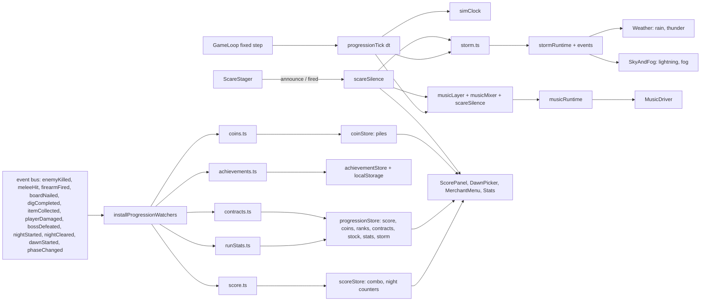
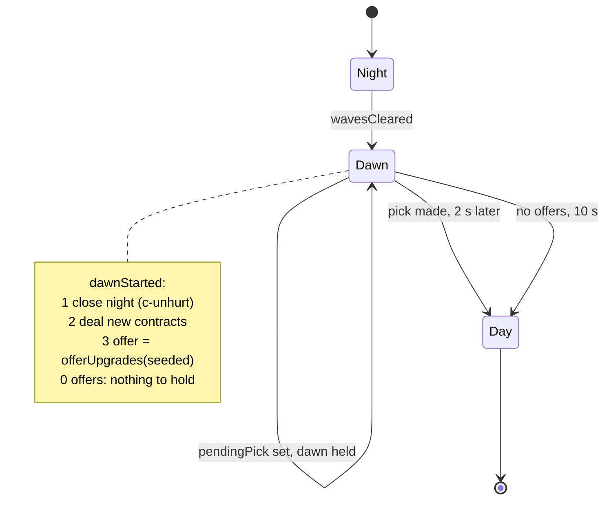
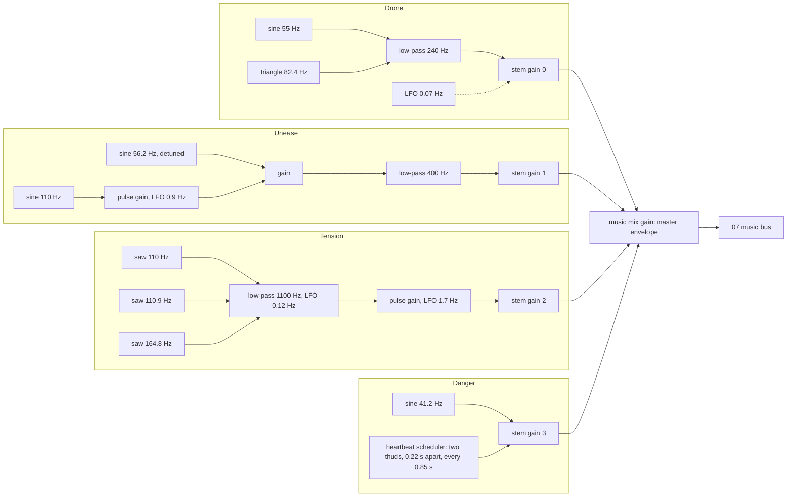

# Design: Progression and Atmosphere

## Overview
Spec 08 gives each dawn a choice (one of three upgrades), turns kills into a score with a combo, adds Grave Coins and a travelling merchant, daily side contracts, four modes (Easy, Normal, Hard, Endless Survival), twelve saved achievements, reactive procedural music that goes silent before a major scare, and storms with rain, lightning and thunder. All numbers come from `docs/game-design.md` §12, with related rows in §3 (Currency) and §8 (Dawn). Values the bible lacks are listed in "Values chosen here".

Approach, in four rules:
1. **Rules are pure functions** in `src/game/systems/` (upgrade offer and modifiers, score and combo, run stats, coins, merchant, contracts, modes and Endless waves, achievements, music layer and mixer, scare silence, storm and lightning). Each has a `*.test.ts` with fast-check properties. None imports React, three.js or Howler (Req 14.2).
2. **Glue lives in `src/game/state/`**, in the style of 06's `tickGuidance` and 07's `combatTick`: a `progressionTick(dt)` called from the one fixed loop, and `installProgressionWatchers()` that turns the 07 events (`enemyKilled`, `firearmFired`, `boardNailed`, `bossDefeated`, `digCompleted`, `itemCollected`) into pure-function calls.
3. **Audio and rendering stay in `src/scene/` and `src/audio/`.** The music graph, rain noise and thunder run on `Howler.ctx` through 07's `synth.ts` buses. Game state never imports `src/audio`; scene components read plain runtime objects (`musicRuntime`, `stormRuntime`) and the event bus.
4. **Spec 06 and 07 are built first.** This spec uses `isSimFrozen()`, `guidanceStore`, the compass marker builder, `playerStore.maxHealth`, `gameStore.retryEpoch`, `healPlayer`, `combatPersistence`, `nightState.clearNightState()`, the Retry snapshot list, `captions.ts`, `synth.ts`, `volumes.ts`, `sanitizeCombat`'s optional-field pattern, `StatMods`, `createEnemy(..., { hpMult, speedMult, damageMult })`, `rollElite(..., chance)` and `nailBoard(..., boardHp)`. None of that is redesigned.

## Findings in the code (corrections to the requirements)
| Requirement says | Code or other text says | Design resolution |
|---|---|---|
| Req 1.5: dawn waits for the pick | `tickDayNight` runs dawn for a fixed `DAWN_DURATION_S` (10 s). `DawnCard.tsx` is a stub that nothing mounts. | `DayNightInput` gains `holdDawn`. `phaseTime` and events freeze while it is true. `DawnCard` becomes the dawn summary and hosts the picker. After the pick, dawn jumps to its last `DAWN_AFTER_PICK_S` (2 s) so the player does not wait out the rest. |
| Req 1.5/12.12: Esc opens pause while an overlay is open | `usePauseTriggers` skips pausing while examine, journal, satchel, workbench or repair is open (each "owns Esc"). Pointer-lock loss also pauses. | The new in-game overlays (picker, merchant) do **not** own Esc. A new `overlayStore` flag makes the pointer-lock-loss path ignore the deliberate cursor release, while the Esc key path always pauses. `PauseMenu.resume` already skips `requestLock` while `isMenuOpen()` (06), and `isMenuOpen()` includes the new overlays. |
| Req 7.7/7.8: Endless nights beyond 5, 120 s day | `tickDayNight` caps `nightNumber` at `LAST_NIGHT`; `phaseDuration('day')` is the constant 360 s; `NightNumber` is `1..5`; `startNight` returns an idle state for any other night; `tickWaves` looks up `NIGHT_MAP`; `WaveDirector` treats `nightNumber >= LAST_NIGHT` as the rite night; `recordNightSurvived` clamps at 5. | `DayNightInput` gains `dayLengthS` and `lastNight`. `WaveState` carries its own `plan` (the night's wave list), so `tickWaves` no longer indexes `NIGHT_MAP` and Endless feeds a generated plan. `WaveState.night` widens to `number`. The rite branch runs only in story modes. `recordNightSurvived` takes a cap. `fogForNight` already clamps at night 5 (0.06), so Endless fog needs no change. |
| Req 7.3: Mode HP and damage on spawn | 07 gives `createEnemy` the options `hpMult`, `speedMult`, `damageMult`, and `eliteStats` returns absolute numbers. | One pure `spawnMultipliers(mode, night, elite)` composes mode, Endless scaling and the elite multipliers into those three options. `WaveDirector` passes the result. Father Crane is not scaled (see Values chosen). |
| Req 7.4/10.5: lantern drain multipliers | `tickLantern(s, dt, phase)` has fixed rates. | New optional `drainMult` argument (default 1). The caller multiplies mode, Long Wick and storm (×1.2) in one pure `lanternDrainMultiplier`. |
| Req 9.5/13.5: silence 1.5 s before a major beat | `tickScares` returns the telegraph and beat cues together at fire time, so `beat.at` is known at once. Every major's lead is at most 1.5 s (door-slam 1.0, lurker-lunge 1.5, hand-from-grave 0.8). `ScareStager` also holds a beat while a menu is open, so a beat can fire late. | `ScareStager.telegraph()` announces the beat to a new `scareSilence` schedule with the lead left, and `beat()` reports that it fired. The silence starts at announcement (always inside the 1.5 s window, so the "announced late" rule of Req 9.5 is the normal case). A beat held by a menu keeps the silence on until it really fires. The same schedule gates lightning (Req 13.6–13.8) and the overlay rules (Req 12.10–12.11). The scare director itself is untouched (Req 13.9). |
| Req 3.1: "melee hit" counted | No melee-hit event exists. `enemyKilled` fires only on a kill. | New `GameEvent` `meleeHit { uid }`, emitted by `MeleeAttack.tsx` once per zombie struck by a melee or heavy swing. Kicks do not count (Req 6.4 says "melee weapons"). |
| Req 2.4/6.7: "night is cleared" | `wavesCleared` is a `WaveEvent` used only inside `WaveDirector`; night 5 never reaches dawn in story mode. | `WaveDirector` emits a new `GameEvent` `nightCleared { nightNumber }` when waves clear, in both branches. Night score, `c-unhurt` and Close Shave read it. |
| Req 2.5 vs 07: Father Crane dies once, but twice in events | 07 emits `enemyKilled` for the `father-crane` zombie when his HP reaches 0 and `bossDefeated` 4 s later. | `enemyKilled` of `father-crane` counts as a kill in the stats but scores nothing and does not touch the combo. `bossDefeated` scores 1000 once through the same combo path. |
| Req 4.5: pile appears "at the kill position" | `enemyKilled` carries no position. | The handler looks the zombie up by `uid` in `enemyStore` (it stays there for 1.5 s while dying). If it is gone, the pile appears at the player's feet, so coins are never lost. |
| Req 5.1/5.6: stock dealt when dawn is released | `installNewDaySave` autosaves on `phaseChanged → day`. A subscriber registered later would save a stock-less day. | `installProgressionWatchers()` is installed **before** `installNewDaySave()` in `main.tsx`, and a test reads the install order. The first day has no dawn, so it has no stock and no merchant (proposed note under Req 5.1). |
| Req 6.1: contracts "when dawn starts" | The first day has no dawn, so day 1 and night 1 would have no contract. | `startRun` deals the first two contracts with the same dealer (proposed addition to Req 6.1). |
| Req 6.2: only weapon needs are excluded | `c-boards-3` is impossible before repair stage 1 is built, and `c-wailer-2` is impossible when the coming night has fewer than 2 Wailers (night 2 has 1). | `ContractReq` adds `barricade` and `minWailersNextNight` beside `weapon`, so "possible right now" is true. Proposed wording for Req 6.2: "needs a weapon, a built barricade, or more Wailers than the coming night has". |
| Req 3.5: stats "in death without Retry Night" | Story modes always offer Retry Night; `TakenScreen` has Retry and Quit. | The Stats_Screen follows an ending and an Endless death. Quit from the story Taken screen abandons the run and shows no stats. |
| Req 12.9: toasts stay at least 3 s | `Toast.tsx` shows each toast for a fixed 2000 ms. | `toastStore.push(text, durationMs?)` and `ToastMessage.durationMs`; contract toasts pass 3000. |
| Req 1.7/1.11: max HP from ranks | 06 keeps `playerStore.maxHealth` out of the save. | Max HP is derived: `PLAYER_MAX_HEALTH + 15 × rank`, written by `syncDerivedStats()` after a pick, a load, a New Game and a Retry. The Retry snapshot already carries `player.maxHealth`. |
| Req 1.8: Deep Pockets +2 slots | `SATCHEL_SLOTS = 12` is defined twice (`data/items.ts`, `systems/crafting.ts`), used by `addItem`, the Satchel grid and `validInventory` (`length <= 12`). 07 routes crafting through `inventory.addItem`. | `addItem(inv, id, qty, slotLimit = SATCHEL_SLOTS)`. Stores pass `currentModifiers().satchelSlots`. The Satchel grid renders that many cells. `validInventory` allows up to `SATCHEL_SLOTS_MAX` (14), so a save never loses items. The duplicate in `crafting.ts` is removed. |
| Req 1.8: Gravedigger | `tickDig` and `digProgress` read `DIG_DURATION_S` directly. | `DigInput.durationS?` and `digProgress(state, durationS?)`; `DigBar` shows the live duration. |
| Req 1.8: Blessed Reach | `ThrownItems.tsx` hard-codes the flash radius (2 or 3); `throwFlask` reads `WEAPON_MAP['holy-water-flask'].radius`. | `throwFlask` and the flash visual take a `radiusBonusM`. |
| Req 3.1/11: run stats | `RunStats` lives in `endingStore` and holds two numbers. It is in neither the save nor the Retry snapshot. `EnemyDirector` banishes on `enemyCollapsed`. | `runStats.ts` is extended (not duplicated) and the `stats` field moves to `progressionStore`, which is saved and snapshotted. `endingStore` keeps its flags. `zombiesBanished` becomes the sum of kills. The `banish()` call is removed from `EnemyDirector`. |
| Req 12.1: five overlays share one behaviour | `MenuDialog` already traps Tab, focuses the first control and restores focus. It does not choose a start control. | `MenuDialog` gains `data-autofocus` support (first match wins, so Normal is focused in the mode list). Esc is optional there, so the picker and merchant menu omit `onEscape` and let Esc reach the pause trigger. |
| Req 10.2/13: no new shadow light | `SkyAndFog` owns the ambient and moon lights. | Lightning boosts those two lights' intensity and the sky colour in the same `useFrame`. No new light exists. |
| Req 8.2 "within 1 s" toast | Nothing yet shows achievement toasts. | `AchievementToasts` renders the store's visible list in the frame after the unlock. |
| Req 4.1 Brute/elite drops come from 07 | 07's `enemyKilled` has `enemy`, `elite`, `source`, `headshot`. | Everything this spec needs is in that event, plus the new `meleeHit` and `nightCleared`. |

Noticed, out of scope: `crafting.ts` and `data/items.ts` each define the satchel size (fixed above only as far as the slot limit goes); `WaveDirector` seeds its RNG with the constant 1849 on every mount.

## Architecture
New and changed files. Data first, then pure systems, state, scene, UI, audio.

| Layer | File | Purpose |
|---|---|---|
| data (new) | `dawnUpgrades.ts`, `scoring.ts`, `graveCoins.ts`, `merchant.ts`, `contracts.ts`, `modes.ts`, `achievements.ts`, `storms.ts`, `music.ts` | The §12 tables and the extra values chosen here |
| data (edit) | `balance.ts`, `captions.ts` (07), `sounds.ts` (07), `items.ts` | `DAWN_AFTER_PICK_S`; `SATCHEL_SLOTS_MAX`; caption and sound rows. `MERCHANT_SPOT` lives in `merchant.ts` and a test checks it against `cemeteryLayout.ts` |
| systems (new) | `dawnUpgrades.ts`, `score.ts`, `coins.ts`, `merchant.ts`, `contracts.ts`, `modes.ts`, `endless.ts`, `achievements.ts`, `musicLayer.ts`, `musicMixer.ts`, `scareSilence.ts`, `storm.ts`, `progressionSave.ts` | Pure rules, each with a `*.test.ts` |
| systems (edit) | `dayNight.ts`, `gameTick.ts`, `lantern.ts`, `stamina.ts`, `waves.ts`, `inventory.ts`, `crafting.ts`, `dig.ts`, `projectiles.ts`, `runStats.ts`, `saveGame.ts`, `objective.ts` (06), `compass.ts` (06), `interaction.ts` | See Components |
| game (edit) | `rng.ts` | `deriveSeed(seed, tag, n)` |
| state (new) | `progressionStore.ts`, `scoreStore.ts`, `coinStore.ts`, `achievementStore.ts`, `overlayStore.ts`, `simClock.ts`, `musicRuntime.ts`, `stormRuntime.ts`, `progressionTick.ts`, `progressionEvents.ts`, `progressionActions.ts`, `progressionPersistence.ts`, `derivedStats.ts`, `endlessBest.ts` | One store per domain, plus runtime objects and glue |
| state (edit) | `endingStore.ts`, `retryNight.ts`, `gameSave.ts`, `resetRun.ts`, `nightState.ts` (07), `menuState.ts`, `toastStore.ts`, `startEnding.ts` | Stats move, snapshot, save, reset, overlays |
| scene (new) | `world/Merchant.tsx`, `world/CoinPiles.tsx`, `world/Weather.tsx` (rain, lightning sync, thunder), `audio/MusicDriver.tsx` | Rendering and audio drivers |
| scene (edit) | `GameLoop.tsx`, `SkyAndFog.tsx`, `enemies/WaveDirector.tsx`, `enemies/EnemyDirector.tsx`, `scares/ScareStager.tsx`, `player/MeleeAttack.tsx`, `player/usePauseTriggers.ts`, `world/ThrownItems.tsx`, `App.tsx` | See Components |
| audio (new/edit) | `music.ts` (graph), `rain.ts`, `synth.ts` and `volumes.ts` (07, edit) | Procedural Web Audio on `Howler.ctx` |
| ui (new) | `menus/ModeSelect.tsx`, `menus/AchievementsMenu.tsx`, `menus/StatsPanel.tsx`, `hud/DawnPicker.tsx`, `hud/ScorePanel.tsx`, `hud/AchievementToasts.tsx`, `merchant/MerchantMenu.tsx`, `journal/ContractsTab.tsx` | Screens |
| ui (edit) | `menus/TitleScreen.tsx`, `menus/PauseMenu.tsx`, `menus/TakenScreen.tsx`, `menus/EndingScreen.tsx`, `menus/MenuDialog.tsx`, `hud/Hud.tsx`, `hud/DawnCard.tsx`, `hud/DigBar.tsx`, `journal/Journal.tsx`, `satchel/Satchel.tsx` | Wiring |



Data flow in one kill: 07's `applyDamage` reports the kill and `enemyKilled` is emitted once. `progressionEvents` runs, in order: `applyKill` (score and combo, `scoreStore`), `recordKill` (stats), `coinDrop` and `addPile` (coins), `advanceContracts`, then `evaluateAchievements`. A kill by Father Crane's `quietEnded` goes through `bossDefeated` the same way.

Timing: pure timers (combo decay, pile age and pickup, storm, mixer, silence, time survived) advance in `progressionTick(STEP)` from `TickDriver`, after `tickCombat`. `TickDriver` already returns early on `isSimFrozen()`, so pause, journal, examine and the intro stop all of them (Req 3.4, 9.9, 10.12). `tickProgression` also returns when `gameStore.taken`.

## Data Models

### Types
```ts
// src/game/types.ts (additions)
export type ModeId = 'easy' | 'normal' | 'hard' | 'endless'
export type DawnUpgradeId = 'iron-constitution' | 'steady-hands' | 'long-wick' | 'deep-pockets' | 'second-wind'
  | 'gravedigger' | 'hardened-boards' | 'grim-harvest' | 'marksman' | 'blessed-reach'
export type ContractId = 'c-dig-3' | 'c-shotgun-5' | 'c-revolver-head-3' | 'c-melee-10'
  | 'c-wailer-2' | 'c-boards-3' | 'c-gather-8' | 'c-unhurt'
export type AchievementId = 'a-first-light' | 'a-grave-robber' | 'a-marksman' | 'a-close-shave' | 'a-combo'
  | 'a-barricade' | 'a-pages' | 'a-relics' | 'a-crane' | 'a-rest' | 'a-endless-10' | 'a-patron'
export type MerchantRowId = 'bandage' | 'lamp-oil' | 'revolver-cartridges' | 'shotgun-shells' | 'holy-water'
  | 'black-powder' | 'lead-shot' | 'wood-planks' | 'kola-tonic' | 'silver-filings'
// GameEvent gains:
  | { type: 'meleeHit'; uid: string }
  | { type: 'nightCleared'; nightNumber: number }
  | { type: 'thunderRolled'; close: boolean }          // emitted by progressionTick when a scheduled thunder is due
```
`GameEvent` is the only place the three new events are declared. Everything else (`enemyKilled`, `firearmFired`, `boardNailed`, `bossDefeated`, `digCompleted`, `itemCollected`, `playerDamaged`, `nightStarted`, `dawnStarted`, `phaseChanged`) already exists after 06 and 07.

### src/data constants (values from §12 unless marked "chosen")
```ts
// dawnUpgrades.ts
export interface DawnUpgradeDef { id: DawnUpgradeId; name: string; maxRank: 1 | 2; rune: string }  // rune: a shape cue on the card
export const DAWN_UPGRADES: readonly DawnUpgradeDef[]  // pool order = §12 table order; ranks 2,2,2,1,2,1,1,2,1,1
export const UPGRADE_PER_RANK = { maxHealth: 15, reload: 0.15, lanternDrain: 0.20, satchelSlots: 2, staminaRegen: 0.25,
  digTime: 0.30, boardHp: 0.25, coinDrop: 0.25, headshot: 0.25, flaskRadiusM: 1 } as const
export const OFFER_SIZE = 3
export const DAWN_AFTER_PICK_S = 2                         // chosen; balance.ts

// scoring.ts
export const KILL_POINTS: Readonly<Record<WaveEnemyId, number>> = { shambler: 10, wailer: 25, lurker: 30, bloater: 30, brute: 75 }
export const BOSS_POINTS = 1000, ELITE_POINTS_MULT = 2, HEADSHOT_BONUS = 5
export const COMBO = { step: 0.25, cap: 3.0, windowS: 4, base: 1.0 } as const
export const NIGHT_SCORE = { clearPerNight: 100, noDamageBonus: 200 } as const

// graveCoins.ts
export const COIN_DROPS: Readonly<Record<WaveEnemyId, { amount: number; chance: number }>> =
  { shambler: { amount: 1, chance: 0.5 }, wailer: { amount: 2, chance: 1 }, lurker: { amount: 2, chance: 1 },
    bloater: { amount: 2, chance: 1 }, brute: { amount: 5, chance: 1 } }
export const ELITE_COIN_BONUS = 5
export const COIN_PILE = { collectRadiusM: 1.5, fadeAfterS: 60, shrinkLastS: 2, mergeRadiusM: 1, maxPiles: 32 } as const  // last three chosen

// merchant.ts
export const MERCHANT_STAY_S = 90, MERCHANT_RANGE_M = 2.5, FIXED_ROWS = 2, POOL_ROWS = 3
export interface MerchantRowDef { id: MerchantRowId; item: ItemId; count: number; price: number; dailyQty: number;
  stock: 'fixed' | 'pool'; needs?: 'revolver' | 'shotgun' }
export const MERCHANT_ROWS: readonly MerchantRowDef[]       // 10 rows exactly as §12
export const MERCHANT_SPOT = { cart: [-9, 0, 37], silas: [-7.2, 0, 36.2], yaw: Math.PI } as const   // chosen

// contracts.ts
export interface ContractDef { id: ContractId; name: string; goal: number; reward: number; text: string; req?: ContractReq }
export interface ContractReq { weapon?: 'revolver' | 'shotgun'; barricade?: true; minWailersNextNight?: number }
export const CONTRACTS: readonly ContractDef[]               // 8 rows as §12; reqs: revolver, shotgun, barricade, wailers 2
export const CONTRACTS_PER_DAWN = 2, UNHURT_MAX_DAMAGE = 50
export const MELEE_SOURCES: readonly DamageSource[] = ['melee', 'heavy']

// modes.ts
export interface ModeDef { id: ModeId; label: string; hpMult: number; damageMult: number; lanternDrainMult: number;
  eliteChance: number; scoreMult: number; story: boolean; dayLengthS: number | null; retryNight: boolean }
export const MODES: Readonly<Record<ModeId, ModeDef>>        // easy .75/.6/.75/.04/.75; normal 1/1/1/.06/1; hard 1.25/1.4/1/.10/1.5; endless = normal, story false, 120 s, no retry
export const DEFAULT_MODE: ModeId = 'normal'
export const ENDLESS = { dayS: 120, waveBase: 2, waveCap: 6, shamblerBase: 4, hpScale: 1.08, hpScaleAfterNight: 5 } as const
export const ENDLESS_BEST_KEY = 'lastrites:endless-best'

// achievements.ts
export interface AchievementDef { id: AchievementId; name: string; goal: string }
export const ACHIEVEMENTS: readonly AchievementDef[]         // 12 rows as §12
export const ACHIEVEMENTS_KEY = 'lastrites:achievements'
export const TOAST = { showS: 4, fadeS: 0.5, maxVisible: 3 } as const      // chosen
export const ACHIEVEMENT_THRESHOLDS = { firstLightNights: 1, digs: 10, headshotsPerNight: 10, closeShaveHp: 10,
  comboCap: 3.0, boards: 20, pages: 5, relics: 5, endlessNight: 10, coinsSpent: 100 } as const

// storms.ts
export const STORM_CHANCE_NIGHT: Readonly<Record<number, number>> = { 1: 0, 2: 0.25, 3: 0.4, 4: 0.5, 5: 1 }
export const STORM_CHANCE_DAY = 0.15
export const STORM = { gapMinS: 20, gapMaxS: 45, thunderMinS: 1, thunderMaxS: 4, fogAdd: 0.01, lanternDrainMult: 1.2,
  closeThunderMaxS: 2, rainFadeS: 3 } as const                    // closeThunderMaxS and rainFadeS chosen
export const LIGHTNING = { flashS: 0.15, slowRiseS: 1.5, slowPeak: 0.3, slowFallS: 1.5, holdBeforeBeatS: 1.5,
  ambientBoost: 1.4, moonBoost: 1.6, skyLerp: 0.5, skyColor: '#d6e4ff' } as const   // last four chosen
export const RAIN = { count: 600, boxM: [36, 20, 36], speedMps: 16, lengthM: 0.9, widthM: 0.02, slantDeg: 8, opacity: 0.28 } as const  // chosen

// music.ts
export const MUSIC = { crossfadeS: 2, duckFadeS: 0.3, fadeInS: 2, silenceBeforeBeatS: 1.5, silenceAfterBeatS: 2,
  distance: { danger: 6, tension: 15, unease: 30 } } as const
export const STEM_WEIGHTS: Readonly<Record<0 | 1 | 2 | 3, readonly [number, number, number, number]>> =
  { 0: [1, 0, 0, 0], 1: [1, 1, 0, 0], 2: [0.8, 1, 1, 0], 3: [1, 1, 1, 1] }    // [drone, unease, tension, danger]; chosen
export const SYNTH_MUSIC = { /* oscillator frequencies, filter cut-offs, LFO rates, stem peaks, heartbeat timing */ }  // chosen, see below
```
A data test compares each table to §12 and names the mismatched value (Req 14.4). A second test scans `src/game/systems/{score,coins,merchant,contracts,modes,endless,dawnUpgrades,storm,musicLayer}.ts` for numeric literals other than 0, 1, 2 and array indices (Req 14.3).

### Stores (one per domain, plain JSON except where noted)
```ts
// progressionStore.ts  (persistent: saved and snapshotted; see progressionPersistence.ts)
interface ProgressionState {
  mode: ModeId
  seed: number                                // run seed; every random stream derives from it
  ranks: Ranks                                // Partial<Record<DawnUpgradeId, number>>
  pendingPick: DawnUpgradeId[] | null         // the offered ids while a pick is open
  dawnSummary: NightSummary | null            // shown on the dawn card
  score: number
  bossScored: boolean
  coins: number
  contracts: DealtContract[]                  // { id, progress, done }
  stock: Stock | null                         // { rows: { id, qty }[] }, null before the first dawn
  stats: RunStats
  storm: { active: boolean }
}
// scoreStore.ts  (Night_State: cleared by clearNightState and at nightStarted)
interface ScoreStoreState { combo: number; lastKillAt: number | null; seen: string[]; nightKillPoints: number;
  nightDamage: number; nightHeadshotKills: number; nightKills: number; nightItems: number; clearHp: number | null }
// coinStore.ts   { piles: CoinPile[]; nextId: number }                      (Night_State)
// achievementStore.ts  { unlocked: AchievementId[]; visible: ToastItem[]; queued: ToastItem[]; unlock(ids), resetSession() }
//                       (own localStorage key; never in RUN_STORES or the snapshot)
// overlayStore.ts  { merchantOpen: boolean; achievementsOpen: boolean; modeSelectOpen: boolean }
// simClock.ts      { now: number }  plain module object, advanced only by progressionTick
// musicRuntime.ts  { layer: 0|1|2|3; stems: [n,n,n,n]; master: number }    plain object read by MusicDriver
// stormRuntime.ts  { storm: StormState; flashLevel: number }               plain object read by SkyAndFog and Weather
```
`progressionPersistence.ts` is the one list of persisted fields, like 07's `combatPersistence`: `PROGRESSION_PERSISTED = ['mode','seed','ranks','pendingPick','dawnSummary','score','bossScored','coins','contracts','stock','stats','storm']`. `captureProgressionSave()` and the Retry snapshot are both built from it, and a test fails if a field is in one and not the other.

### Run stats (extends `systems/runStats.ts`)
```ts
export interface RunStats {
  nightsSurvived: number; zombiesBanished: number            // existing; banished = sum of kills
  kills: Record<EnemyId, number>                             // all six ids incl. father-crane
  meleeHits: number; shotsFired: number; shotsHit: number
  bestCombo: number; timeS: number
  coinsEarned: number; coinsSpent: number; digs: number; boardsNailed: number   // the last three feed contracts and achievements
}
```
Score, relics and the Endless best are not fields: score is `progressionStore.score`, relics are counted live from inventory and mystery as the current summary already does, and the Endless best is read from storage.

### Save format (additive, SAVE_VERSION stays 1)
```ts
interface ProgressionSave {                  // JSON shape of PROGRESSION_PERSISTED, all plain values
  mode: ModeId; seed: number; ranks: Record<string, number>; pendingPick: string[] | null
  dawnSummary: NightSummary | null; score: number; bossScored: boolean; coins: number
  contracts: { id: string; progress: number; done: boolean }[]
  stock: { rows: { id: string; qty: number }[] } | null
  stats: RunStats; storm: { active: boolean }
}
// SaveFile gets  progression?: unknown   (optional on read, always written)
// SaveState gets progression: ProgressionSave
```
`sanitizeProgression(raw: unknown, ctx: { inventory: Inventory; takenPickups: readonly string[] }): ProgressionSave` works field by field, like `sanitizeCombat`:
- Missing or non-object `raw` → all defaults: Normal, seed `DEFAULT_SEED` (1849), no ranks, no pick, score 0, coins 0, no contracts, no stock, empty stats, no storm (Req 11.8).
- `mode` in `MODE_IDS`, else `normal`. `seed` a finite integer ≥ 0, else the default.
- `ranks`: unknown ids dropped; each rank an integer 0..max, else 0 (Req 11.9).
- `pendingPick`: unknown or duplicate ids dropped, ids already at max rank dropped; 0 left → null; more than 3 → first 3.
- `score`, `coins`: finite integers ≥ 0, else 0. `bossScored`: boolean, else false.
- `contracts`: entries with an unknown id or a duplicate dropped; `progress` an integer in 0..goal; `done` forced true when `progress === goal`; at most 2 kept.
- `stock`: rows with an unknown id, a duplicate or `qty` outside 0..dailyQty dropped; a stock that does not have exactly 5 rows after that becomes null.
- `stats`: `parseStats` per field (each count a finite integer ≥ 0, `timeS` finite ≥ 0, unknown kill ids dropped). `storm.active` boolean, else false.

`readSave` still returns null for unparsable or structurally wrong data, so Continue stays hidden and storage is untouched. A pre-08 save loads with the defaults and all its earlier fields intact (Req 11.11).

### Retry snapshot and Night_State
Snapshot list gains `progression` (all persisted fields; the store has no non-data fields to omit). `inventory`, `player` (with `maxHealth`), `lantern`, `world`, `chapel` and 07's `combat` and `doors` are already in it. `clearNightState()` (07) gains:

| Cleared | How |
|---|---|
| Combo, kill timer, seen uids, night counters | `scoreStore.resetNight()` |
| Coin piles | `coinStore.clear()` |
| Lightning timers, pending strikes, flash level | `stormRuntime.reset()` (the next tick redraws the first gap from the phase seed) |
| Scare silence schedule and held time | `scareSilence.clear()` |
| Music layer | `musicRuntime.reset()`: the mixer restarts at the layer for the restored state |

Persistent values (coins, stats, score, contract progress, stock, ranks) come back from the snapshot, so anything earned in the failed night is gone, as Req 11.6–11.7 intend. `retryNight()` returns early in Endless (`MODES.endless.retryNight` is false), and `TakenScreen` hides the button.

## Components and Interfaces

### Seeds (`rng.ts`)
```ts
export const deriveSeed = (seed: number, tag: string, n = 0): number    // FNV-1a over the tag, mixed with seed and n; >>> 0
```
Every stream is `createRng(deriveSeed(progression.seed, tag, n))`: `'offer'` (night), `'stock'` (night), `'contracts'` (night), `'coins'` (night, re-created at each phase start), `'storm-roll'` (kind + night), `'lightning'` (night × 1000 + strike index), `'elite'` is 07's. A Retry Night therefore redraws the same offers, storm and lightning, and Continue restores them from the saved seed. `New Game` is the only place that calls `Math.random()` (once, for the seed).

### Upgrades (`dawnUpgrades.ts`) — Req 1
```ts
export type Ranks = Readonly<Partial<Record<DawnUpgradeId, number>>>
export const rankOf = (r: Ranks, id: DawnUpgradeId): number
export const belowMax = (r: Ranks): DawnUpgradeId[]                    // pool order
export function offerUpgrades(r: Ranks, rng: Rng): DawnUpgradeId[]     // partial Fisher-Yates over belowMax; length min(3, n)
export function pickUpgrade(r: Ranks, id: DawnUpgradeId): Ranks        // +1 on id; returns r itself for unknown or maxed ids
export interface Modifiers {
  maxHealthBonus: number; reloadTimeMult: number; lanternDrainMult: number; satchelSlots: number
  staminaRegenMult: number; digTimeMult: number; boardHpMult: number; coinDropMult: number
  headshotMultAdd: number; flaskRadiusBonusM: number
}
export const IDENTITY_MODIFIERS: Modifiers                              // 0, 1, 1, 12, 1, 1, 1, 1, 0, 0
export function modifiersFromRanks(r: Ranks): Modifiers                // reload 1 - 0.15R, drain 1 - 0.20R, slots 12 + 2R, regen 1 + 0.25R, dig 1 - 0.30R, boards 1 + 0.25R, coins 1 + 0.25R, ...
export interface UpgradeCard { id: DawnUpgradeId; name: string; rune: string; rankText: string; lines: string[] }
export const upgradeCard = (r: Ranks, id: DawnUpgradeId): UpgradeCard   // "Rank 1/2"; lines "Max health 115 → 130"
```
`upgradeCard` builds its lines from the modifiers before and after the pick, so it cannot disagree with `modifiersFromRanks`. Percent stats read "Reload time 85% → 70%". The only consumer of `Modifiers` is `currentModifiers()` in `derivedStats.ts` (memoised by the `ranks` object).

Where each modifier is applied:

| Modifier | Applied in |
|---|---|
| `maxHealthBonus` | `syncDerivedStats()` → `playerStore.setMaxHealth(100 + bonus)`. On a pick it then calls `healPlayer(15)`; 06's `healPlayer` caps at `maxHealth`. |
| `reloadTimeMult`, `headshotMultAdd`, `boardHpMult` | Passed as 07's `StatMods` = `{ reloadTimeMult, headshotMultAdd, boardHpMult }` into `deriveStats` / `firearmStats` and to `nailBoard(..., boardHp)` as `round(60 × mult)` = 75. Boards already nailed keep their health (07 property). |
| `lanternDrainMult` | `lanternDrainMultiplier` → `tickLantern(..., drainMult)` |
| `satchelSlots` | `addItem(..., slotLimit)` and the Satchel grid |
| `staminaRegenMult` | `tickStamina(s, dt, sprinting, drainMult, regenMult)` (07 added `drainMult`) |
| `digTimeMult` | `DigInput.durationS = DIG_DURATION_S × mult` |
| `coinDropMult` | `coinDrop` |
| `flaskRadiusBonusM` | `throwFlask` and the flash visual |

### Dawn hold — Req 1.4–1.6, 12.11
```ts
// dayNight.ts
export interface DayNightInput {
  wavesCleared: boolean
  holdDawn?: boolean          // true while a pick is pending
  dayLengthS?: number         // default DAY_DURATION_S; Endless 120
  lastNight?: number          // default LAST_NIGHT; Endless Infinity
}
```
In the phase loop: `if (phase === 'dawn' && input.holdDawn) break` before the duration check, so `phaseTime` stays and no event fires. `dayLengthS` and `lastNight` replace the two constants. `TickInput` carries all three; `GameLoop`'s `liveInput` calls `deriveTickInput()` in `progressionTick.ts`.


- On `dawnStarted`, the watcher (a) closes the night's contracts, (b) deals the next two, (c) stores `dawnSummary`, (d) sets `pendingPick = offerUpgrades(ranks, createRng(deriveSeed(seed,'offer',night)))`, or null if the offer is empty. Because the event is published after a frame's ticks, at most a few fixed steps of dawn pass before the hold takes effect; none of them matter (no zombies, no timer).
- `DawnPicker` is visible when `pendingPick !== null && !majorScareActive`. While a major scare is active the dawn stays held and the picker waits (Req 12.11). The picker is a `MenuDialog` with no `onEscape`.
- `pickUpgrade` action (ignored when `pendingPick` is null, which covers a second click or key press): raises the rank, runs the Iron Constitution step, clears `pendingPick`, calls `syncDerivedStats()`, then sets `worldStore.phaseTime = max(phaseTime, DAWN_DURATION_S − DAWN_AFTER_PICK_S)`.
- On `phaseChanged → day` (after a dawn) the watcher deals the merchant stock (seed `'stock'`, night) and emits the arrival subtitle. Day 1 has none.
- Time survived does not advance while `pendingPick` is set.

### Score and combo (`score.ts`) — Req 2
```ts
export interface ScoreState { score: number; bossScored: boolean; combo: number; lastKillAt: number | null
  seen: readonly string[]; nightKillPoints: number }
export interface KillInput { uid: string; enemy: EnemyId; elite: boolean; headshot: boolean }
export interface KillResult { state: ScoreState; points: number; comboRaised: boolean; counted: boolean }
export function applyKill(s: ScoreState, k: KillInput, now: number, scoreMult: number): KillResult
export function applyBoss(s: ScoreState, now: number, scoreMult: number): KillResult   // 1000, once per run
export function tickCombo(s: ScoreState, now: number): ScoreState                      // reset to 1 after > 4 s without a counted kill
export interface NightScore { kill: number; clear: number; noDamage: number; total: number }
export function nightScore(s: ScoreState, night: number, damageTaken: number, scoreMult: number): NightScore
export const comboView = (s: ScoreState, now: number): { visible: boolean; text: string; barFraction: number }
```
`applyKill` ignores a uid already in `seen`, an unknown enemy id, and `father-crane` (no points, no combo). Otherwise: if `lastKillAt` is non-null and `now − lastKillAt ≤ 4` the combo rises by 0.25 (capped at 3.0), else it resets to 1.0. Points are `round((KILL_POINTS[enemy] × (elite ? 2 : 1) + (headshot ? 5 : 0)) × combo × scoreMult)`. `nightScore` is `{ kill: nightKillPoints, clear: round(100 × night × mult), noDamage: damageTaken === 0 ? round(200 × mult) : 0 }`; the clear and no-damage parts are added to `score` on `nightCleared` (Req 2.4). `comboView.text` is `×1.75`, hidden at ×1.0; `barFraction = clamp(1 − (now − lastKillAt) / 4, 0, 1)`.

### Run stats (`runStats.ts`) — Req 3
```ts
export const recordKill: (s: RunStats, enemy: EnemyId) => RunStats          // kills[enemy]++ and zombiesBanished++; unknown id → s
export const recordMeleeHit, recordShot(s, hit), recordCombo(s, combo), recordTime(s, dt), recordCoins(s, earned, spent), recordDig, recordBoard
export const accuracyPercent = (s: RunStats): number                        // floor(100 × hit / fired); 0 if none fired
export const formatTime = (timeS: number): string                           // "m:ss", seconds zero-padded, minutes unbounded
export const formatAccuracy = (p: number): string                           // "N%"
export const statRows = (s: RunStats, extra: { score: number; relics: number; endlessBest?: number }): SummaryRow[]
export const serializeStats = (s: RunStats): unknown  /  parseStats = (raw: unknown): RunStats               // junk → defaults per field
```
`recordShot` never lets `shotsHit` exceed `shotsFired`. `recordNightSurvived(s, night, cap = LAST_NIGHT)` gains the cap. `statRows` returns every row of Req 3.5, with 0 for empty stats. The existing `finalizeStats` and `summaryRows` callers use `statRows`.

### Coins (`coins.ts`) — Req 4
```ts
export function coinDrop(rng: Rng, enemy: WaveEnemyId, elite: boolean, grimRank: number): number
// base = chance roll ? amount : 0 (one rng() only when chance < 1); (base + (elite ? 5 : 0)) then floor(... × (1 + 0.25 × grimRank))
export interface CoinPile { id: number; x: number; z: number; amount: number; age: number }
export function addPile(piles: readonly CoinPile[], x: number, z: number, amount: number, id: number): { piles: CoinPile[]; overflow: number }
export function stepPiles(piles: readonly CoinPile[], dt: number, player: Vec2): { piles: CoinPile[]; collected: number[] }
export const pileScale = (age: number): number                // 1, shrinking to 0 over the last 2 s of the 60
```
`coinDrop` for an elite Shambler whose 50% roll fails is 5 (the elite bonus is not chance-gated). `addPile` merges into a pile within 1 m, and when the 32-pile cap is hit it returns the oldest pile's amount as `overflow`, which the caller banks, so no coin is lost to the cap. `stepPiles` collects each pile within 1.5 m exactly once and removes piles at 60 s (their coins are lost, Req 4.7). A zero drop makes no pile and no subtitle.

### Merchant (`merchant.ts`) — Req 5
```ts
export interface StockRow { id: MerchantRowId; qty: number }
export interface Stock { rows: StockRow[] }
export function dealStock(rng: Rng, owned: { revolver: boolean; shotgun: boolean }): Stock   // Bandage and Lamp Oil first, then 3 distinct pool rows
export function merchantPresent(w: Pick<WorldState, 'phase' | 'phaseTime'>, stock: Stock | null): boolean   // day, phaseTime < 90, stock dealt
export const withinTradeRange = (player: Vec2): boolean                                       // ≤ 2.5 m from Silas
export type BuyResult =
  | { ok: true; stock: Stock; coins: number; inv: Inventory; spent: number; gained: number }
  | { ok: false; reason: 'sold-out' | 'coins' | 'space'; text: string }
export function tryBuy(stock: Stock, id: MerchantRowId, coins: number, inv: Inventory, slotLimit: number): BuyResult
export const canOpenMerchant: (c: { phase: Phase; present: boolean; majorActive: boolean; inRange: boolean }) => boolean
```
`tryBuy` checks, in order, sold out, then coins (`coins < price`: "Need 8 coins, you have 3"), then space (`addItem` on a copy accepts fewer than `count`: "No room in the satchel"). On success it subtracts the price, lowers the quantity by 1 and adds `count` items. The owned-weapon test uses `combat.takenPickups` (07), so a weapon dropped from the satchel still counts as owned. `canOpenMerchant` is false at dusk and night, outside range, and while a major scare is active.

### Contracts (`contracts.ts`) — Req 6
```ts
export interface DealtContract { id: ContractId; progress: number; done: boolean }
export interface ContractContext { owns: { revolver: boolean; shotgun: boolean }; barricadeBuilt: boolean; wailersNextNight: number }
export const possibleContracts = (c: ContractContext): ContractId[]
export function dealContracts(rng: Rng, c: ContractContext): DealtContract[]     // up to 2 distinct possible ones
export type ContractEvent =
  | { type: 'kill'; enemy: EnemyId; source: DamageSource; headshot: boolean } | { type: 'dig' }
  | { type: 'board' } | { type: 'material' }
export function advanceContracts(list: readonly DealtContract[], e: ContractEvent): { list: DealtContract[]; completed: { id: ContractId; reward: number }[] }
export function finishNight(list: readonly DealtContract[], damageTaken: number): { list: DealtContract[]; completed: ... }
```
Matching rules: `c-dig-3` ← `dig`; `c-shotgun-5` ← kill with `source === 'shotgun'`; `c-revolver-head-3` ← kill with `source === 'revolver'` and `headshot`; `c-melee-10` ← kill with source in `MELEE_SOURCES`; `c-wailer-2` ← kill of a `wailer`; `c-boards-3` ← `board`; `c-gather-8` ← `material` (one event per pickup, from `itemCollected` whose item is a material); `c-unhurt` only by `finishNight`. Progress is capped at the goal, a done contract ignores events, and a reward is returned once. The glue adds the reward to `coins` and `stats.coinsEarned`, pushes a 3 s toast "Contract done: NAME, +N coins" and the subtitle "[contract done: NAME]".

### Modes and Endless (`modes.ts`, `endless.ts`) — Req 7
```ts
export function spawnMultipliers(mode: ModeId, night: number, elite: boolean): { hpMult: number; speedMult: number; damageMult: number }
// hp = mode.hp × (endless ? endlessHpScale(night) : 1) × (elite ? 2 : 1); speed = elite ? 1.15 : 1; damage = mode.damage × (elite ? 1.25 : 1)
export const endlessHpScale = (night: number): number                 // 1 for n <= 5, else 1.08 ^ (n - 5)
export const lanternDrainMultiplier = (c: { mode: ModeId; ranks: Ranks; storm: boolean }): number   // mode × (1 − 0.2R) × (storm ? 1.2 : 1)
export function endlessNight(n: number): { night: number; waves: WaveComposition[] }
// waves = min(2 + floor(n/2), 6); each wave: shambler 4 + n, wailer floor(n/2), lurker floor((n-1)/2), bloater floor((n-2)/2), brute floor((n-3)/3), each max 0
export const nightPlan = (mode: ModeId, night: number): readonly WaveComposition[]     // waves.ts: story → NIGHT_MAP (with 07 additions), endless → endlessNight
export const parseBest = (raw: string | null): number                  // NaN, negative, non-finite, non-number → 0
export function updateBest(stored: number, runScore: number): { best: number; write: boolean }
```
The elite multipliers come from 07's `ELITE` constants (a test checks they are the same numbers). `WaveDirector` calls `rollElite(rng, type, night, waveHasElite, MODES[mode].eliteChance)` and `createEnemy(uid, type, pos, { elite, ...spawnMultipliers(...) })`. The score multiplier reaches `applyKill` as `MODES[mode].scoreMult`.

`endlessBest.ts` (state): `readBest()` parses storage and never throws; `settleEndless(score)` computes `updateBest`, tries `setItem`, and on failure keeps a module-level `sessionBest = max(sessionBest, score)` so the Stats_Screen still shows the higher of the run and the earlier best (Req 7.12). It runs once per run, guarded by `endingStore.runId`.

### Achievements (`achievements.ts`) — Req 8
```ts
export interface AchievementFacts { nightsSurvived: number; digs: number; nightHeadshotKills: number; clearHp: number | null
  bestCombo: number; boardsNailed: number; pagesRead: number; relics: number; craneRested: boolean
  ending: EndingId | null; endlessNight: number; coinsSpent: number }
export function evaluateAchievements(unlocked: readonly AchievementId[], f: AchievementFacts): AchievementId[]   // newly met, in ACHIEVEMENTS order
export const parseUnlocked = (raw: string | null): AchievementId[]       // bad JSON, wrong type, unknown ids → valid entries only
export const serializeUnlocked = (ids: readonly AchievementId[]): string
export function queueToasts(visible: ToastItem[], queued: ToastItem[], add: ToastItem[], max = 3): { visible: ToastItem[]; queued: ToastItem[] }
```
Facts come from `progression.stats`, `scoreStore` (`nightHeadshotKills`, `clearHp`), `mystery.pages.size`, `countRelics`, `mystery.craneRested` (07) and `mystery.ending`, and `world.nightNumber` in Endless. `evaluateNow()` runs after each watcher handler and on `mysteryStore` and `inventoryStore` changes (a cheap pure check, coalesced per frame). `clearHp` is set from `playerStore.health` on `nightCleared` and cleared after the check. `achievementStore.unlock(ids)` adds to the set (never removes), tries the `localStorage` write (a failure is swallowed, the session set stays), queues the toasts and pushes the subtitle "[achievement: NAME]" (SUBTITLE_S = 3). Reaching night 10 is checked on `nightStarted` in Endless.

### Music (`musicLayer.ts`, `musicMixer.ts`, `scareSilence.ts`) — Req 9, 13.5
```ts
export type Layer = 0 | 1 | 2 | 3
export function musicLayer(i: { phase: Phase; waveRunning: boolean; nearestZombieM: number; bossOnField: boolean }): Layer
// 3 if nearest ≤ 6 or boss; else 2 if waveRunning or nearest ≤ 15; else 1 if dusk or nearest ≤ 30; else 0. No zombies → Infinity.

export type Weights = readonly [number, number, number, number]                  // drone, unease, tension, danger
export interface MixerState { from: Weights; to: Weights; t: number; layer: Layer; master: number }
export const initMixer = (layer: Layer): MixerState
export function stepMixer(s: MixerState, i: { layer: Layer; silent: boolean }, dt: number): MixerState
export const currentWeights = (s: MixerState): Weights                             // lerp(from, to, min(t / 2, 1))

export interface SilenceState { pending: readonly { id: string; beatAt: number }[]; holdUntil: number }
export const emptySilence: SilenceState
export const announce = (s: SilenceState, id: string, beatAt: number): SilenceState
export const fired = (s: SilenceState, id: string, now: number): SilenceState      // drops id; holdUntil = max(holdUntil, now + 2)
export const isSilent = (s: SilenceState, now: number): boolean                     // any pending (beatAt − now ≤ 1.5, or overdue) or now < holdUntil
export const majorScareActive = isSilent                                            // same window: announcement to 2 s after the beat
export const beatImminent = (s: SilenceState): boolean                              // any pending
```
`nearestZombieM` is the nearest living zombie (any state except dying and dead, dormant Lurkers included), `waveRunning` is `waveStore.waves.phase === 'active'`, and `bossOnField` is `bossStore.boss.stage === 'risen'`. `stepMixer` on a layer change sets `from = currentWeights(s)`, `to = STEM_WEIGHTS[layer]`, `t = 0`, so a second change mid-fade continues from the audible gains (Req 9.2). `master` falls at `1 / 0.3` per second while `silent` and rises at `1 / 2` per second otherwise. The fade keeps running while silent, so the layer that fades in is the current one (Req 9.7). `scareSilence` times are `simClock.now` values; `ScareStager` converts the director's lead with `now + (beat.at − directorTime)`.

The music runtime object is updated in `progressionTick`: it computes the layer, steps the mixer with `silent = isSilent(...)`, and writes `musicRuntime`. `MusicDriver` reads it per frame.

### Storm and lightning (`storm.ts`) — Req 10, 13.6–13.8
```ts
export interface StormState { active: boolean; strikeIn: number | null; strikeIndex: number
  thunder: readonly { inS: number; close: boolean }[]; flashAge: number | null; slow: boolean }
export type StormEvent = { type: 'stormStarted' } | { type: 'stormEnded' } | { type: 'strike'; slow: boolean } | { type: 'thunder'; close: boolean }
export const stormChance = (kind: 'day' | 'night', night: number): number            // table; unknown night → 0
export const rollStorm = (rng: Rng, chance: number): boolean                         // rng() < chance: 0 never, 1 always
export function startStorm(seed: number, night: number): StormState                  // first gap drawn from deriveSeed(seed,'lightning',night×1000)
export function endStorm(s: StormState): { state: StormState; events: StormEvent[] }  // cancels strikes, keeps scheduled thunder
export function tickStorm(s: StormState, dt: number, c: { seed: number; night: number; beatPending: boolean; flashingLights: boolean }): { state: StormState; events: StormEvent[] }
export const lightningLevel = (age: number | null, slow: boolean): number            // 0..1; fast: 1 for 0.15 s; slow: ramp to 0.3 over 1.5 s then back over 1.5 s
export const stormModifiers = (active: boolean): { fogAdd: number; lanternDrainMult: number }
export const thunderShakes = (s: { cameraShake: boolean; scareIntensity: 'full' | 'reduced' | 'off' }, close: boolean): boolean
```
Strike `k` draws `rng_k = createRng(deriveSeed(seed, 'lightning', night × 1000 + k))`: gap `20 + 25 × rng_k()` and thunder delay `1 + 3 × rng_k()`. The gap counts from the previous strike (or the storm start). `tickStorm` counts `strikeIn` down; at 0 it fires unless `beatPending` is true, in which case it waits at 0 and fires on the first tick after the beat (the strike still draws the same thunder delay from that moment, Req 13.7). A strike sets `flashAge = 0`, `slow = !flashingLights`, schedules its thunder and draws the next gap. A thunder entry counts down and emits `thunder` with `close = delay ≤ 2 s`. `endStorm` clears `strikeIn` but not `thunder` (Req 10.11). The storm lives from its roll until the phase changes: the watcher ends it on any `phaseChanged` away from the phase it was rolled for, and the rain fades over 3 s. Dusk and dawn never have a storm (storms roll at `nightStarted` and at `phaseChanged → day`). `progression.storm.active` is saved; after a load, `startStorm` redraws the first gap.

### Weather, lightning and thunder (scene)
- **`Weather.tsx`** sits inside `<GameLoop>`. It owns the rain mesh, subscribes to the `thunder` events the glue emits (`GameEvent` `thunderRolled { close }`, declared with the other two new events) and plays thunder through `playSound`, adds the `[thunder]` caption and calls the existing `scareRuntime.shakeAge = 0` hook when `thunderShakes` is true (using 07's `impactShakeAllowed`).
- **Rain** is one `InstancedMesh` of 600 `PlaneGeometry(0.02, 0.9)` quads with a transparent `MeshBasicMaterial` (colour `--moon`, opacity 0.28 × storm fade, fog on, `depthWrite` off). The mesh is a child of a group that follows the camera and takes the camera's yaw, so every quad faces the camera with matrices that only carry translation. A `Float32Array` holds positions in a 36 × 20 × 36 m box; each frame (skipped when `isSimFrozen()`) the instances fall at 16 m/s with an 8° slant and wrap to the top. Cost: 1 draw call, 1200 triangles, one matrix update per instance, no light, no shadow.
- **Lightning** is applied in `SkyAndFog`'s existing `useFrame`: `level = stormRuntime.flashLevel` raises the ambient light by `1.4 × level`, the moon by `1.6 × level` and lerps the sky and fog colour toward `#d6e4ff` by `0.5 × level`. The fast flash is 1.0 for 0.15 s. With Flashing lights off, the slow variant peaks at 0.3 (30% of the flash) after 1.5 s and returns over 1.5 s. Fog density is `fogDensity + stormModifiers(active).fogAdd` (the world store keeps the unmodified value, so the save is unchanged).
- **Audio** (`rain.ts`, `synth.ts`): rain is a looped noise buffer through a band-pass (2.4 kHz, Q 0.5) and a high-pass (500 Hz) at gain 0.22 on the `sfx` bus, faded in and out over 3 s and muted while `isSimFrozen()`. Thunder is two one-shot recipes in `sounds.ts`: `thunder-close` (noise burst, low-pass sweeping 400 → 80 Hz, 0.15 s attack, 3 s decay, two sub sines 40 → 28 Hz) and `thunder-far` (lower gain, 4 s tail). Both ride the `sfx` bus, so master and SFX volume apply (Req 10.13). A thunder already sounding when the game pauses finishes its tail (at most 4 s); only the timers and rain are frozen.

### Procedural music graph (`audio/music.ts`, `scene/audio/MusicDriver.tsx`)

The graph is built once, lazily, the first time `getAudio()` reports a running `AudioContext`, and never torn down. `MusicDriver` runs `useFrame`: if `ctx.state !== 'running'` it returns (silent, no error, and it builds and starts when the context resumes, Req 9.8); otherwise it writes `stems[i]` and `master` with `setTargetAtTime(value, now, 0.04)` (a short smoothing that avoids zipper noise but keeps the pure mixer in charge of the 2 s and 0.3 s timings). The heartbeat thuds are scheduled on `ctx.currentTime` with a 0.25 s look-ahead while stem 3 is above 0.05. Because the mixer is stepped in the fixed loop, pause freezes fades and silence timers, and the driver stops scheduling thuds while frozen. Volume (master × music) is the bus gain set by 07's `volumes.ts`, so a slider change applies to playing music at once. No file is loaded; peak stem gains are 0.55, 0.40, 0.35 and 0.60.

### Scare silence wiring (`ScareStager.tsx`)
In `telegraph()`, for `def.tier === 'major'`: `scareSilence.announce(cue.eventId, simClock.now + max(0, beatCue.at − directorTime))`, where `beatCue` is the matching `phase: 'beat'` cue in the stager's queue. In `beat()`, for a major: `scareSilence.fired(cue.eventId, simClock.now)`. A dig-triggered `hand-from-grave` takes the same path. `clearNightState()` and the taken screen call `scareSilence.clear()`. No scare rule, cooldown or chance changes.

### Merchant (scene and interaction)
`Merchant.tsx` mounts only while `merchantPresent(world, stock)`: a hearse cart built from primitives merged into three meshes (black timber, iron, cloth drape): a box bed 1.6 × 0.3 × 3.2 m, four corner posts, a sloped box roof, two cylinder wheel pairs (r 0.55), a shaft, and a lantern as an emissive sphere (no light). Silas Vane is a capsule, a sphere head and a top-hat cylinder at `MERCHANT_SPOT.silas`. About 5 draw calls, day only, with no zombies on screen. Silas is an `Interactable` with a new `InteractAction` `'trade'` (label "Trade", rune ᛗ), so the prompt reads "E: Trade" within the existing 2.5 m range. Interact opens the menu through `canOpenMerchant`. The compass builder (06) takes an optional `merchant?: Vec3` and adds a marker with glyph ⚱ and the text "Silas" while he is present.

### UI screens
All five new screens use `MenuDialog` (focus trap, first-control focus, focus return). Layout beside the 06 and 07 HUD:

| Element | Position | Notes |
|---|---|---|
| `ScorePanel` | right edge, `top: 88px; right: 24px` | Below the toast region (top 24 px, about 48 px tall) and clear of 07's bottom-right ammo and effects, the left door status and the top-centre compass stack. Lines: "Score 1,240", the combo "×1.75" with a text-labelled bar (shown only above ×1.0), and "◎ 12 coins". Always rendered text, `pointer-events: none`, 16 px minimum. |
| `AchievementToasts` | right edge, `top: 204px`, stacked | Up to 3 at a time, parchment, a "★" glyph and the name; 4 s each with 0.5 s fades; queued ones wait in unlock order. |
| `DawnPicker` (hosts `DawnCard`) | centre, modal | Title "Dawn", rows (zombies banished this night, items found, recipe unlocked, **night score** with its kill, clear and no-damage parts), then the three cards. With no offer, `DawnCard` shows in the HUD for the normal dawn instead. |
| Upgrade cards | inside the picker | Native buttons in one row; Tab and the arrow keys move between them, Enter or Space picks. Each shows rune, name, "Rank 1/2" and the "old → new" lines. |
| `MerchantMenu` | centre, modal, world keeps running | Header "Silas Vane", coins "◎ 12", a table of rows (item and count, price, "Left: 2", a Buy button), a `role="alert"` line for refusals, a Close button. No `onEscape` (Esc reaches the pause trigger). Closes by itself when he leaves, at dusk, or when the player is more than 2.5 m away; a purchase is atomic, so a close never leaves half of one. |
| `ModeSelect` | centre, modal, from New Game | Native radios (Easy, Normal, Hard, Endless Survival), Normal checked and focused (`data-autofocus`). Each option lists its modifiers as text; Endless lists "120 s day, no relics or rite, no Retry Night". "Begin" and "Back" buttons. Esc goes back. |
| `StatsPanel` | inside `EndingScreen`'s summary and the Endless Taken screen | `dl` rows from `statRows`; the Endless best below. A "Close" button returns to the title (Req 3.7). Endless: "Retry" is not rendered. |
| `AchievementsMenu` | from Title and Pause (nested like Settings) | A list of 12: unlocked show name and goal; locked show an outline, the goal and a "Locked" tag. Disabled with a text note while a major scare is active (Req 12.10). |
| `ContractsTab` | a new Journal tab "Contracts" | Goal text, "n/goal", "◎ 15" reward, and a "Done ✓" tag. Empty slots render nothing. |

`TitleScreen` offers New Game → `ModeSelect` → `newGame(mode)` (06's `newGame()` plus `startRun(mode)`); Endless skips the intro cutscene. Continue is unchanged apart from loading `progression`. `EndingScreen.newGame` also opens `ModeSelect`.

### Glue (`progressionEvents.ts`, `progressionActions.ts`, `progressionTick.ts`)
- `installProgressionWatchers()` subscribes once: `enemyKilled`, `meleeHit`, `firearmFired`, `boardNailed`, `digCompleted`, `itemCollected`, `playerDamaged`, `bossDefeated`, `nightStarted`, `nightCleared`, `dawnStarted`, `phaseChanged`; and to `mysteryStore` and `inventoryStore`. It ignores events when `screen !== 'game'` or `gameStore.taken`. `main.tsx` installs it **before** `installNewDaySave()` and `installRunStats()`.
- `startRun(mode)`: `resetRun()` first, then `seed`, `mode`, first contracts, `syncDerivedStats()`, `scoreStore.reset()`. `achievementStore` and the Endless best are untouched (Req 8.8, 11.3).
- `nightStarted`: reset the night counters, create the night's coin RNG, roll the night storm. `phaseChanged → day`: roll the day storm, deal stock if a dawn came before it. `nightCleared`: compute `NightScore`, bank the clear and no-damage parts into `score`, evaluate `c-unhurt` (via `finishNight`) and Close Shave, store `dawnSummary`.
- `progressionTick(dt)` (fixed step): advance `simClock`; `recordTime` (not while `pendingPick`); `tickCombo`; `stepPiles` and bank collected coins (subtitle "[+N grave coins]"); `tickStorm` and publish events; step the music mixer.

## Accessibility
- **Flashing lights off:** the Combo text changes without a pulse (a 0.2 s pulse only when on, Req 2.7); lightning is the 1.5 s slow rise to 30%, never a flash; achievement toasts fade for 0.5 s each way and never pulse; the Dawn card and cards have no animation. The dawn hold itself shows no blinking.
- **Camera shake / scare intensity:** thunder shakes only if `thunderShakes` (shake on and Full); the existing `impactShakeAllowed` is the one decision point.
- **Not by colour alone:** "Rank 1/2" and "old → new" text, a rune on every upgrade card, "Done ✓" and "Locked" tags, "×1.75" text, "◎ 12 coins", the ⚱ "Silas" compass marker, the "[+3 grave coins]" caption, and refusal reasons as text.
- **Keyboard:** every control is a native button, radio or checkbox with `:focus-visible`. Focus moves into each overlay on open, Tab cycles inside, and focus returns to the previous control when it closes (`MenuDialog`). Esc pauses (even mid-scare, mid-merchant and mid-picker), and closing the pause screen restores the focus the overlay had.
- **Subtitles:** thunder, the merchant's arrival (and his leaving), coin pickup, contract completion and achievement unlock all go through 07's caption queue. With Subtitles off, contract and achievement toasts still show for at least 3 s.
- **Text size:** every new class uses `1rem` or more; subtitles stay 20 px.
- **Major scares:** Merchant, Achievements and Stats do not open while `majorScareActive`; the picker waits; both tell the player in text ("Not now"), never silently.

## Horror pacing
- **Silence before scares:** the music is silent from the announcement of a major scare (always within 1.5 s of its beat) until 2 s after it, at every Scare intensity (Req 13.5). A late beat (held by a menu) keeps the silence until it fires.
- **No lightning into a scare:** while a beat is pending the strike waits. After the beat it fires and thunder follows 1–4 s later. Lightning never starts the telegraph of a scare, and a flash cannot hide one.
- **Release:** the merchant (day, 90 s, near the south wall), the dawn card, and the lit chapel remain the release valves. Calm layer 0 is the default for the quiet half of every night's gap between waves, and layer 3 only appears at 6 m or with the boss.
- **Fair, bounded:** coins and score never create pressure to stand in danger: piles collect themselves at 1.5 m and the combo window is 4 s, not a penalty. Storms add a 1.2× lantern drain and +0.01 fog, both small, and rain does not hide threats (the streaks fade with fog).
- **No cheap deaths:** nothing in this spec deals damage. The merchant sells healing and ammunition, and Endless death is the only run end.

## Error Handling
- **Storage:** `parseUnlocked`, `parseBest` and `readSave` never throw. A missing, unparsable or hostile `lastrites:achievements` or `lastrites:endless-best` becomes an empty set or 0 with no message and no change to the save (Req 8.9, 7.11, 11.12). A failed write (full, blocked, unavailable) is caught: the achievement still unlocks for the session, the best score is held in memory, and the game runs on.
- **Events:** a duplicate uid, an unknown enemy id or a field of the wrong type leaves score, combo, stats and contracts unchanged (Req 2.8, 3.9). `advanceContracts` ignores events for contracts that are not dealt.
- **Coins and purchases:** every purchase checks sold out, coins and space on a copy before changing anything. Coins and quantities are clamped at 0 on every path, including a corrupt save.
- **Audio:** a missing or suspended `AudioContext` makes `MusicDriver`, rain and thunder no-ops; they start when the context runs. A thunder that arrives while audio is unavailable still emits its caption and shake decision.
- **Storm and music state** are cleared with `clearNightState()`; a Retry never inherits a pending strike, a pending beat or a half-faded layer.
- **Save:** the loader sanitises every added field on its own and fills defaults for missing ones; a rank above its maximum, an unknown contract id or a stock with the wrong row count resets only that field.
- **Dawn hold:** if `pendingPick` ever names no valid upgrade, `sanitizeProgression` drops it to null so the dawn can never be held with nothing to pick.
- **Limits:** a thunder already sounding when the player pauses finishes its tail; rain is not blocked by the chapel roof or the hut.

## Values chosen here
These are not in the design bible. Please add them there (or correct them).

| Value | Chosen | Why |
|---|---|---|
| Merchant cart and Silas | cart centre (−9, 0, 37), Silas (−7.2, 0, 36.2), south of the hut inside the south fence | The cemetery entrance is not modelled (the south fence has no gap except the catacomb mouth). 5.4 m from the wave grave at (−2, 35), clear of the chapel; a data test checks clearance. |
| First dawn | Day 1 has no merchant and no stock; `startRun` deals the first two contracts | No dawn precedes day 1 (Req 5.1, 6.1) |
| Time after the pick | 2 s of dawn remain (`DAWN_AFTER_PICK_S`) | The card is not left on screen for 8 more seconds |
| Time survived | Does not count while the upgrade pick is open | A pause-like wait should not inflate the stat |
| Contract requirements | `c-boards-3` needs a built barricade; `c-wailer-2` needs at least 2 Wailers in the coming night; shotgun and revolver need the weapon | "Possible right now" (Req 6.2) |
| Melee kills for `c-melee-10` | Source `melee` or `heavy`; kicks, thrown items and traps do not count | Req 6.4 says "melee weapons" |
| `c-gather-8` | One count per pickup action | `itemCollected` has no quantity |
| Crane and modes | Father Crane's HP and attacks are not scaled by the mode | A tuned boss fight; the bible scales "zombies" |
| Crane score | `enemyKilled` of Crane scores 0; `bossDefeated` scores 1000 once | Avoids double counting |
| Endless intro | New Game in Endless skips the cutscene | "No story" |
| Endless fog beyond night 5 | 0.06 (existing clamp) | Fog thickens "each night" up to the table's end |
| Coin pile extras | merge within 1 m, at most 32 piles (the oldest is banked, not lost), shrink in the last 2 s of the 60 | Bible gives collect radius and fade only |
| Elite coin bonus | Added even when a Shambler's 50% roll fails | "+5 on top of its type" |
| Score panel | right edge, `top: 88px` | Free space beside 06 and 07 HUD |
| Achievement toasts | right edge below the score panel, 4 s each, 0.5 s fades, 3 visible | Req 8.4, 8.5 |
| Lightning light | ambient +1.4, moon +1.6, sky lerp 0.5 toward `#d6e4ff` at level 1 | Lights the whole cemetery with no new light |
| Slow variant | 1.5 s up to 30%, 1.5 s down | Req 10.8 gives only the rise |
| Close thunder | delay ≤ 2 s of the 1–4 s range | "Close" is undefined; half the range |
| Storm lifetime | From its roll to the next phase change; rain fades over 3 s; no storm at dusk or dawn | Storms roll only at day and night start |
| Rain | 600 streaks, 36 × 20 × 36 m box, 16 m/s, 0.9 × 0.02 m, 8° slant, opacity 0.28 | Within the draw-call and fps budget |
| Music synth | Frequencies, filters, LFO rates and stem peaks as in the graph; heartbeat 0.85 s with a 0.22 s double | Audio tuning |
| Stem weights per layer | 0: [1,0,0,0], 1: [1,1,0,0], 2: [0.8,1,1,0], 3: [1,1,1,1] | The bible lists sounds per layer; this makes them cumulative |
| Wave running (music) | `waveStore.waves.phase === 'active'` | The gap between waves is a release |
| Silence fade-in | 2 s | Same as the crossfade |
| Merchant leaving | Subtitle "[the hearse cart rolls away]" | Mirrors his arrival |
| Compass glyph | ⚱ "Silas" | One glyph with text |
| Trade verb | `InteractAction` `'trade'`, "Trade", rune ᛗ | Hold-free prompt |
| Seeds | Run seed from `Math.random()` at New Game; default 1849 for old saves; tags `offer`, `stock`, `contracts`, `coins`, `storm-roll`, `lightning` | Req 1.2, 4.3, 10.3 |

## Correctness Properties
*A property is a characteristic or behavior that should hold true across all valid executions of a system-essentially, a formal statement about what the system should do. Properties serve as the bridge between human-readable specifications and machine-verifiable correctness guarantees.*

Reflection: criteria that restate a data table (1.1, 2.9, 4.11, 6.9, 7.2, 8.1, 10.14, 14.3), UI layout and focus (3.7, 3.8, 7.1, 7.14, 8.5–8.7, 12.1–12.4, 12.12), file counts (9.3, 14.1) and the final browser run are examples or smoke checks, not properties. Offer and pick invariants (1.12, 1.13) are the same properties as 1.2–1.6. The determinism, round-trip and idempotence criteria are folded into the property of the function they describe.

### Property 1: Upgrade offers are valid and seeded
For any rank map and any seed, `offerUpgrades` returns `min(3, number of upgrades below max rank)` distinct ids, every one below its max rank and from the pool, and the same rank map and seed give the same offer.
**Validates: Requirements 1.2, 1.3, 1.4, 1.12**

### Property 2: A pick changes exactly one rank
For any rank map and any upgrade id, `pickUpgrade` raises that rank by exactly 1 when it is below max and leaves the map unchanged otherwise; no rank ever exceeds its maximum and every other rank is unchanged.
**Validates: Requirements 1.6, 1.13**

### Property 3: Modifiers are identity at rank 0, follow §12, and never get worse
For any rank map, `modifiersFromRanks` of all zeros is the identity; each field equals its §12 per-rank formula; the helpful fields (max health bonus, slots, regen, coin drop, headshot add, board health, flask radius) never decrease and the cost fields (reload, drain, dig time) never increase as a rank rises; Iron Constitution gives `min(hp + 15, newMax)`; Hardened Boards at rank 1 gives boards of 75.
**Validates: Requirements 1.7, 1.8, 1.9**

### Property 4: Upgrade cards are complete
For any rank map and any upgrade below max, the card's rank text is `Rank r/m` with r the current rank, it has at least one line, and every line has the form `old → new` with old different from new.
**Validates: Requirements 1.10**

### Property 5: A pending pick holds dawn and nothing else
For any world state in the dawn phase with `holdDawn` true and any sequence of steps, the phase stays dawn, `phaseTime` is unchanged and no event is emitted; with `holdDawn` false the same steps advance normally and dawn ends after its duration; for any `dayLengthS` and `lastNight` the day lasts that long and the night number never exceeds `lastNight`.
**Validates: Requirements 1.5, 7.7, 12.11**

### Property 6: Kill points follow the formula
For any enemy, elite flag, headshot flag, combo state and score multiplier, a counted kill awards `round((base × (elite ? 2 : 1) + (headshot ? 5 : 0)) × updatedCombo × mult)`, and the score rises by exactly that amount.
**Validates: Requirements 2.1, 7.6**

### Property 7: Combo window and decay
For any kill times, a kill at most 4 s after the previous counted kill raises the combo by 0.25 up to 3.0, a later kill or the first kill resets it to 1.0 before scoring, `tickCombo` resets it exactly when more than 4 s have passed without a counted kill, and with no ticks (pause) nothing changes.
**Validates: Requirements 2.2, 2.3**

### Property 8: Score and combo invariants, determinism and spaced kills
For any kill sequence, the combo stays within 1.0 and 3.0, the score never decreases, and replaying the same events gives the same score and combo; for any sequence whose kills are more than 4 s apart, each kill scores its base points at ×1.0 times the mode multiplier.
**Validates: Requirements 2.10, 2.11, 2.12**

### Property 9: Repeated and unknown events are ignored
For any score or stats state, a kill whose uid is already counted, whose enemy id is unknown, or that has a missing or wrongly typed field leaves score, combo, timer and stats unchanged; a Father Crane kill scores nothing and does not touch the combo.
**Validates: Requirements 2.8, 3.9**

### Property 10: Night score and the boss bonus
For any night, damage taken, kill points and mode, the night score is the kill points plus `round(100 × night × mult)` plus `round(200 × mult)` only when damage is 0; `bossDefeated` adds 1000 (with the combo and mode multipliers) the first time and 0 afterwards.
**Validates: Requirements 2.4, 2.5**

### Property 11: Run stats are consistent
For any sequence of shots, kills, hits and combo values, shots hit never exceed shots fired, accuracy is `floor(100 × hit / fired)` between 0 and 100 (0 with no shots), best combo never decreases, kills by type sum to the banished count, and time survived equals the sum of the steps that were not frozen.
**Validates: Requirements 3.1, 3.2, 3.3, 3.4, 3.10**

### Property 12: Stats formatting and round trip
For any seconds value, `formatTime` is `m:ss` with two-digit seconds and parses back to the whole seconds; `formatAccuracy` is `N%`; for any stats value `parseStats(serializeStats(s))` equals `s`, and for any junk input `parseStats` returns valid stats without throwing.
**Validates: Requirements 3.6, 3.11, 3.9**

### Property 13: Coin drops follow the table and the seed
For any seed, enemy, elite flag and Grim Harvest rank 0–2, the drop is a whole number of at least 0 equal to `floor((base + eliteBonus) × (1 + 0.25 × rank))`, where a Shambler's base is 0 or 1 and every other base is fixed; the same inputs give the same drop; a Shambler drop of 1 stays 1 at every rank.
**Validates: Requirements 4.1, 4.2, 4.3, 4.10**

### Property 14: Coin piles collect once, expire and never lose coins to the cap
For any piles, player positions and steps, a pile within 1.5 m is collected exactly once and its amount is credited once, a pile is removed at 60 s with its coins lost, the coin total never goes negative, and adding a pile beyond the cap returns the oldest pile's amount as overflow.
**Validates: Requirements 4.5, 4.6, 4.7, 4.10**

### Property 15: Merchant presence and menu gates
For any world state and stock, the merchant is present iff the phase is day, `phaseTime` is below 90 and a stock was dealt; he is absent at dusk and night; the menu can be opened iff he is present, the player is within 2.5 m and no major scare is active, and any state that fails that test closes an open menu.
**Validates: Requirements 5.4, 5.5, 5.13, 12.10, 13.1, 13.2, 13.3, 13.4**

### Property 16: Dealt stock is valid
For any seed and owned weapons, the stock has exactly 5 rows with no repeated item, starts with Bandage and Lamp Oil, draws the other three from the pool only, excludes revolver cartridges until the revolver is owned and shotgun shells until the shotgun is owned, uses the §12 prices and quantities, and is the same for the same seed.
**Validates: Requirements 5.6, 5.7, 5.14**

### Property 17: Purchases are atomic and conserve value
For any stock, coins, inventory and purchase sequence, a purchase succeeds iff the row has quantity, coins are at least the price and the items fit; a success subtracts exactly the price, lowers the quantity by 1 and adds exactly the row's item count; a refusal names the first failed check and changes nothing; coins and quantities never go below 0.
**Validates: Requirements 5.9, 5.10, 5.15, 5.16**

### Property 18: Contracts are dealt validly
For any seed and context, the dealt contracts number at most 2, are distinct, come from the table and are each possible in that context (weapon owned, barricade built, enough Wailers), and the same seed and context give the same deal; with fewer than 2 possible contracts it deals as many as exist.
**Validates: Requirements 6.1, 6.2, 6.3, 6.12**

### Property 19: Contract progress is monotone, capped and paid once
For any dealt contracts and any event sequence, progress counts only events that satisfy the goal, never decreases, never exceeds the goal, a completed contract ignores later events, and each reward is returned exactly once; `c-unhurt` completes at night end iff damage taken is 50 or less.
**Validates: Requirements 6.4, 6.6, 6.7, 6.10, 6.11**

### Property 20: Mode multipliers match the table
For any mode, night and elite flag, `spawnMultipliers` equals the mode's HP and damage times the elite multipliers (×2 HP, ×1.15 speed, ×1.25 damage when elite) and times `1.08^(n−5)` for Endless nights above 5; Normal and non-elite is the identity; the lantern multiplier is the product of the mode, Long Wick and storm factors; `tickLantern` with a multiplier m drains m times as much fuel.
**Validates: Requirements 7.3, 7.4, 7.5, 7.9, 10.5**

### Property 21: The Endless generator is well formed
For any night from 1 to 50, the wave count is `min(2 + floor(n/2), 6)`, every composition has integer counts of at least 0 equal to the §12 formulas, shamblers per wave equal `4 + n`, and the shambler count for night n is strictly greater than for n − 1.
**Validates: Requirements 7.8, 7.15, 7.16**

### Property 22: The Endless best only goes up and survives bad storage
For any stored text and run score, `parseBest` returns a finite number of at least 0 (0 for anything else), `updateBest` writes only when the run score is greater, and when the write fails the displayed best is the higher of the run and the earlier best without throwing.
**Validates: Requirements 7.10, 7.11, 7.12, 7.13**

### Property 23: Achievement storage round trip and sanitising
For any set of known ids, `parseUnlocked(serializeUnlocked(set))` equals the set; for any other text (bad JSON, wrong types, unknown ids mixed with known ones) it returns only the valid known ids and does not throw.
**Validates: Requirements 8.9, 8.11**

### Property 24: Achievements unlock once and never shrink
For any fact sequence, `evaluateAchievements` returns exactly the achievements whose goals are met and that are not unlocked yet, in table order; applying it twice unlocks nothing the second time; the unlocked set never shrinks; and for any batch the toast queue shows at most 3 and keeps the rest in unlock order.
**Validates: Requirements 8.2, 8.4, 8.12, 8.13**

### Property 25: The music layer is a monotone pure function
For any phase, wave flag, boss flag and nearest distance (including none), `musicLayer` returns an integer from 0 to 3 equal to a reference of the first-match rule with inclusive limits, and for distances a ≤ b with other inputs equal, `layer(a) ≥ layer(b)`.
**Validates: Requirements 9.1, 9.10, 9.11, 9.12**

### Property 26: Crossfades are continuous and frozen by pause
For any sequence of layer changes and steps, every stem weight stays within 0 and 1, no step changes a weight by more than `|Δw| × dt / 2`, a retarget mid-fade starts from the current weights (no jump), the weights equal the target 2 s after the last change, and zero steps (pause) change nothing.
**Validates: Requirements 9.2, 9.9**

### Property 27: Scare silence covers the window and tracks the layer
For any announcements, beats and times, the silence is on from each announcement until 2 s after the later of the beats (a second scare extends it), a pending beat that has not fired keeps it on, the master gain reaches 0 within 0.3 s of silence starting and returns over 2 s afterwards, and while silent the mixer keeps tracking the layer so the fade-in is toward the current one; this holds for every Scare intensity.
**Validates: Requirements 9.5, 9.6, 9.7, 13.5**

### Property 28: Storm rolls follow the table
For any seed, night and kind, a chance of 0 never starts a storm and a chance of 1 always does; an unconfigured night has chance 0; the same seed gives the same roll.
**Validates: Requirements 10.1, 10.2, 10.4, 10.17**

### Property 29: Lightning and thunder timing is seeded and bounded
For any seed and night, the first strike and every later gap are between 20 and 45 s, every thunder delay is between 1 and 4 s, and running the storm twice with the same seed and night gives identical strike times and thunder.
**Validates: Requirements 10.3, 10.6, 10.16, 10.18**

### Property 30: Lightning never starts within 1.5 s before a beat
For any storm run and any schedule of pending beats, no strike occurs while a beat is pending; a strike that was due waits and fires on the first tick after the beat; and its thunder still comes 1–4 s after the delayed strike.
**Validates: Requirements 13.6, 13.7, 13.8**

### Property 31: Flash envelope and shake follow the settings
For any age, the fast envelope is 1 for 0.15 s and 0 after; the slow envelope rises smoothly to 0.3 at 1.5 s and returns by 3 s, never above 0.3 and never changing faster than the ramp allows; the strike's variant is slow iff Flashing lights is off; thunder shakes the camera iff Camera shake is on and Scare intensity is Full.
**Validates: Requirements 10.7, 10.8, 10.10, 12.6, 12.7**

### Property 32: Storm end and pause
For any storm state, `endStorm` removes pending strikes and keeps scheduled thunder, so every scheduled thunder still plays; modifiers are `+0.01` fog and `×1.2` drain exactly while a storm is active; and with no steps (pause) strike, thunder and flash times are unchanged.
**Validates: Requirements 10.5, 10.11, 10.12**

### Property 33: Persistent state round trips and sanitises per field
For any valid progression state, `sanitizeProgression(captureSave(s))` equals `s` (including a pending pick with its offers); for any state with one invalid field (wrong type, out of range, unknown id, rank above max), that field alone is replaced by its default and every other field is kept; a missing object gives all defaults; a pre-08 save loads with those defaults and its earlier fields intact.
**Validates: Requirements 1.11, 6.5, 11.1, 11.4, 11.5, 11.8, 11.9, 11.10, 11.11, 11.13**

### Property 34: Retry Night restores the snapshot and clears the night
For any persistent state taken at dusk, any later changes and any Night_State, a Retry restores a state equal to the snapshot, and taking the snapshot and restoring it immediately changes nothing; after a Retry the combo, night score in progress, coin piles, lightning timers and silence schedule are empty.
**Validates: Requirements 11.6, 11.7, 11.14**

## Testing Strategy
Property-based tests use `fast-check` with vitest, at least 100 runs each, and every test carries the tag comment `Feature: 08-progression-and-atmosphere, Property N: <text>`. Each of the 34 properties is one test. Every new file in `src/game/systems/` has a matching `*.test.ts`, and `npm run test` must pass with 0 failures (Req 14.5).

**Unit tests (examples):**
- **Data:** each table equals §12 and the failing test names the mismatched value (upgrades, scores, coins, merchant rows, contracts, modes, achievements, storm chances, music layer limits); `MERCHANT_SPOT` is at least 5 m from every `WAVE_GRAVES` entry, outside the chapel box and inside the south fence; elite multipliers in `modes.ts` equal 07's `ELITE`; a scan finds no numeric literal for balance values in the new systems (Req 14.3).
- **Structure:** no `react`, `three` or `howler` import under `src/game/**` (Req 14.2); the install order in `main.tsx` puts the progression watchers before `installNewDaySave`; `PROGRESSION_PERSISTED` and the Retry snapshot list cover the same fields; no new `.ogg`, `.mp3` or `.glb` files (Req 14.1).
- **Stores:** a `startRun` reset (ranks 0, coins 0, achievements and Endless best kept); `pickUpgrade` twice for one dawn changes one rank; a pending pick plus a major scare keeps the picker closed and the dawn held; `retryNight` in Endless does nothing and the button is not rendered; `healPlayer` honours `maxHealth` after Iron Constitution; `toastStore` honours `durationMs`.
- **Events:** a `meleeHit` per zombie struck; `nightCleared` from both `WaveDirector` branches; `enemyKilled` of Father Crane scores 0 and `bossDefeated` scores 1000 once; a kill with no live uid drops the pile at the player's feet.
- **Audio, with a fake `AudioContext`:** the music graph is not built while the context is suspended and starts when it runs (Req 9.8); the master gain target is 0 while silent.
- **Updated existing tests:** `dayNight.test.ts` (hold, day length, last night), `lantern.test.ts` (multiplier), `waves.test.ts` (plan-driven `tickWaves`), `inventory.test.ts` (slot limit), `runStats` and `saveGame.test.ts` (new fields, old saves), `scareDirector.test.ts` stays green untouched (Req 13.9).

**Not suitable for PBT:** the music's sound, the rain and lightning look, the merchant cart, the layout of the five screens and the Satchel grid. They are covered by the browser checkpoint below.

**Final checkpoint (real browser, Chrome, Edge or Firefox, desktop at 1080p).** Marked done only after each item is seen working, with `npm run build` and `npm run lint` at 0 errors:
1. New Game → mode select: four options, Normal focused, arrows and Tab work, each option's modifiers read as text. Endless skips the intro.
2. Play a full night (Normal) with the score panel: score, combo text and bar (and no pulse with Flashing lights off), coin piles appearing and collecting themselves, "[+N grave coins]" caption.
3. Dawn: the card shows the night score, three upgrade cards with rank and "old → new" lines, dawn does not end until a pick, the pause menu opens from the picker with Esc, and the day starts about 2 s after the pick. Iron Constitution raises the health bar's max.
4. Day 2: the hearse cart and Silas stand near the south wall, the ⚱ marker is on the compass, "E: Trade" opens the menu, a purchase works and a refusal shows its reason, and he leaves at 90 s (menu closes).
5. Contracts appear in the journal, advance, and show a toast and caption on completion; Achievements open from Title and Pause, unlocks toast, and reload keeps them.
6. Reactive music: layer changes with distance and at dusk, the 2 s crossfade is smooth, music drops before a door slam or lurker lunge and returns after, and the music slider changes it live.
7. Storm night (force with a seeded run or night 5): rain streaks, rain noise, lightning (fast flash with the setting on, a slow brightening with it off), thunder 1–4 s later with "[thunder]", close thunder shakes only with Camera shake on and Full intensity, no strike lands during a scare telegraph.
8. Endless: 120 s day, no relics or rite, night 6+ scales, death shows the stats and the best (reload keeps it), no Retry.
9. Retry Night in story mode restores coins, score and stats to dusk and clears combo and piles; Save, quit and Continue keeps ranks, coins, contracts, stock and a pending pick with the same three offers.
10. Keyboard-only pass through all five new screens; focus returns after each; reduced motion gives fades only; computed font sizes ≥ 16 px.
11. Frame rate stays at 45 fps or better with fewer than 150 draw calls during a storm night with the merchant day and a full wave (rain adds 1 draw call).
