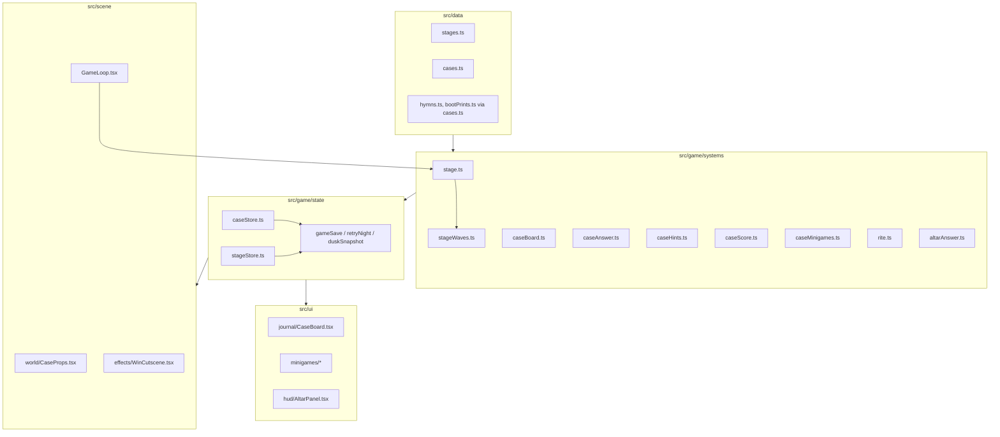
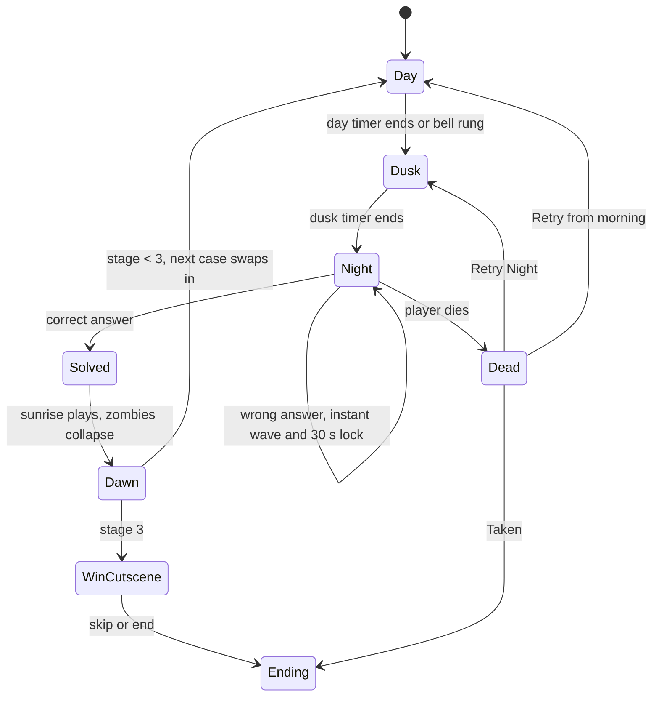

# Design Document

Spec 10: Curse Stages and Cases

## Overview

The five-night loop becomes three Stages. Each Stage is one day, one dusk, one endless night and one dawn, and each is wrapped around a Case: a deduction puzzle made of day Minigames, a cork Case_Board and a Final_Question answered at the chapel altar. A correct answer is the only thing that ends the night.

Design decisions and why:

- **A new `stage` domain sits above `dayNight`.** `tickDayNight` already ends a night when `wavesCleared` is true. Rather than rewrite it, the Stage_System feeds it `wavesCleared = caseSolved` (the field keeps its name to avoid churn in `world` saves), `lastNight = 3`, and a `dayLengthS` per mode. The old `nightNumber` is the Stage number from now on.
- **The wave plan becomes a generator.** `nightPlan(mode, night)` returns a finite array today. A new pure `stageWave(stage, waveIndex)` returns the composition of any wave, so the Wave_Director never reaches `done` in Story modes. `WaveState.plan` stays for Endless Survival.
- **Case rules are pure, answers are data.** Everything a Case knows lives in `src/data/cases.ts`; `case*.ts` systems only compare player input with it. This matches the architecture rules and keeps the "every answer is reachable" test cheap.
- **One overlay shell for all Minigames.** `MinigameShell` gives each puzzle the same cursor release, keyboard model, captions and Esc behaviour, so the seven Minigames are only their own rules and artwork.
- **Cuts are safe by construction.** Name the Dead, E4, 2c, 2a and E9 are leaf features. Case data supplies fallback clues (2a, 2c) so a cut leaves the Case solvable.

Research notes: no new library is needed. Drag for Red_String uses pointer events on an SVG layer; keyboard linking is a small state machine. Cursor release already exists (`useCursorRelease` plus `isMenuOpen()`), and a Minigame only has to count in `isMenuOpen()` through `overlayStore`.

## Architecture



Files by layer (names follow their main export):

| Layer | New or changed | Purpose |
|---|---|---|
| `src/data/` | `stages.ts`, `cases.ts`, `caseText.ts` (closed-case pages), changes to `balance.ts`, `waves.ts`, `clues.ts`, `journal.ts`, `recipes.ts`, `captions.ts`, `relics.ts`, `modes.ts`, `objectiveRules.ts` | Content as typed constants |
| `src/game/systems/` | `stage.ts`, `stageWaves.ts`, `altarAnswer.ts`, `caseBoard.ts`, `caseAnswer.ts`, `caseHints.ts`, `caseScore.ts`, `caseMinigames.ts`, `rite.ts`, `winSequence.ts`, `keeperHunch.ts`, `killCam.ts`, `staminaCap.ts`, `tieredCrafting.ts`, `nameTheDead.ts`; changes to `waves.ts`, `dayNight.ts`, `objective.ts`, `compass.ts`, `scareDirector.ts`, `mystery.ts`, `finalRite.ts`, `stamina.ts`, `crafting.ts` | Pure logic, each with a `*.test.ts` |
| `src/game/state/` | `stageStore.ts`, `caseStore.ts`, `riteStore.ts`; changes to `waveStore.ts`, `worldStore.ts`, `mysteryStore.ts`, `gameSave.ts`, `retryNight.ts`, `resetRun.ts`, `menuState.ts`, `overlayStore.ts` | One store per domain |
| `src/ui/` | `journal/CaseBoard.tsx`, `journal/ClueCard.tsx`, `journal/RedString.tsx`, `journal/ClosedCases.tsx`, `minigames/MinigameShell.tsx` and one file per Minigame, `hud/AltarPanel.tsx`, `hud/CurseMeter.tsx`, `menus/WinCard.tsx` | HTML overlays |
| `src/scene/` | `world/CaseProps.tsx` (bell posts, casts, tiles, hymn board, hasp pin, tablets), `world/AltarRite.tsx`, `effects/WinCutscene.tsx`, `effects/KillCam.tsx`, changes to `GameLoop.tsx`, `FinalRite.tsx`, `FirstPersonController.tsx` | Rendering and input only |
| `src/dev/` | New buttons in `DevPanel.tsx`, actions in `devActions.ts` | Playtest only |
| `src/debug/debugHook.ts` | `stageState()`, `caseState()`, `minigameState()` | e2e reads |
| `e2e/` | One spec per case task, `playthrough.spec.ts` rewritten | Playwright |

### Stage state machine



`Solved` is a sub-phase of night in the store (`stageStore.solvedAt`) so `dayNight` still sees phase `night` until `wavesCleared` flips; this keeps `phaseChanged` and `dawnStarted` events unchanged for the many listeners already wired to them.

## Components and Interfaces

### Pure systems

```ts
// stage.ts
export type StageNumber = 1 | 2 | 3
export interface StageState {
  stage: StageNumber
  caseSolved: boolean
  solvedAtPhaseTime: number | null
  nightElapsed: number
}
export function startStage(stage: StageNumber): StageState
export function markCaseSolved(s: StageState, phaseTime: number): StageState
export function nextStage(s: StageState): StageState | 'win'
export function wavesClearedFor(s: StageState): boolean // = s.caseSolved

// stageWaves.ts
export function stageWaveComposition(stage: StageNumber, waveIndex: number): WaveComposition
export function waveStrength(c: WaveComposition): number // weighted sum: shambler 1, wailer 2, lurker 2, bloater 3, brute 6
export function aliveCap(stage: StageNumber): 12 | 16 | 20
export function nextWaveDelay(sincePrevStartS: number, sinceLastFallS: number | null): number // min(20 - lastFall, 60 - start)
export function addDoubt(c: WaveComposition, doubt: number): WaveComposition // first wave only, capped by caller

// altarAnswer.ts
export interface AltarState { lockedUntil: number; wrong: number; linksAtLastWrong: number }
export type AltarVerdict =
  | { kind: 'solved' }
  | { kind: 'wrong'; state: AltarState; spawnWave: true }
  | { kind: 'locked'; secondsLeft: number }
  | { kind: 'needs-link' }
  | { kind: 'day' }
export function giveAnswer(a: AltarState, now: number, phase: Phase, linksNow: number, correct: boolean, kind: 'case' | 'accusation'): AltarVerdict

// caseBoard.ts
export function linkKey(a: string, b: string): string // sorted pair "a|b"
export function addLink(board: BoardState, caseDef: CaseDef, a: string, b: string): { board: BoardState; note: DeductionNote | null }
export function curseMeter(board: BoardState, caseDef: CaseDef): { value: number; max: number }

// caseAnswer.ts
export function checkFinalAnswer(c: CaseDef, answer: SlotAnswer): boolean
export function checkMinigame(c: CaseDef, id: MinigameId, input: MinigameInput): MinigameVerdict

// caseHints.ts
export function nextHint(h: HintState, coins: number, nightSeconds: number, storyMode: boolean): HintResult
// caseScore.ts
export function applyDoubt(d: DoubtState, nightId: number): DoubtState // capped at 3 a night
export function sharpEye(h: { hintsUsed: number; wrongAnswers: number }): number // 300 or 0
// rite.ts
export function placeRelic(r: RiteState, slot: number, relic: RelicId, order: readonly RelicId[], craneAlive: boolean): RiteResult
```

`caseMinigames.ts` holds one verdict function per Minigame (`ledgerFlags`, `bellPosts`, `hymnTiles`, `evidenceTimeline`, `crestDials`, `watchOrder`, `bootMatch`). They take the player input and the data and return `{ ok, firstWrong? }`.

### Stores

- `stageStore`: `{ stage, caseSolved, solvedAt, nightElapsed, stageStartedAt }`, actions `startStage`, `solveCase`, `advance`.
- `caseStore`: `{ cases: Record<CaseId, CaseProgress>, closed: CaseId[], hints, doubt, altar: AltarState }`; `CaseProgress` holds found clue ids, links, minigame partial and solved flags, filled slots and wrong counts. Actions: `findClue`, `link`, `fillSlot`, `submitMinigame`, `giveAnswer`, `useHint`, `closeCase`.
- `riteStore`: `{ placed: Partial<Record<number, RelicId>>, craneAlive }`.

Each store is composed in `src/game/state/index.ts` like the existing ones, and subscribes to `phaseChanged`, `dawnStarted` and `nightStarted` through the same event bus used by `progressionEvents.ts`.

### UI

- `CaseBoard.tsx` renders `ClueCard` buttons in a CSS grid over a cork background and one SVG layer for `RedString` paths. Pointer drag uses `pointerdown`/`pointermove`/`pointerup` on cards; keyboard uses roving tabindex, `Enter` to select the first card, move focus, `Enter` again to join, `Esc` to cancel. A visually hidden `aria-live` region speaks each Deduction_Note.
- `MinigameShell.tsx` takes `{ title, children, onClose, captions }`. It registers the overlay in `overlayStore` so `isMenuOpen()` is true and Cursor_Release frees the mouse. It traps focus and handles Esc.
- `AltarPanel.tsx` is shown when the player interacts with the altar at night: it lists the Final_Question slots with option buttons and a "Give answer" button, and shows the lock countdown.
- `CurseMeter.tsx` shows "Curse 7 / 10" plus a bar (width and tick marks).

### Scene

`CaseProps.tsx` renders each prop from simple boxes and cylinders, gated by Case progress, using `Interactable` for the examine prompt. Props reuse the placement anchors in `src/data/cemeteryLayout.ts` and are checked by the existing layout tests (`cemeteryLayout.test.ts`, `progressionLayout.test.ts`) which are extended with the new anchors. No new lights are added.

### Dev hooks

New buttons call `skipToStage(n)`, `solveCurrentCase()`, `giveCaseClues()`, `solveCurrentMinigame()` in `devActions.ts`. Each calls the real store actions (`stageStore.advance`, `caseStore.submitMinigame` with the data's right answer). The Real_Input_Test never imports them.

## Data Models

```ts
export type CaseId = 'saved-by-the-bell' | 'resurrection-men' | 'sealed-catacombs'
export type MinigameId = '1a' | '1b' | '2a' | '2b' | '2c' | '3a' | '3b'
export type ClueId = string // kebab-case literal union generated per case in cases.ts

export interface ClueDef {
  id: ClueId
  title: string
  line: string
  icon: RuneId | MarkId
  redHerring: boolean
  found: ClueSourceDef // { kind: 'minigame'; id: MinigameId } | { kind: 'walk'; spot: ZoneId; position } | { kind: 'purchase' } | { kind: 'item'; item: ItemId }
}

export interface DeductionNote { a: ClueId; b: ClueId; text: string }

export interface FinalQuestionDef {
  template: string                 // "The one buried alive lies in {0} because {1}."
  slots: readonly { label: string; options: readonly string[] }[]
  answer: readonly string[]
  optional?: boolean               // the Accusation
}

export interface HintTierDef { cost: 5 | 10 | 20; text: string }

export interface CaseDef {
  id: CaseId
  stage: StageNumber
  title: string
  clues: readonly ClueDef[]        // 6 to 8, at least 2 red herrings
  notes: readonly DeductionNote[]
  minigames: readonly MinigameId[]
  final: FinalQuestionDef
  accusation?: FinalQuestionDef    // case 3 only
  hints: readonly [HintTierDef, HintTierDef, HintTierDef]
  closedPage: readonly string[]    // 3 to 5 sentences
  curseSteps: number               // default 10
}

export interface StageDef {
  stage: StageNumber
  caseId: CaseId
  ladderRows: readonly [number, number] | readonly [number]
  fog: readonly [number, number] | readonly [number]
  aliveCap: 12 | 16 | 20
  maxStamina: 100 | 90 | 80
  dawnUnlocks: readonly RecipeId[]
}

export interface BoardState { found: ReadonlySet<ClueId>; links: ReadonlySet<string>; selected: ClueId | null }
export interface CaseProgress {
  board: BoardState
  minigames: Partial<Record<MinigameId, { solved: boolean; partial: unknown }>>
  slots: readonly (string | null)[]
  wrongAnswers: number
  hintsUsed: 0 | 1 | 2 | 3
  doubt: number
  solved: boolean
  accusation?: { given: boolean; correct: boolean }
}
```

Minigame data (all in `cases.ts`): `ledger: { entries[8]; stones[6]; mismatches[3] }`, `bells: { posts[3]; cutRope; rustedBell; earlyTag }`, `hymnBoard: { numbers: [4,19,2,41,23]; letters: 'BELOW'; index: readonly string[60] }`, `timeline: { cards[6]; order[6]; beats[] }`, `crests: { dials[4]; years[6]; order[4] }`, `watchLog: { entries[8]; order[8]; gap: { start; end; keeper } }`, `bootPrints: { casts[3]; boots[4]; match }`, `rite: { order: RelicId[5] }`.

Save and snapshot fields:

| Where | Fields added |
|---|---|
| `gameSave` (altar save, autosave, Continue) | `stage`, `caseSolved`, the whole `caseStore` data (found, links, minigame partials, slots, wrongAnswers, hintsUsed, doubt, `altar.lockedUntil` as seconds remaining, closed list), `riteStore.placed` |
| Dusk snapshot (Retry Night) | same as above, plus `stageStore` and `caseStore` data in the `SnapshotData` map; Sets are stored as arrays and `pickData` converts on load |
| Morning snapshot (Retry from morning) | the same stores at the start of the day |
| New Game (`resetRun`) | `stageStore` and `caseStore` reset to `startStage(1)` and empty progress |

Per F5 the clues, links and solved Minigames found after the retry point stay found on Retry Night: `restoreRetry` merges `caseStore.found`, `links` and `minigames` as a union of snapshot and current values, then restores everything else from the snapshot. Doubt and wrong-answer counts restore from the snapshot.

Old saves: `migrateSave` maps `nightNumber` 1–5 to Stage 1, 1, 2, 2, 3 and builds a fresh Case state with relics-dependent flags preserved.

## Correctness Properties

*A property is a characteristic or behavior that should hold true across all valid executions of a system-essentially, a formal statement about what the system should do. Properties serve as the bridge between human-readable specifications and machine-verifiable correctness guarantees.*

### Property 1: Waves run exactly while the case is unsolved

For any Stage, any seed and any sequence of ticks in which the case becomes solved at tick k (or never), the Wave_Director produces waves (never reaching `done`) before tick k and produces no spawn from tick k onward.

**Validates: Requirements 2.1, 2.2**

### Property 2: Wave difficulty never decreases within a night

For any Stage and any wave index n, the total enemy count and the strength score of wave n+1 are each greater than or equal to those of wave n, and the composition of wave n+1 contains at least the enemies of wave n for the types that the ladder keeps.

**Validates: Requirements 2.3, 2.4, 2.5**

### Property 3: Alive cap holds

For any Stage, any queue of pending spawns and any live count, the number of zombies the Wave_Director releases never takes the live count above the Stage cap (12, 16 or 20).

**Validates: Requirements 2.6**

### Property 4: Wave pacing

For any time since the previous wave began and any time since its last zombie fell, the delay to the next wave is the smaller of 20 s after the last fall and 60 s after the start, and is never negative.

**Validates: Requirements 2.8**

### Property 5: No zombie and no lurker lunge by day

For any seed and any day-phase tick, the Wave_Director returns no spawn, and for any rolled scare the day resolver never returns `lurker-lunge`.

**Validates: Requirements 1.2, 6.1**

### Property 6: Altar answers obey the lock and the link rule

For any sequence of answers, times and board link counts, a correct case answer outside the lock, outside day and with the link rule satisfied returns solved; a wrong case answer starts a 30 s lock and asks for a wave; any answer inside the lock or on a day returns locked or day; and after 2 wrong answers the next answer is refused until the link count has grown.

**Validates: Requirements 3.1, 3.2, 3.3, 3.4, 3.5, 3.6**

### Property 7: A wrong accusation costs nothing

For any Accusation answer that is not the correct one, `giveAnswer` returns a verdict with no wave request, no lock and no change to the wrong-answer count of the case.

**Validates: Requirements 3.8, 18.4, 18.5**

### Property 8: Clue sets swap per stage

For any Stage and any set of found clue ids, the visible Case_Board cards are the found clues that belong to that Stage's Case, and starting the next Stage hides every clue of the previous Case.

**Validates: Requirements 4.5, 7.3**

### Property 9: Case store round trip

For any valid Case_Store state, serialising to the save format and parsing it back produces an equal state, including Sets, the lock remainder and the closed-case list.

**Validates: Requirements 4.3, 4.6**

### Property 10: Retry keeps knowledge, New Game resets

For any pair of a dusk snapshot and a later current state, Retry Night yields found clues, links and solved Minigames that are the union of both, and restores Doubt and wrong-answer counts from the snapshot; for any state, New Game yields the initial state exactly.

**Validates: Requirements 4.1, 4.4**

### Property 11: Old saves migrate monotonically

For any night number from 1 to 5 in an old save, `migrateSave` returns a Stage from 1 to 3 that never decreases as the night number grows, and the load never throws.

**Validates: Requirements 4.7**

### Property 12: Linking is idempotent and note-correct

For any Case and any two clue ids, `addLink` returns a note exactly when the pair is listed in the Case's notes, linking the same pair twice equals linking it once, and the Curse_Meter value is within 0 to its maximum and never rises as links are added.

**Validates: Requirements 8.5, 8.6, 8.7**

### Property 13: Hint tiers reveal in order

For any sequence of hint requests, coin balances and night times, the revealed tiers are always the prefix 1..k in order, coins never go below zero, a request with too few coins reveals nothing and keeps the coins, and tier 3 is free in Story modes once the night has run 3 minutes.

**Validates: Requirements 9.1, 9.2, 9.3**

### Property 14: Doubt is capped

For any number of wrong day answers in one night, Doubt never exceeds 3, and the extra Shamblers added to the first wave equal the Doubt value.

**Validates: Requirements 9.4, 9.5**

### Property 15: Sharp Eye only for a clean case

For any pair of hints used and wrong answers given, `sharpEye` returns 300 when both are zero and 0 otherwise.

**Validates: Requirements 9.6, 9.9**

### Property 16: Right answers accepted, wrong answers rejected

For any Case and any Final_Question or Accusation, the data's right answer is accepted and every other combination of slot options is rejected. For any Minigame the right input is accepted, any other input is rejected, and for ordering Minigames the reported first-wrong index is the first position that differs from the right order.

**Validates: Requirements 12.2, 12.3, 12.4, 13.4, 14.2, 14.3, 15.2, 15.3, 16.2, 16.4, 18.3, 19.2, 19.3, 20.2, 20.3, 21.2, 21.3, 22.2, 22.3**

### Property 17: Every answer's clues are reachable

For each Case, every clue that the right answer needs has a source in the same Stage: a walk spot inside a reachable zone, a Minigame of that Case, an item obtainable in that Stage, or the first purchase; and each Case has 6 to 8 clues of which at least 2 are red herrings that no right answer needs.

**Validates: Requirements 7.1, 7.2**

### Property 18: Case data is internally consistent

For any Case in `cases.ts`, clue ids are unique, every Deduction_Note references two existing clues, and every Final_Question answer is among its slot's options.

**Validates: Requirements 7.4, 7.6**

### Property 19: The rite completes only in order and with Crane fallen

For any sequence of relic placements, the Rite completes if and only if all 5 relics are placed in the data's order and Father Crane is not alive; a relic placed in a wrong slot is returned to the satchel and never counts.

**Validates: Requirements 17.3, 17.4, 17.5, 17.6**

### Property 20: Keeper's hunch

For any timeline of clue discoveries, the hunch is active exactly when 120 s of day play have passed since the last discovery and an unfound clue exists, and its target is the nearest unfound clue.

**Validates: Requirements 24.1**

### Property 21: Kill-cam cooldown and intensity

For any sequence of grab attempts and any intensity, two Kill_Cam starts are at least 60 s apart, intensity Off never pulls the camera, and no grab is the only cause of a lethal hit.

**Validates: Requirements 25.1, 25.2, 25.5, 25.7**

### Property 22: Stamina never exceeds a cap that never rises

For any sequence of ticks, sprint inputs, difficulties and Stage changes, stamina is never above the current cap, and the cap for Stage n+1 is less than or equal to the cap for Stage n.

**Validates: Requirements 26.1, 26.3, 26.4**

### Property 23: Tier damage and cost rise together

For any two crafting tiers a < b, the minimum weapon damage of tier b is at least that of tier a and the minimum total material cost of tier b is at least that of tier a.

**Validates: Requirements 27.3**

### Property 24: Name the Dead hold

For any hold duration, damage event time and name, the grave is sealed iff the hold lasted 3 s without damage and the name is in the Case's evidence.

**Validates: Requirements 28.2, 28.3, 28.4**

### Property 25: The journal pauses only by day

For any phase and any journal-open flag, the simulation is paused iff the phase is day and the journal is open.

**Validates: Requirements 10.1, 10.2**

### Property 26: Objective follows the rule table

For any game facts, the Objective_Tracker line is the first matching rule: at night with an unsolved case it is the curse line with the Curse_Meter, by day it is the first unsolved Minigame or missing key of the current Case, and with all Minigames solved it is "Solve the case".

**Validates: Requirements 6.4, 6.5, 6.6**

## Error Handling

- **Unknown or stale ids in a save:** `caseStore` load drops clue ids and links that are not in the current Case data, logs once with `console.warn` in dev only, and continues.
- **Altar answer in a wrong state:** `giveAnswer` is total; every phase and lock combination maps to a verdict, so the UI never has to guess.
- **Insufficient coins:** hint purchase returns `{ ok: false, reason: 'coins' }`; the UI shows the price and keeps the button enabled for the keyboard, with text "Need 10 coins".
- **Pointer lock loss during a Minigame:** all overlays count in `isMenuOpen()`, so Cursor_Release is the only place that handles lock; a failed relock waits for the next gesture as it does today.
- **Missing geometry for a prop:** props fall back to the box placeholder and the layout test fails in CI rather than the game failing at runtime.
- **Cut features:** `cases.ts` keeps fallback clues for 2a and 2c; with the Minigame absent the clue has `found: { kind: 'walk' }`. A data test runs both configurations.
- **Death at night:** a wrong answer never kills (the wave is a pressure spike); Kill_Cam damage can be lethal only through the normal hit rules, never by the camera itself.
- **Win flow interrupted by Esc:** pause freezes the cutscene clock; skip is accepted again after resume.
- **Storage failure:** snapshots reuse `saveSnapshot` and `loadSnapshot`, which already return false or null; Retry then falls back to the existing fallback path.

## Testing Strategy

Property-based testing applies: most of the work is pure rules over a large input space (waves, answers, hints, links, saves). It does not apply to the overlays, the scene props, the cutscene or the camera, which use example tests and Playwright.

**Unit tests (vitest), next to their files:** one `*.test.ts` per system and store (`stage.test.ts`, `stageWaves.test.ts`, `altarAnswer.test.ts`, `caseBoard.test.ts`, `caseAnswer.test.ts`, `caseHints.test.ts`, `caseScore.test.ts`, `caseMinigames.test.ts`, `rite.test.ts`, `keeperHunch.test.ts`, `killCam.test.ts`, `staminaCap.test.ts`, `tieredCrafting.test.ts`, `nameTheDead.test.ts`, `caseStore.test.ts`, `stageStore.test.ts`), plus data tests (`cases.test.ts`, `stages.test.ts`) and layout tests for the new anchors. Specific examples: BELOW from the hymn index, the Case 1 right answer, the 30 s lock timing, the Win_Cutscene total length.

**Property tests (fast-check with vitest):** each of Properties 1 to 26 is a single property test with at least 100 runs, tagged in a comment as `Feature: 10-curse-stages, Property N: <title>`. Generators build random `StageNumber`, wave indexes, tick lists, answer sequences, `CaseProgress`, link pairs and sequences of Altar events. Seeds go through the existing `rng.ts`.

**Playwright (e2e/):**
- One spec per case task (`stage-loop.spec.ts`, `case-board.spec.ts`, `case1.spec.ts`, `case3.spec.ts`, `case2.spec.ts`, `win-cutscene.spec.ts`, `help.spec.ts`, `killcam.spec.ts`, ...). Every Minigame test uses `page.mouse` and `page.keyboard` only, plus a keyboard-only variant that never touches the mouse.
- Dev actions are allowed to set up (for example to start at Stage 3 with the right items) in all specs except `playthrough.spec.ts`.
- Screenshot_Pairs at 1280x720 and 800x600 are saved by each Minigame spec to `e2e/screenshots/` (names `<minigame>-1280x720.png`, `<minigame>-800x600.png`).
- Milestone runs of the full e2e suite after Stage 1 and after Stage 3.
- Playwright uses the GPU by default (spec 09 part 0); only specs that measure frame time run with one worker.

**Per-task finish:** lint, build, the full unit suite and the task's own e2e specs green, a `docs/kiro-log.md` entry, then a local commit `<what changed> (spec 10 task N)`. No push.

## Decisions made unattended

1. **Stage replaces night in `dayNight`:** I kept `tickDayNight` and its `wavesCleared` field and fed it the case-solved flag, rather than rewriting the cycle. This is the smallest change that keeps every `phaseChanged`/`dawnStarted` listener working.
2. **Wrong accusation in Stage 3:** the bible says a wrong Accusation does not lock the altar; I made the rule explicit (no wave, no lock, no wrong-answer count) and tested it as Property 7.
3. **Altar answer in day:** the bible says the answer can only be given at the altar and the altar works at night; I made day attempts show a prompt and accept nothing.
4. **Hint prices and free tier 3:** used 5 / 10 / 20 coins and "free after 3 minutes of night" in all Story modes, from the bible.
5. **Curse meter:** 10 steps per Case, lowered by every link the Case marks as a deduction note (bible default).
6. **Cuttable Minigames:** if 2a is cut, the whistle stays where it is now and the sexton's ledger becomes a found item; if 2c is cut, the boots clue becomes a found item. Both fallbacks are in the data so a cut never breaks the Case.
7. **Minigame shell location:** built in the Stage 1 task (first user) and reused by later Minigames, not in the Case-board task.
8. **Altar answer UI in the Case-board task, verdict stub in the stage-loop task:** E1 implements the lock, wave and link logic with an injected verdict so it can ship before the Case data exists; the board task wires the real check.
9. **Short Vigil start oil:** 100% as in spec 09 B10; no other Short Vigil difference.
10. **Name the Dead names:** the names come from each Case's evidence list (the stone names and watchmen), so no new content file is needed.
11. **Retry merge rule:** found clues, links and solved Minigames are unioned on Retry Night (per F5 "death keeps knowledge"); Doubt and wrong-answer counts come from the snapshot so a retry does not carry penalties forward.
12. **Uneasy Peace ending:** retired in the data and tests; old saves that stored it map to Rest or Taken by relic count at load.
13. **Spec 09 follow-ups:** task 3 is annotated, not edited, so its history stays intact.
14. **Property numbering:** reflection merged "waves never stop before" and "always stop after" into Property 1 and the right/wrong checks of all Minigames into Property 16.
