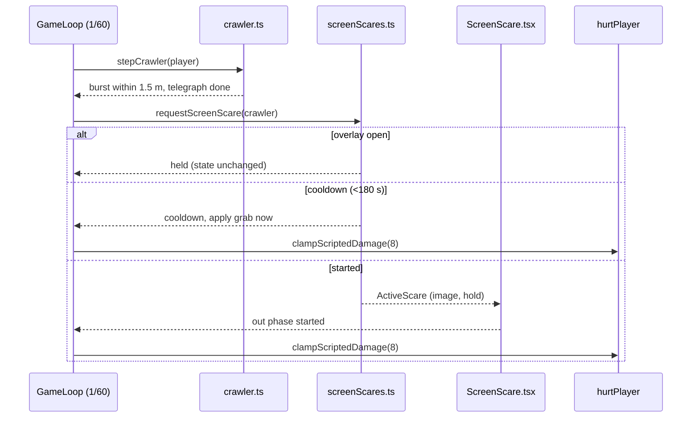

# Design Document: 11-horror-pass

## Overview

Spec 11 makes Last Rites scarier and easier to read. It adds seven features, each tied to a requirement in `requirements.md`:

| Id | Feature | Requirement | Cut priority (1 = last to cut) |
|---|---|---|---|
| H6 | Hut vending machine | 6 | 1 |
| H1 | Screen jumpscares | 1 | 2 |
| H4 | Bats that watch you | 4 | 3 |
| H5 | Info dots | 5 | 4 |
| H7 | Hands and realistic lantern light | 7 | 5 |
| H2, H3 | New creatures and zombie looks | 2, 3 | 6 (depend on Claude's models) |
| 8 | Design bible §12 and cross-cutting rules | 8 | never cut |

The design follows the project steering. Every rule is pure TypeScript in `src/game/systems/` with a test file beside it. Every tunable number sits in `src/data/` and mirrors §12 of the design bible. R3F components in `src/scene/` and overlays in `src/ui/` read stores and call the pure functions; they hold no rules.

Art (models, rigs, face images, lantern cookie) comes from Claude in Blender at fixed paths. Where a file is missing, the code runs against a marked placeholder and records the missing path in a central **Waiting_List** registry (see Placeholder-asset strategy).

### Research findings that shape the design

- **Existing settings.** `src/game/systems/settings.ts` already owns `scareIntensity` (`full | reduced | off`), `flashingLights`, `cameraShake`, `lowGraphics`, `plainJournalFont` and `showControlHints`. The new `jumpscares` setting is a separate field. `scareIntensity` governs the existing scare director events (spec 04). `jumpscares` governs only the new full-screen faces. This keeps old saves and old tests valid, and lets a player turn off faces but keep the quieter alley scares.
- **Existing timed effects.** `EffectId` in `src/game/types.ts` is `'blessed-rounds' | 'adrenaline' | 'salt-circle'` and `src/game/systems/effects.ts` refreshes rather than stacks. Brisk Draught (R6.12) becomes a fourth id, `'brisk-draught'`, so non-stacking comes for free.
- **Existing scare director.** `scareDirector.ts`, `scareSilence.ts` and `scareStaging.ts` already implement telegraph, 45 s major cooldown and overlay gating. Screen scares reuse the overlay-gating predicate and the telegraph helper; they add their own 180 s cooldown on top (a screen scare is a major scare, so the 45 s gap also applies).
- **Existing enemies.** `src/data/enemies.ts` has `EnemyId`, `ENEMY_MAP`, `ENEMY_LOOKS` (keyed by `EnemyId`, so adding ids forces every consumer to handle them at compile time). `WaveEnemyId` excludes `father-crane`; it will also exclude `bride` (R2.6).
- **Existing economy.** `coins.ts` and `merchant.ts` hold the Grave_Coins counter and Silas's stock rules. The vending machine reuses `coins.ts` for spending and `satchel.ts` / `inventory.ts` for fit checks, so the non-negative-coins invariant is enforced in one place.
- **Library APIs to confirm with context7 before coding** (steering rule `mcp-usage`): `@react-three/drei` `useGLTF`, `useAnimations`, `Instances`; `@react-three/fiber` `useFrame`; three.js `SpotLight.map` (cookie) and `SpotLight.shadow.mapSize`; `@react-three/postprocessing` `SelectiveBloom` (or bloom with `Selection`/`Select`) for flame-and-glass-only bloom; `howler` `pos()` and `ctx` routing for ducking; `fast-check` `fc.assert` / `fc.property`. The design names these APIs only as intent; the implementing tasks look up the current signatures.

## Architecture

### Layering

```mermaid
flowchart LR
  subgraph data [src/data]
    D1[screenScares.ts]
    D2[enemies.ts + creatures.ts]
    D3[bats.ts]
    D4[infoTips.ts]
    D5[vending.ts]
    D6[lanternLight.ts]
    D7[placeholders.ts]
    D8[assets.ts]
  end
  subgraph game [src/game - pure TS]
    S1[systems/screenScares.ts]
    S2[systems/crawler.ts, bride.ts, hounds.ts, creatureTells.ts]
    S3[systems/bats.ts]
    S4[systems/infoTips.ts]
    S5[systems/vending.ts]
    S6[systems/lanternFlicker.ts, gripClass.ts, lanternHand.ts]
    S7[systems/waitingList.ts]
    ST[state/ stores]
  end
  subgraph scene [src/scene - R3F]
    C1[effects/ScreenScareFx.tsx]
    C2[enemies/Crawler, Bride, Hound]
    C3[world/Bats.tsx, BelfryFlock.tsx]
    C4[world/VendingMachine.tsx]
    C5[player/Viewmodel, Lantern]
  end
  subgraph ui [src/ui]
    U1[hud/ScreenScare.tsx]
    U2[theme/InfoDot.tsx]
    U3[journal/Bestiary.tsx]
    U4[menus/VendingPanel.tsx]
  end
  data --> game
  game --> scene
  game --> ui
  data --> scene
  data --> ui
  GL[scene/GameLoop.tsx fixed dt 1/60] --> game
```



Dependencies point one way: `data` → `game` → `scene`/`ui`. `src/game/` imports no React, three.js or Howler, so all of it runs under vitest in Node. Dev tooling (forced screen scares, spawn crawler, set coins) lives in `src/dev/` and goes through the real stores.

### Fixed-timestep integration

All new simulation runs inside the existing single loop in `src/scene/GameLoop.tsx` at `dt = 1/60`. New systems expose `stepX(state, input, dt): state` functions. `GameLoop` calls them in this order after the existing enemy and scare steps, so a trigger fired this tick sees this tick's positions:

1. `stepCreatures` (crawler ambush, bride, hounds)
2. `stepBats`
3. `stepScreenScares` (consumes trigger requests queued by steps 1, scripted moments and dev)
4. `stepLanternFlicker` (render-rate sample; the signal is a pure function of sim time, so it also interpolates)

Visual-only parts (face animation, bat wing flap, flame mesh scale) run in `useFrame` from the pure functions' output and the interpolated sim time.

### File placement (per `structure` steering)

| Concern | Data (`src/data/`) | Pure rules (`src/game/systems/`, each with `*.test.ts`) | Scene / UI |
|---|---|---|---|
| H1 screen scares | `screenScares.ts` | `screenScares.ts` | `src/ui/hud/ScreenScare.tsx`, `src/scene/effects/ScreenScareFx.tsx` (dim, shake, chromatic split via post-processing), `src/audio/screenScareAudio.ts` |
| H2 creatures | `enemies.ts` (extended), `creatures.ts` (tuning), `bestiary.ts` | `crawler.ts`, `bride.ts`, `hounds.ts`, `creatureTells.ts`, `bestiary.ts`, `hurtGuard.ts` | `src/scene/enemies/Crawler.tsx`, `Bride.tsx`, `Hound.tsx`; `src/ui/journal/Bestiary.tsx` |
| H3 looks | `enemies.ts` (`ENEMY_LOOKS`), `assets.ts` | `lookVariant.ts` | `src/scene/enemies/EnemyModels.tsx` (variant visibility, tint) |
| H4 bats | `bats.ts` | `bats.ts` (state machine), `batPerches.ts` | `src/scene/world/Bats.tsx`, `BelfryFlock.tsx` |
| H5 info dots | `infoTips.ts` | `infoTips.ts` (sentence counter, lookup) | `src/ui/theme/InfoDot.tsx`, hooks in journal and HUD panels |
| H6 vending | `vending.ts` | `vending.ts` | `src/scene/world/VendingMachine.tsx`, `src/ui/menus/VendingPanel.tsx` |
| H7 hands and light | `lanternLight.ts` | `gripClass.ts`, `lanternHand.ts`, `lanternFlicker.ts` | `src/scene/player/Viewmodel.tsx` (extended), `Lantern.tsx` (extended) |
| Placeholders | `placeholders.ts` | `waitingList.ts` | `src/scene/assets/PlaceholderMesh.tsx` |
| Settings | — | `settings.ts` (extended) | `src/ui/menus/Settings.tsx` (extended) |

Existing files extended rather than duplicated: `src/data/assets.ts` (all new paths), `src/data/captions.ts` (every new sound), `src/data/sounds.ts`, `src/data/effects.ts` (brisk-draught), `src/data/items.ts` (`brisk-draught`), `src/data/waves.ts` and `src/data/elites.ts`, `src/game/types.ts`, `src/game/systems/interaction.ts` (overlay gating predicate reuse).

### Settings additions

Two new fields on `Settings` (`src/game/types.ts`), validated and clamped by `settings.ts`:

| Field | Type | Default | Storage |
|---|---|---|---|
| `jumpscares` | `'full' \| 'reduced' \| 'off'` | `'full'` | `last-rites-settings` |
| `showInfoDots` | `boolean` | `true` | `last-rites-settings` |

- `SCARE_INTENSITIES` is reused for `jumpscares` validation. An unknown or missing stored value loads as `'full'`, so old saves migrate silently.
- `showInfoDots` is added to `BOOLEAN_KEYS`.
- The Settings menu gets a "Jumpscares" three-way control (placed next to Scare intensity, same widget, keyboard-operable with visible focus) and a "Show info dots" toggle.
- Effective-effects resolution is one pure function, `resolveScareFx(jumpscares, flashingLights, cameraShake, prefersReducedMotion)` in `systems/screenScares.ts`. It is the single place that decides flash, shake, chromatic split, dim, sting gain and subtitle-only mode, so Requirements 1.12 to 1.15 and 8.4 to 8.7 cannot drift apart.

### H1: Screen jumpscares (Requirement 1)

**Pure system** (`systems/screenScares.ts`):

- `ScreenScareState = { lastStartSim: number | null; used: ReadonlySet<ScriptedMomentId>; lastImage: Record<ScareSet, ImageId | null>; active: ActiveScare | null }`.
- `requestScreenScare(state, req, ctx): { state; outcome }` where `req = { kind: 'crawler' | 'bride' | 'scripted'; momentId?; simTime }` and `ctx = { overlayOpen; settings; rng }`. Outcomes: `started | held | cooldown`.
  - `overlayOpen` → `held`. State is unchanged: no cooldown started, no moment marked used (R1.10).
  - `simTime - lastStartSim < 180` → `cooldown`. State unchanged, so a scripted moment stays unused (R1.9).
  - Otherwise pick an image, choose a hold duration, set `lastStartSim`, mark a scripted moment used, return `started`.
- `pickImage(set, last, rng)` draws from `SCREEN_SCARE_IMAGES[set]` excluding `last` (R1.16). Each set has at least 2 images, which the data test enforces.
- `holdDuration(rng)` returns a value in [550, 800] ms.
- `scareTimeline(hold): { inMs: 70; holdMs; outMs: 250 }` and `phaseAt(timeline, tMs): 'in' | 'hold' | 'out' | 'done'` plus `progress`. Shake amplitude `shakeAt(tHold, hold) = A * (1 - tHold/hold)` decays to 0 at the end of the hold (R1.3). Scale jitter is `1 + 0.04 * noise01(t)` bounded to [1.00, 1.04].
- `telegraphLeadMs(rng)` returns 500 to 1500 (R1.18). The trigger systems start the telegraph first and call `requestScreenScare` when the lead elapses.

**Triggers** are queued by gameplay systems, never by the overlay:

| Trigger | Source | Notes |
|---|---|---|
| Crawler burst within 1.5 m in front | `crawler.ts` | zombie face; grab damage applied after out phase starts (R1.6) |
| Bride reaches player | `bride.ts` | ghost face from top; oil drain applied after in phase ends (R1.7) |
| Coffin night 2, hut west window night 3, ossuary grille first look | `data/screenScares.ts` `SCRIPTED_MOMENTS` with a trigger volume or interaction id | once per save, state kept in the progression save |

Gameplay effects that follow a scare are queued as **deferred effects** with a release time (`afterOutStart`, `afterInEnd`). If the scare is skipped by cooldown, the effect applies at once (R1.9 says the gameplay effect stays unchanged). If the setting is Off, there is no image but the same deferral timing is kept, so gameplay is identical at every setting (R8.5).

**Presentation**:

- `ScreenScare.tsx` (HUD layer above everything else, `pointer-events: none`) renders the `` with `height: 85vh`, anchored `bottom: 0` for zombie faces and `top: 0` for ghost faces. The in phase uses a linear 70 ms transform with no easing; the out phase slides off the anchored edge and fades opacity from 1 to 0 over 250 ms.
- The chromatic split is a CSS duplicate-layer technique (two offset copies with `mix-blend-mode`) on the image only, so it does not need a render pass.
- World dim to 30% is a uniform on the existing post-processing stack (`scene/effects/`), ramped for the hold. Camera shake feeds the existing camera-shake channel, so Camera shake and reduced-motion already gate it, and `resolveScareFx` also zeroes it.
- White flash is one frame: a full-screen div with `opacity: 1` mounted for exactly one `requestAnimationFrame`, and removed in the next one. Only when `fx.flash` is true.
- Audio: `audio/screenScareAudio.ts` plays three layers (attack, thud, scream or wail) through Howler, and ducks the master bus by 70% for the hold, restoring within 250 ms (R1.5). Reduced plays at 50% gain. Missing sound files fall back to procedural Web Audio on `Howler.ctx` (steering rule), flagged as placeholders.
- Subtitle: one caption for the whole span from in start to out end (R1.17). With Jumpscares Off, a 3 s descriptive caption (R1.13).
- Pause: the overlay timer uses sim time from the store, so pausing halts it (R8.11). The audio layer pauses via the existing pause hook.
- Missing image: `ScreenScareFace` asks `waitingList.resolveAsset(path)`. On failure it shows a labelled placeholder (a flat silhouette card reading "PLACEHOLDER face-zombie-1"), registers the path once and finishes with the same timing and sting (R1.20). The placeholder is a plain labelled rectangle; it is never final art (R8.16).

### H2: New creatures (Requirement 2)

**Data**: `enemies.ts` gains `'crawler' | 'bride' | 'hound'` in `EnemyId`. `WaveEnemyId` becomes `Exclude<EnemyId, 'father-crane' | 'bride'>`, so the bride cannot enter wave tables or elites at compile time (R2.6). `ENEMY_MAP` rows use the numbers in R2.1. `ENEMY_LOOKS` gets 4 variants per new id (R3.7). `src/data/creatures.ts` holds traits as typed constants: crawler (`burstRange 2`, `faceRange 1.5`, `grabCooldown 1.5`, `tell 0.5..1.5`), bride (`revealRadius 3`, `drainPoints 20`, `respawn 30..60`, `lanternDimNear 8`, `lanternDim 0.3`), hound (`packSize 2..3`, `circle 4..6`, `dartDamage 10`, `dartGap 2`, `scatterRadius 15`, `scatterDuration 4`). Each value is mirrored in §12.

**Pure systems**:

- `crawler.ts`
  - `pickCrawlerSpots(spots, seed, count)` returns `min(count, spots.length)` distinct spots with `count ∈ [3, 6]` (R2.2).
  - `stepCrawler(c, player, dt)`: hidden until `dist <= 2`, then `burst`. A grab applies at most once per 1.5 s.
  - `crawlerHit(attack)`: horizontal melee → 0 damage "miss"; downward melee, bullet, trap fire → normal damage (R2.4, R2.5). The attack kind comes from `combat.ts` (`'melee-horizontal' | 'melee-down' | 'bullet' | 'fire' | ...`).
  - `faceTriggerApplies(c, player)`: burst within 1.5 m and in front (dot with player forward > 0).
- `bride.ts`
  - `brideVisible(b, player, lanternOn, coneContains)`: visible iff in the cone or within 3 m (R2.7). Invisible bride still moves.
  - `brideTouch(b, fuel, rng)`: fuel after = `max(0, fuel - 20)`, bride vanishes, next return in [30, 60] s (R2.8; see Decisions on 20% meaning).
  - `brideCanSpawn(world)`: stage ≥ 2 and no living bride (R2.6).
  - `brideMoveBlocked(from, to, colliders, salt)`: blocks at chapel and hut walls and salt circles; ignores fences and gravestones (R2.9). Colliders are tagged by kind in the existing collider data (`wall` vs `prop`); the test uses fixture colliders.
  - `brideDamage(source, amount)`: `lead` → 0 plus a `no-effect` cue flag; `holy-water | silver-sabre | blessed-rounds` → normal (R2.10, R2.11).
  - `lanternBend(distance, flashing)`: returns `{ dim: 0.7 | 1, bend }` with a slew rate cap when flashing is off (at least 1 s fade, R2.16).
- `hounds.ts`
  - `stepPack(pack, player, events, dt)`: circle at 4 to 6 m; picks one dart at a time with at least 2 s between darts; `scatter` event (lantern flare, gunshot within 15 m) sets `scatterUntil = t + 4`, during which hounds move away and `canDealDamage = false` (R2.12, R2.13).
- `creatureTells.ts`: `tellLead(creature, rng)` ∈ [0.5, 1.5] s, and the sound and caption ids for each tell (R2.14, R2.15). Every sound id in `CREATURE_SOUNDS` must exist in `captions.ts` (tested).
- `hurtGuard.ts`: `clampScriptedDamage(hp, hpAtEventStart, dmg)` returns `max(1, hp - dmg)` when `hpAtEventStart > 1`, else normal (R2.20). All new creature damage and scripted events go through the existing `hurtPlayer` via this guard.
- `bestiary.ts`: `seenCreatures(seen)`, `bestiaryEntry(id, seen)` returns `null` for unseen, so the UI cannot leak names or sketches (R2.18). `markSeen(state, id, playerPos, creaturePos, inCone)` when within 10 m or in cone. The seen set is saved with the run (`progressionSave.ts`).
- Wave integration: `data/waves.ts` adds `crawler` (from stage 1 night mapped to "night 2" semantics, i.e. from wave 1 of stage 2's first row per the ladder) and `hound` (stage 2 onward) to ladder rows. Ladder row sizes are only increased, so `waves.test.ts` monotonicity and the alive caps keep passing (R2.17). Crawlers are mostly placed by `crawler.ts`, not by waves; the wave table lists them only as optional extras.

**Scene**: `Crawler.tsx`, `Bride.tsx` and `Hound.tsx` follow the existing zombie component pattern (skinned mesh, clip crossfade). The bride has no collider with props; her visibility is a material opacity driven by `brideVisible`. If a model is missing, `EnemyModels` uses `zombie.glb` scaled and tinted (placeholders table) and registers the path (R2.19).

### H3: Zombie looks (Requirement 3)

- `lookVariant.ts`: `lookIndex(uid: string): 0 | 1 | 2 | 3` uses a stable string hash (FNV-1a 32-bit) modulo 4 (R3.4). No `Math.random`.
- `EnemyModels.tsx` shows `look-N` and hides the other three; where the variant is missing it shows the base mesh only (R3.6). A tint applies only when `ENEMY_LOOKS[id].variants[n].tint` is defined (R3.5), and never overrides file materials otherwise (R3.9).
- Clip fallback: `resolveClip(requested, available)` returns the requested clip or `Idle`, and logs one warning per `(model, clip)` pair (R3.3). A load failure falls back to the base `zombie.glb`.
- All model paths live in `src/data/assets.ts`. A test greps `src/` for `.glb` literals outside `assets.ts` and `*.test.ts` files (R3.1).

### H4: Bats (Requirement 4)

**Pure system** (`systems/bats.ts`, `systems/batPerches.ts`):

- `qualifyingBoxes(boxes)`: boxes with height in [0.6, 1.6] (inclusive).
- `choosePerches(boxes, seed, occupied)`: picks `min(n, qualifying)` distinct boxes with `n ∈ [8, 12]` (R4.1, R4.2). Positions are the top-face centre of the chosen box.
- State machine: `perched → fleeing → gone → perched`.
  - `perched → fleeing` when player distance < 3 m, or a gunshot occurs within 10 m (R4.7).
  - `fleeing → gone` after 6 s of flight; fade opacity reaches 0 within 1 s after (R4.8).
  - `gone → perched` after 120 s from removal, at a different, unoccupied qualifying box (R4.9).
- `headYaw(rest, bearing, current, dist, dt)`: target is the bearing to the player, clamped to ±120° from `rest` while `dist <= 14`, else `rest`. Exponential ease with time constant τ ∈ [0.3, 0.6] s (default 0.45), which gives return to rest within 2 s (R4.3, R4.4: 5τ = 2.25 s, so the constant is set to 0.4 s, 5τ = 2 s).
- `chitterAllowed(lastChitter, now)`: true only if at least 20 s have passed since the last, and at least one bat is perched (R4.6).
- `batEvents` never touches player health or the screen scare system (R4.11). A test asserts `bats.ts` imports neither `playerHealth` nor `screenScares`.

**Scene**: `Bats.tsx` loads `props/bat-perched.glb` and `props/bat-flying.glb` (swap on the same frame, R4.7), turns `head` and `eyes` on Y, flaps `wing-left` and `wing-right` pivots at 8 flaps/s (angle `A * sin(2π * 8 * t)`). Eyes use an emissive material; no `pointLight` is created. `BelfryFlock.tsx` (optional) uses `InstancedMesh` with 15 to 20 instances and wing flap in the vertex shader (a single `uTime` uniform), runs for at most 10 s, and is gated by a runtime frame-time guard: if the rolling 60-frame average exceeds 22 ms (below 45 fps), the flock is skipped (R4.12). With Flashing lights off the eyes are steady emissive. The flock applies no camera shake (R4.13).

### H5: Info dots (Requirement 5)

- `data/infoTips.ts`: `INFO_TIP_KEYS` (a `const` tuple) and `INFO_TIPS: Record<InfoTipKey, string>`. Keys: journal sections (`journal-clues`, `journal-case`, `journal-recipes`, `journal-map`, `journal-relics`, `journal-creatures`, plus any other section present in the journal's tab list; the test derives the list from the journal tab data, so a new tab without a tip fails) and HUD panels (`hud-case-board`, `hud-clues`, `hud-curse`, `hud-hints`, `hud-map`, `hud-recipes`, `hud-satchel`, `hud-relics`, `hud-oil`, `hud-stamina`, `hud-bestiary`, `hud-coins`).
- `systems/infoTips.ts`: `countSentences(text)` (splits on `.`, `!`, `?` followed by space or end, ignoring decimals and abbreviations in a small allow list) and `tipFor(key)`.
- `InfoDot.tsx` (`src/ui/theme/`): a `<button type="button" aria-describedby={tipId} aria-label="More info: …">` rendering a circled "i", with a tooltip element (`role="tooltip"`) shown within one frame on hover, focus, or tap and closed on pointer leave, blur or outside tap. A key handler on the dot captures Escape only while the tooltip is open: `stopPropagation()` and `preventDefault()` on that event, so the pause handler does not see it (R5.4). With no tooltip open, Escape propagates unchanged (R5.5). The pause handler in `menuState` listens on `keydown` in the bubble phase; the dot's handler runs first on the target. If an existing handler uses capture on `window`, the task changes it to check a `tooltipOpen` flag in a tiny store `infoDotState` instead. The implementing task confirms which case applies.
- When `settings.showInfoDots` is false, the component returns `null`, so it is not in the DOM or the Tab order (R5.9).
- Layout: the tooltip is positioned with a clamp function `placeTooltip(anchorRect, tipSize, viewport, avoidRects)` (pure, in `systems/infoTips.ts`) that keeps it inside the viewport and away from the health bar, oil gauge and hint panel rects (R5.10). Browser checks cover 800x600 with the plain font.
- Tip texts are written from code behaviour. The draft in `docs/kiro-prompt-next.md` is checked line by line during the data task; see Decisions for likely corrections (for example, the hint cost and the map key must be confirmed against `caseHints.ts` and `data/controls.ts`).

### H6: Vending machine (Requirement 6)

**Data** (`data/vending.ts`):

```ts
export type VendingRowId = 'revolver-cartridge' | 'shotgun-shell' | 'lamp-oil' | 'kola-tonic' | 'brisk-draught' | 'bandage'
export interface VendingRow { id: VendingRowId; item: ItemId; qty: number; price: number; perDay: number; requiresWeapon?: 'revolver' | 'shotgun'; handle: 0|1|2|3|4; blurb: string }
export const VENDING_ROWS: readonly VendingRow[]  // exactly the table in R6.3
export const VENDING_FORBIDDEN: readonly string[] // relics, key items, journal pages, recipes, clues, holy-water, silver-filings
```

Bandage shares handle 2 with Lamp Oil (kept from the prompt: "shares row 2's handle visually"; Lamp Oil is row 2).

**Pure system** (`systems/vending.ts`):

- `VendingState = { stockLeft: Record<VendingRowId, number> }`; `freshStock()`; `resetAtDawn(state)`.
- `visibleRows(owned: { revolver; shotgun })` hides weapon rows (R6.5), using the same `ownsGun` predicate as `elites.ts` (extracted to a shared helper if it is not already exported).
- `canBuy(row, state, coins, satchel): { ok: true } | { ok: false; reason: 'sold-out' | 'coins' | 'full'; shortfall?: number }` with refusal text built from the reason (R6.8 to R6.10).
- `buy(row, state, coins, satchel): { state; coins; satchel; result }`. On success: `coins - price`, `stock - 1`, goods added; on refusal everything returned unchanged. `coins` never goes below 0 (R6.13).
- `purchaseAnimation(tMs)`: handle offset 0.05 m (±0.01) out and back within 1.2 s, as a pure curve (out 0.25 s, hold, spring back), returned for the component to apply.
- The purchase does not touch simulation pause, invulnerability or the panel's Esc handling (R6.7). `VendingPanel` registers as an overlay that does not pause (like the journal at night), so `isOverlayOpen` still stops player input, while Esc still reaches pause.

**Scene and UI**: `VendingMachine.tsx` loads `props/vending-machine.glb` at (2.83, 0, 1.85), rotationY −π/2, with `handle-0..4` anchors, an emissive marquee, and an optional `marquee-light` (a shadowless warm `pointLight`) enabled only when the live shadow-light count and frame time allow. Colliders are added to `hut.json` and the machine's own JSON. `VendingPanel.tsx` reuses the merchant panel styles and shows each row's name, price, "N left", one-sentence blurb, "Sold out" card and refusal reason text. The Brisk Draught item (`items/brisk-draught.glb`, a bottle placeholder until delivered) adds effect `brisk-draught` (+25% move speed, 60 s) to `data/effects.ts`; `movement.ts` multiplies speed by `1.25` while it is active, composed with Adrenaline by taking the larger multiplier, not the product, unless a design decision says otherwise (see Decisions).

### H7: Hands and lantern light (Requirement 7)

**Pure systems**:

- `gripClass.ts`: `gripFor(weaponId): 'pistol' | 'haft' | 'long'` total over all weapon ids with a compile-time exhaustiveness check (revolver → pistol; shotgun → long; shovels, axe, club, sabre → haft) (R7.2). `GRIP_BLEND_S = 0.3`.
- `lanternHand.ts`: a small state machine for the left hand: `held | belt | strap`. Transitions: shotgun equipped → `belt` (within 0.5 s back to `held` on switching away); throw or heavy swing released → `strap`, and catch back to `held` within 0.6 s of the swing or throw end (R7.4, R7.6). The caption "Lantern hooked to your belt" is requested once per run via a saved flag; New Game clears it, Continue, Retry Night and Retry from morning keep it (R7.5). `lanternAnchor(state)` returns `'glass' | 'belt'` so the light origin follows (R7.8). While on `strap`, the light stays on and follows the lantern.
- `lanternFlicker.ts`: `flickerSignal(t, params): number` is a layered noise: slow breathing (0.2 to 0.5 Hz), gutters (4 to 12 Hz) and occasional dips up to −25%. It is a pure function of `t` and a seed (value noise built from a hash, no `Math.random`), so tests can sample it. Output is a multiplier `m` with `m ∈ [0.75 * lo, hi]` bounds listed in the data (below). `params` is derived by `flickerParams({ oil, sprinting, gust, flashingLights, brideNear })`:
  - normal: `gutterAmp = G`, `color = #ffb46b`.
  - oil < 15%: `gutterAmp ≥ 2G`, colour shifted redder (R channel ≥, B channel ≤ base, in HSL hue lower than base).
  - sprinting or gust: `gutterAmp ≥ 1.5 × walking value`.
  - flashingLights off: gutters, dips and the last flare are replaced by components below 1 Hz, and `maxStep` (largest frame-to-frame change at 60 Hz) ≤ 10% of base. Implemented by low-pass: only breathing is kept plus a slow dip (<1 Hz).
  - bride within 8 m: `intensity × 0.7`, ramped at no more than 0.7 per s when flashing is off.
  - oil = 0: `lastFlare(t)` plays one 0.3 s flare then `intensity = 0` and `emissive = 0` (R7.12).
  - `signalToFlame(m)` and `signalToGlass(m)` return the flame scale and the glass emissive from the same `m`, so all three follow the same value in the same frame (R7.11).
- Light rig (`data/lanternLight.ts` constants): one `SpotLight` with shadow, `shadow.mapSize = 1024`, cookie `SpotLight.map` from `lantern-cookie.png`, colour `#ffb46b`, plus one `PointLight` fill with `distance ≤ 3`, `castShadow = false`. `lowGraphics` removes the cookie and keeps the spot's shadow (R7.15). Intensity and range follow oil through the existing `lantern.ts` radius function (8 m at full, 2 m at 0), multiplied by `m`.
- The rig replaces the camera-origin light. The existing Lantern shadow-casting light is reused (it is already one of the four allowed), so the shadow-light count does not rise (R7.9, R7.16).
- Bloom on flame and glass only: the flame and glass meshes are the only members of the postprocessing `Selection`, so no other surface blooms (R7.16).

**Viewmodel** (`Viewmodel.tsx`): if `viewmodel/hands.glb` and `viewmodel/lantern.glb` both load, play the grip clip chosen by `gripFor` and `Lantern-Hold`, with the sway lag of 80 ms on the lantern hand (critically damped follow with time constant 0.08 s) and a −0.05 to −0.15 m drop when sprinting, steady when Head bob is off (R7.3). If either file is missing or fails, the current weapon-only viewmodel stays and both missing paths register in the Waiting_List (R7.7). Because the lantern light origin needs a lantern mesh, when only `lantern.glb` is missing the light origin falls back to a fixed offset from the camera and the path is registered.

### Placeholder-asset strategy and Waiting_List registry

One registry holds every missing art file, so the final report (R8.16) is generated from data, not memory.

- `src/data/placeholders.ts` declares **every expected art file** as typed rows: `{ path, kind: 'model'|'image'|'sound'|'texture', owner: 'claude', feature: 'H1'|…, used: 'screen scare face from bottom' }`. Paths come from `assets.ts`. This is the full list; it exists even before any file is missing.
- `src/game/systems/waitingList.ts` is pure: `register(state, path): state` is idempotent (a second call with the same path changes nothing), `list(state): readonly string[]` returns paths sorted and unique. The runtime store `src/game/state/waitingList.ts` wraps it. Scene code calls `useAssetOrPlaceholder(path)` (in `src/scene/assets/`) which tries the load and, on a 404 or error, registers the path once and returns the placeholder.
- A **build-time check** (`tests/waitingList.test.ts`, Node `fs`) compares `placeholders.ts` against `public/assets/`: files that exist are not listed as waiting; files missing from disk are listed. The task that closes the spec prints this list in its report and in `docs/kiro-log.md`. This works without a browser and reflects the real state of the repo.
- Placeholder rules, all testable or lintable:
  1. Each placeholder use site carries a `// PLACEHOLDER: <path>` comment. A test scans `src/` for `PlaceholderMesh`, `PLACEHOLDER` use and compares with the registry rows.
  2. A placeholder is never drawn art. Allowed forms are the existing zombie model scaled and tinted (creatures), a labelled flat rectangle (face images), a plain bottle primitive named "Brisk Draught (placeholder)" (item), a soft round generated texture (cookie), procedural Web Audio tones (sounds), and today's weapon-only viewmodel (hands).
  3. `PlaceholderMesh` always renders a small "PLACEHOLDER" label in dev (`?dev=1`), so a placeholder is visible during playtests but not on the production page.
  4. The game builds, runs and passes tests with every art file absent (R8.22). A test mounts each loader with a failing fetch and expects no throw.
- Compression and size (R8.15): new models are Draco or meshopt compressed by Claude's export; the task adds a size check to the existing asset-budget script that fails when the sum of `public/assets` exceeds 25 MB.

### Performance plan

Budget: 60 fps target, never below 45, under 150 draw calls, 4 shadow-casting lights, download under 25 MB.

| Item | Cost control |
|---|---|
| Screen scare | One DOM `` and a CSS filter pair; no new render pass. World dim is a uniform on the existing post pass. Chromatic split is CSS on the image. |
| Bats | 8 to 12 perched bats: `Instances` for the perched model (one draw call) and a second for the flying model. Head and eye yaw are applied by per-instance matrices for the body and separate small instanced meshes for head and eyes, or three `InstancedMesh` objects (body, head, eyes) in total. Cap total bat draw calls at 6. Perched bats beyond 40 m skip updates. |
| Belfry flock | One `InstancedMesh`, wing flap in the vertex shader, 10 s lifetime, frame-time gate. |
| Creatures | Crawlers are not rendered until they first move; hounds at most 3 per pack and at most 2 packs alive; all counted inside the alive caps 12 / 16 / 20. |
| Vending machine | One model, one marquee emissive; `marquee-light` has no shadow and is skipped when frame-time gate trips. Machine is inside the hut, so it culls with the hut area. |
| Lantern light | One shadow spot (1024 or lower), one fill light with no shadow. This replaces, rather than adds to, the current lantern light. The cookie is off in Low. |
| Hands | One skinned mesh each, under budget; clips from the same file. |
| Info dots | DOM only; tooltip mounts on demand. |

Measurement: the GPU perf project (`e2e/d8-perf.spec.ts` style) runs on the same scene and resolution before the first code task and after the last, with results in `e2e/logs/`. The draw-call counter in the dev panel is checked in the hut (machine and lantern), the graveyard (bats) and the chapel (belfry flock). Any area over 150 draw calls is listed in the kiro-log with the number, as done for 11n-e.

### Design bible §12 outline ("Horror pass")

§12 is written first (before any code, R8.1). Sections, each with tables mirrored one-to-one by `src/data/` files:

1. **§12.1 Screen jumpscares.** Faces and sets, timeline (70 / 550–800 / 250 ms), 85% height, effects by setting, cooldown 180 s, scripted moments table (id, place, stage or night), triggers and deferred effects, accessibility table (setting × effects).
2. **§12.2 New creatures.** Stats table (HP, speed, damage), traits, tells with lead times, weaknesses, first night, wave and elite membership, bestiary notes (field note and "What works").
3. **§12.3 Zombie looks.** Model and clip contract, variant rule (`look-0..3`, uid hash), tint rule, budgets.
4. **§12.4 Bats.** Counts, perch rule, ranges (14 m, 3 m, 10 m), timings (6 s, 1 s, 120 s, 20 s chitter, 8 flaps/s), belfry flock.
5. **§12.5 Info dots.** Section and panel list, tooltip rules, setting.
6. **§12.6 Vending machine.** Row table (exactly R6.3), forbidden list, stock reset, Brisk Draught effect, handle animation, marquee.
7. **§12.7 Hands and lantern light.** Grip table, lantern hand states, light rig numbers, flicker layers and bounds, oil and bride effects, Low graphics.
8. **§12.8 Settings and controls.** `Jumpscares`, `Show info dots`; update to §6 (lantern) and §7 table for new enemies, §3 item `brisk-draught`, §4 effects table.
9. **§12.9 Cut list.** Which items are "cut" in priority order, marked in the same change as the cut.

The bible edits to existing sections (§3 items, §4 timed effects, §7 enemies, §8 waves, §9 scare director, §11 HUD) are listed in the first task so the bible stays the single source of truth.

## Components and Interfaces

Key pure interfaces (signatures only; the implementing tasks refine them).

```ts
// systems/screenScares.ts
export type ScareSet = 'zombie-bottom' | 'ghost-top'
export type ScareKind = 'crawler' | 'bride' | 'scripted'
export type ScriptedMomentId = 'coffin-night-2' | 'hut-window-night-3' | 'ossuary-grille'
export interface ScareFx { image: boolean; flash: boolean; shake: boolean; chromatic: boolean; dim: boolean; stingGain: 0 | 0.5 | 1; subtitleOnly: boolean }
export function resolveScareFx(j: ScareIntensity, flashing: boolean, shake: boolean, reducedMotion: boolean): ScareFx
export function requestScreenScare(s: ScreenScareState, r: ScareRequest, c: ScareContext): { state: ScreenScareState; outcome: 'started' | 'held' | 'cooldown'; scare?: ActiveScare }
export function phaseAt(tl: ScareTimeline, tMs: number): { phase: 'in' | 'hold' | 'out' | 'done'; progress: number }

// systems/vending.ts
export function buy(row: VendingRowId, v: VendingState, coins: number, satchel: SatchelState): BuyResult
export function resetAtDawn(v: VendingState): VendingState

// systems/bats.ts
export type BatPhase = 'perched' | 'fleeing' | 'gone'
export function stepBat(b: Bat, input: BatInput, dt: number): Bat

// systems/lanternFlicker.ts
export function flickerSignal(t: number, p: FlickerParams): number
export function flickerParams(i: FlickerInputs): FlickerParams

// systems/waitingList.ts
export function register(s: WaitingState, path: string): WaitingState
```

### Interaction between systems



## Data Models

```ts
// data/screenScares.ts
export const SCREEN_SCARE_COOLDOWN_S = 180
export const SCREEN_SCARE_IN_MS = 70
export const SCREEN_SCARE_OUT_MS = 250
export const SCREEN_SCARE_HOLD_MS = { min: 550, max: 800 } as const
export const SCREEN_SCARE_HEIGHT_VH = 85
export const SCREEN_SCARE_IMAGES = {
  'zombie-bottom': ['face-zombie-1', 'face-zombie-2', 'face-crawler'],
  'ghost-top': ['ghost-bride-1', 'ghost-bride-2'],
} as const
export const SCRIPTED_MOMENTS: readonly { id: ScriptedMomentId; set: ScareSet; when: string; place: string }[]

// data/creatures.ts: typed constants listed in H2 above.
// data/bats.ts
export const BAT = { perchedMin: 8, perchedMax: 12, boxHeight: { min: 0.6, max: 1.6 }, watchRange: 14, maxYaw: 120, easeTau: 0.4, takeoffRange: 3, gunRange: 10, flightS: 6, fadeS: 1, returnS: 120, chitterGapS: 20, flapsPerS: 8 } as const
// data/lanternLight.ts
export const LANTERN_LIGHT = { color: '#ffb46b', lowOilColor: '#ff6a3a', shadowMap: 1024, fillRadius: 3, breathHz: [0.2, 0.5], gutterHz: [4, 12], dipMax: 0.25, lowOilBelow: 15, lowOilGutterMult: 2, moveGutterMult: 1.5, flashingOffMaxStep: 0.1, flashingOffMaxHz: 1, flareS: 0.3, brideDim: 0.3 } as const
```

Saved state additions (versioned, defaults on load so old saves still load):

| Where | Field | Reset by |
|---|---|---|
| `progressionSave` | `screenScares.used` (scripted moments), `screenScares.lastStartSim` | New Game only |
| `progressionSave` | `bestiary.seen` | New Game only |
| `progressionSave` | `lanternHookCaptionShown` | New Game only (kept by Continue, Retry Night, Retry from morning) |
| world save | `vending.stockLeft`, `bats` states | Dawn reset; New Game |
| `settings` | `jumpscares`, `showInfoDots` | never |

Retry Night and Retry from morning keep `used` scripted moments, in line with "a Retry never un-finds anything" (spec 09 F5); the cooldown timer resets with sim time.

## Correctness Properties

*A property is a characteristic or behavior that should hold true across all valid executions of a system-essentially, a formal statement about what the system should do. Properties serve as the bridge between human-readable specifications and machine-verifiable correctness guarantees.*

**Property reflection.** The prework found these overlaps, merged as shown:
- 1.3, 1.4, 1.5, 1.12 to 1.15 and 8.4 to 8.7 are all views of `resolveScareFx`; merged into Property 2.
- 2.4 and 2.5 (crawler swing) merged; 2.10 and 2.11 (bride damage by source) merged.
- 2.12 and 2.13 (hound pack) kept as two properties: dart spacing and scatter safety are different invariants.
- 6.5, 6.8, 6.9, 6.10 and 6.13 are folded into the buy properties: success deltas (Property 12) and refusal-leaves-state-unchanged (Property 13). 6.13 (coins never negative) is stated once in Property 13 and applied over arbitrary sequences.
- 7.12, 7.13 and 7.14 each constrain `flickerParams` and are kept separate from the signal bounds (Property 21) because they compare two parameter sets rather than bound one output.
- 4.3 and 4.4 are one property (yaw clamp and return).
- 8.8 and 8.12 hold for all new sounds and scripted scares; 8.8 is folded into Property 10 (caption coverage), 8.12 into Property 3.

### Property 1: Screen scare cooldown and overlay gating

*For any* sequence of screen-scare requests with non-decreasing sim times, arbitrary kinds and arbitrary overlay flags, every pair of requests that returned `started` is at least 180 s apart; a request made while an overlay is open returns `held` and leaves the state byte-for-byte unchanged; a request inside the cooldown returns `cooldown` and leaves the state unchanged, so a scripted moment is never marked used by a skipped request.

**Validates: Requirements 1.9, 1.10**

### Property 2: Effective scare effects follow the settings

*For any* combination of Jumpscares (full, reduced, off), Flashing lights, Camera shake and reduced-motion preference, `resolveScareFx` returns: at Full with all permissions, all effects on; at Reduced, no flash, no shake, no chromatic split, no dim, sting gain 0.5, image on; at Off, no image, flash, shake, sting or dim and `subtitleOnly` true; with Flashing lights off, `flash` and `chromatic` false at every value; with Camera shake off (or reduced motion without shake turned on), `shake` false at every value.

**Validates: Requirements 1.3, 1.4, 1.5, 1.12, 1.13, 1.14, 1.15, 8.4, 8.5, 8.6, 8.7**

### Property 3: Scare timeline and telegraph bounds

*For any* rng seed, the generated hold is in [550, 800] ms, the in phase is exactly 70 ms, the out phase is exactly 250 ms, `phaseAt` is monotonic in time and returns `done` after in + hold + out, the shake amplitude is non-increasing and reaches 0 at the end of the hold, the jitter scale stays in [1.00, 1.04], and the telegraph lead is in [500, 1500] ms.

**Validates: Requirements 1.2, 1.3, 1.18, 8.12**

### Property 4: Image choice never repeats within a set

*For any* sequence of picks from either set with any rng, each result belongs to the requested set and no two consecutive picks from the same set are equal.

**Validates: Requirements 1.16**

### Property 5: Screen scare never reduces health

*For any* scare request and any player HP at least 1, the scare system alone (excluding the deferred creature effects it releases) changes the player's HP by 0; and for any deferred creature damage `d` released after a scripted event that began with HP above 1, the resulting HP is at least 1.

**Validates: Requirements 1.18, 2.20**

### Property 6: Crawler rules

*For any* set of at least 3 candidate spots and any seed, `pickCrawlerSpots` returns between 3 and 6 distinct spots (or all spots if fewer than the requested count); *for any* player path, a crawler bursts only after the player comes within 2 m, grabs at most once per 1.5 s, and the grab damage is 8; *for any* attack kind, a horizontal melee swing deals 0 damage while downward melee, bullets and fire deal that attack's normal damage.

**Validates: Requirements 2.2, 2.3, 2.4, 2.5**

### Property 7: Bride rules

*For any* world state, a bride may spawn only at stage 2 or later and only when none is alive, and is never drawn by the wave table or elite roll; *for any* player and bride positions, the bride is visible iff she is inside the lantern cone or within 3 m; *for any* starting fuel, a touch leaves `max(0, fuel − 20)`, makes her vanish, and sets a return delay in [30, 60] s; *for any* move, it is blocked by chapel walls, hut walls and salt circles and never blocked by fences or gravestones; *for any* damage source, lead deals 0 and shows the no-effect cue, and holy water, silver sabre and Blessed Rounds deal their normal damage.

**Validates: Requirements 2.6, 2.7, 2.8, 2.9, 2.10, 2.11**

### Property 8: Hound pack rules

*For any* simulated pack and event sequence, at most one hound is darting at any time, consecutive darts are at least 2 s apart, a dart deals 10 damage, hounds hold 4 to 6 m while circling, and after a scatter event within 15 m no hound deals damage for the next 4 s.

**Validates: Requirements 2.12, 2.13**

### Property 9: Creature tells precede attacks

*For any* creature and rng seed, the tell lead is in [0.5, 1.5] s, and in any simulated engagement no creature attack damage is applied earlier than the tell lead after its tell started.

**Validates: Requirements 2.14**

### Property 10: Sound and caption coverage

*For any* new sound id registered by this spec (creature tells and attacks, screen scare sting, bat chitter, vending sounds, lantern hook), `captions.ts` has a caption whose minimum display time is at least 1.5 s.

**Validates: Requirements 2.15, 4.6, 6.16, 8.8**

### Property 11: Bride lantern effect

*For any* bride distance and Flashing lights value, the lantern dim multiplier is 0.7 when the distance is at most 8 m and 1 otherwise; with Flashing lights off, the change per second never exceeds 0.7 (a fade of at least 1 s) and the signal has no flicker component.

**Validates: Requirements 2.16, 7.14**

### Property 12: Wave and elite tables stay on the curve

*For any* stage and wave index, composition from the ladder with `crawler` and `hound` added is never smaller than the previous wave, never exceeds the alive caps (12, 16, 20), and never contains `bride`.

**Validates: Requirements 2.6, 2.17**

### Property 13: Bestiary hides unseen creatures

*For any* seen set and creature id, `bestiaryEntry` returns an entry only if the id is in the seen set; seeing requires being in the lantern cone or within 10 m; and for any unseen id no name or sketch field is exposed.

**Validates: Requirements 2.18**

### Property 14: Look variant is deterministic and in range

*For any* uid string, `lookIndex(uid)` is in {0, 1, 2, 3} and calling it twice returns the same value; for any list of a few hundred distinct uids, every variant is used at least once.

**Validates: Requirements 3.4**

### Property 15: Clip fallback

*For any* requested clip name and available clip set, `resolveClip` returns the requested clip if present and `Idle` otherwise, and the warning for a given (model, clip) pair is logged at most once.

**Validates: Requirements 3.3**

### Property 16: Bat perch selection

*For any* collider box list and seed, `choosePerches` returns distinct boxes whose heights are in [0.6, 1.6]; when at least 8 qualify, the count is in [8, 12]; when fewer qualify, the count equals the number qualifying and no non-qualifying box is chosen.

**Validates: Requirements 4.1, 4.2**

### Property 17: Bat head turn

*For any* rest heading, player bearing, distance and step sequence, the head yaw offset from rest never exceeds 120°; while the distance is at most 14 m the yaw converges toward the clamped bearing; once the distance exceeds 14 m the yaw returns within 2 s of rest.

**Validates: Requirements 4.3, 4.4**

### Property 18: Bat state machine

*For any* sequence of player distances, gunshot events and time steps: a bat leaves `perched` only when the player is within 3 m or a shot occurred within 10 m; it is `gone` after 6 s of flight plus the fade (at most 1 s); it returns to `perched` no earlier than 120 s after being removed, on a qualifying box with no other bat and different from its previous box; the state machine never causes player damage or a screen scare request; and at most one chitter is allowed in any 20 s window, only while a bat is perched.

**Validates: Requirements 4.6, 4.7, 4.8, 4.9, 4.10, 4.11**

### Property 19: Info tips completeness

*For any* key in the journal-section list (derived from the journal tab data) and the HUD-panel list, `INFO_TIPS[key]` exists, is non-empty after trimming, and `countSentences` is at most 2; the coins tip mentions the vending machine; and `placeTooltip` keeps any tooltip that fits the viewport fully inside it and clear of the avoid rects.

**Validates: Requirements 5.2, 5.10, 5.11, 5.12**

### Property 20: Settings round trip

*For any* valid settings object including `jumpscares` and `showInfoDots`, `saveSettings` followed by `loadSettings` returns an equal object; *for any* stored value that is not a valid `jumpscares` value, loading yields `'full'`.

**Validates: Requirements 1.11, 5.8, 5.9**

### Property 21: Vending stock never includes forbidden items

*For any* `VENDING_ROWS` entry and any state, the row's item id is not in the forbidden set (relics, key items, journal pages, recipes, clues, holy water, silver filings), and the row table equals the six rows of R6.3 exactly (name, quantity, price, per-day).

**Validates: Requirements 6.3, 6.4**

### Property 22: Vending visibility and purchase deltas

*For any* owned-weapon combination, the revolver row is visible iff the revolver is owned and the shotgun row iff the shotgun is owned; *for any* successful purchase, coins drop by exactly the price, the row's stock drops by exactly 1, the satchel gains exactly the row's goods, and no other row changes.

**Validates: Requirements 6.5, 6.6**

### Property 23: Vending refusals leave state unchanged and coins never go negative

*For any* sequence of purchase attempts with arbitrary coins, satchel and stock, coins stay at 0 or above after every attempt; every refusal (coins short, satchel full, sold out) returns coins, stock and satchel unchanged with a reason naming the cause (and the shortfall for coins).

**Validates: Requirements 6.8, 6.9, 6.10, 6.13**

### Property 24: Vending dawn reset

*For any* stock state, `resetAtDawn` returns every row at its per-day value, and applying it twice equals applying it once.

**Validates: Requirements 6.11**

### Property 25: Brisk Draught does not stack

*For any* sequence of Brisk Draught uses at arbitrary times, the active effect list contains at most one `brisk-draught`, its remaining time after a use is 60 s, and the movement speed multiplier is exactly 1.25 while it is active.

**Validates: Requirements 6.12**

### Property 26: Grip class is total and matches the table

*For any* weapon id, `gripFor` returns exactly one of pistol, haft, long, with revolver as pistol, shotgun as long and all other melee weapons as haft.

**Validates: Requirements 7.2**

### Property 27: Lantern hand state machine

*For any* sequence of equip, throw, heavy-swing-release and time events, the hand state is `belt` exactly while the shotgun is equipped (after at most 0.5 s transitions), returns to `held` within 0.6 s of a throw or swing ending, the light anchor is `belt` iff the state is `belt`, the light stays on in `strap`, and the "Lantern hooked to your belt" caption is requested at most once per run flag lifetime.

**Validates: Requirements 7.4, 7.5, 7.6, 7.8**

### Property 28: Flicker signal bounds

*For any* time `t`, seed and parameter set from `flickerParams`, `flickerSignal` is finite, and lies in [0.75, 1.15] times the base (dips never below −25%); it is deterministic for equal inputs; with Flashing lights off the largest change between samples 1/60 s apart is at most 10% of base and the spectrum above 1 Hz has no more than a small fraction of the total power; with oil at 0 the intensity after the 0.3 s flare is 0 and the glass and flame emission are 0.

**Validates: Requirements 7.11, 7.12, 7.14**

### Property 29: Flicker parameters respond to oil and movement

*For any* oil in [0, 100], sprint flag and gust flag, `gutterAmp` with oil below 15% is at least twice the amp at oil 15% or more with the same other inputs; the colour for oil below 15% has a hue not above the base colour's hue and a red channel not less than the base; `gutterAmp` with sprint or gust is at least 1.5 times the walking value; and the flame scale and glass emissive derived from the signal move monotonically with it.

**Validates: Requirements 7.11, 7.12, 7.13**

### Property 30: Waiting list is idempotent and complete

*For any* sequence of `register(path)` calls, the listed paths are unique and equal the set of registered paths, calling `register` again with an existing path leaves the state equal, and for any set of missing files on disk the build-time check reports exactly the declared art files not found under `public/assets/`.

**Validates: Requirements 1.20, 3.3, 4.15, 6.17, 7.7, 7.10, 8.16, 8.22**

## Error Handling

| Failure | Behaviour |
|---|---|
| Face image missing or fails to decode | Labelled placeholder rectangle, path registered once, same timing and sting (R1.20). |
| Sting sound file missing | Procedural Web Audio layers on `Howler.ctx`, same ducking; path registered. |
| Creature model missing or lacks a clip | Base `zombie.glb` scaled and tinted; missing clip → `Idle`; one warning per pair (R3.3, R2.19). |
| `look-N` mesh missing | Base mesh shown, only one mesh visible (R3.6). |
| Bat models missing | A small dark ellipsoid primitive, labelled in dev; path registered (R4.15). |
| `graveyard-colliders.json` has fewer than 8 qualifying boxes | One bat per qualifying box, no error shown (R4.2). |
| `vending-machine.glb` or `brisk-draught.glb` missing | Plain cabinet primitive (box with the real collider and the real handle anchors as invisible empties) and a bottle primitive; machine stays fully usable (R6.17). |
| `hands.glb` or `lantern.glb` missing | Current weapon-only viewmodel; light origin falls back to the camera offset (R7.7). |
| `lantern-cookie.png` missing | Generated soft round cookie texture (a `DataTexture`), path registered (R7.10). |
| Stored setting invalid | `jumpscares` loads as `'full'`, `showInfoDots` as `true`, other fields as today. |
| Old save without new fields | Defaults applied on load (`used = []`, `seen = []`, `stockLeft = full`). |
| Purchase refused | Text reason in the panel and a subtitle; no state change (R6.8 to R6.10). |
| Scripted scare held by overlay | Re-queued by the trigger volume while the player stays valid; once per save only counts when `started`. |
| Frame time above budget | Belfry flock skipped, `marquee-light` disabled, bat updates throttled. The gates read a rolling frame-time average and never crash. |
| Load rejection in any asset hook | Caught inside the hook; never reaches the error boundary (R8.22). |

## Testing Strategy

**Dual approach.** Unit tests cover concrete examples, data tables and integration points; property tests cover the universal rules above. Both run under `npm run test`.

**Property-based testing is appropriate** here: most new logic is pure functions over a large input space (timers, settings combinations, collider lists, purchase sequences, noise signals). PBT is **not** used for rendering, CSS layout, shaders, audio output, Blender assets or frame-rate checks.

- **Library:** `fast-check` with vitest (already in the stack). No hand-rolled generators beyond `fc.record` and `fc.array` compositions.
- **Iterations:** each property test sets `numRuns: 100` or more.
- **One test per property.** Each carries a tag comment in the form: `// Feature: 11-horror-pass, Property N: <title>`.
- **File placement:** beside the system (`screenScares.test.ts`, `crawler.test.ts`, `bride.test.ts`, `hounds.test.ts`, `bats.test.ts`, `batPerches.test.ts`, `infoTips.test.ts`, `vending.test.ts`, `gripClass.test.ts`, `lanternHand.test.ts`, `lanternFlicker.test.ts`, `waitingList.test.ts`, `lookVariant.test.ts`, `hurtGuard.test.ts`, `bestiary.test.ts`). Cross-system checks (asset-path rule, `PLACEHOLDER` comments, import boundaries, 25 MB budget, §12 mirror) sit in `tests/`.

**Unit and example tests** (non-property):

- Data tables: stat rows for the three creatures (R2.1), the six vending rows (R6.3), scare set contents (R1.16), `ENEMY_LOOKS` has 4 variants per new id (R3.7), `BAT` and `LANTERN_LIGHT` constants.
- §12 mirror test: a small parser reads the tables in `docs/game-design.md` §12 and compares them to the data constants (R8.2).
- Import-boundary test: files in `src/game/` import no React, three or howler; `bats.ts` imports neither `playerHealth` nor `screenScares` (R8.18, R4.11).
- Info dot component test (testing-library): hover, focus and tap open within 100 ms (fake timers), leave and blur close, Escape closes without pausing, Escape with no tooltip reaches pause, `aria-describedby` points at the tooltip id, hidden dots are absent from the DOM (R5.2 to R5.6, R5.9).
- Overlay components: `ScreenScare` renders the right edge anchor and 85vh height for each set; the flash is mounted for one frame only at Full with Flashing lights on.
- Retry and save: Retry Night keeps used scripted moments, bestiary and hook caption flag; New Game clears them (R7.5, spec 09 F5).

**Browser checks** (Playwright, in `e2e/`, same pattern as existing specs, with screenshots at 1280x720 and 800x600 under `e2e/screenshots/`), per R8.21:

1. each screen scare at Full and Reduced (bottom zombie face, top ghost face) using the dev panel's forced scare;
2. crawler ambush;
3. the Bride seen only in the lantern cone or within 3 m;
4. the hound pack circling and scattering on a gunshot;
5. a bat turning its head then taking off;
6. each info dot hovered;
7. a vending purchase (handle pull, coins drop, stock count);
8. hands per grip class and the belt lantern with the shotgun;
9. the lantern cage shadows on the hut wall;
10. GPU perf before and after (draw calls, frame time, shadow light count).

Browser checks run against placeholders when art is missing and are re-run when the art lands.

**Process gates per task** (R8.19): `npm run lint`, `npm run build` and `npm run test` exit 0, one `docs/kiro-log.md` entry, one local commit, never pushed. New third-party assets get a `docs/CREDITS.md` line in the same change (R8.17).

## Decisions made unattended

| # | Decision | Reason | Date |
|---|---|---|---|
| 1 | The new `jumpscares` setting is separate from the existing `scareIntensity`. | Spec 04's alley scares and spec 11's faces have different effects; separate controls avoid breaking existing tests and saves. Reduced and Off follow the same three-value pattern. | 2026-11-12 |
| 2 | "Drains 20% of the lantern oil" is implemented as 20 points of the 0 to 100 fuel scale, floored at 0. | The requirements say "20% of the player's lantern oil (never below 0%)". Points of the full tank are easier for the player to read than a percentage of what is left, and give a fixed cost per touch. If the owner meant 20% of current fuel, change `drainPoints` to a ratio in `data/creatures.ts` and Property 7. | 2026-11-12 |
| 3 | Screen scares also respect the existing 45 s major-scare gap, on top of the 180 s cooldown. | R8.12 asks for 45 s between new major scares, and the 180 s cooldown is a stricter rule for screen faces only. The 180 s value implies the 45 s gap for screen faces, but other new scripted scares (hut window effects not tied to a face) still use 45 s. | 2026-11-12 |
| 4 | When a scare is skipped by cooldown, its gameplay effect (crawler grab, bride drain) applies at once. | R1.9 says the gameplay effect stays unchanged; applying it without the face keeps the creature rules identical at every setting. | 2026-11-12 |
| 5 | Brisk Draught and Adrenaline combine by taking the larger speed multiplier, not the product. | Both are "no stacking" effects, and 1.3 × 1.25 would exceed the sprint feel set in §6. The rule is one line in `movement.ts` and easy to reverse. | 2026-11-12 |
| 6 | Bat ease time constant is 0.4 s. | R4.3 allows 0.3 to 0.6 s and R4.4 needs return to rest within 2 s; 5 × 0.4 s = 2 s satisfies both. | 2026-11-12 |
| 7 | Info tip drafts in `docs/kiro-prompt-next.md` are verified against code during the data task, not copied. | R5.7 requires each tip to match current behaviour. Known items to check: hint costs (5, 10, 20 coins), the big-map key (M) and pin limit (3), "answer the case at dusk or night", and the Stamina refill rule. | 2026-11-12 |
| 8 | The waiting list is generated from a declared list of expected art files plus a disk check, in addition to the runtime registry. | The runtime registry only knows files the player's session touched; the build-time check gives a complete list for the final report without launching a browser. | 2026-11-12 |
| 9 | Crawler and hound wave-table entries only increase ladder rows, and the crawler is mainly placed by `crawler.ts`. | Keeps the existing monotonic-wave and alive-cap properties valid, and makes tuning changes reversible. Every change is logged in `docs/kiro-log.md` (R2.17). | 2026-11-12 |
| 10 | Face-image placeholders are labelled flat rectangles and bat placeholders are plain primitives. | Steering and R8.16 forbid shipping drawn stand-in art as final; labelled primitives are clearly not art. | 2026-11-12 |
| 11 | The belfry flock is gated by a rolling frame-time average (skipped above 22 ms). | R4.12 is optional "where the frame budget allows"; a runtime gate is the testable form of that condition. | 2026-11-12 |
| 12 | Escape handling for info dots uses a small `infoDotState` flag if the pause handler listens in the capture phase. | The tooltip must stop Escape from reaching pause only while open (R5.4, R5.5). The task confirms the real listener order before choosing. | 2026-11-12 |
